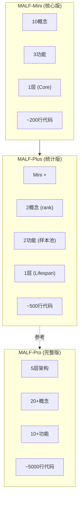

# 组织架构图

**图解**: MALF三个版本的关系  
**更新日期**: 2026-11-23

---

## 🎯 三版本架构



---

## 📊 对比表

| 维度 | Mini | Plus | Pro |
|------|------|------|-----|
| **概念数** | 10 | 12 | 20+ |
| **功能数** | 3 | 5 | 10+ |
| **层数** | 1 | 2 | 5 |
| **代码量** | ~200行 | ~500行 | ~5000行 |
| **适用** | 结构识别 | 量化回测 | 生产系统 |
| **状态** | ✅ 完整 | ✅ 完整 | 📦 参考 |

---

## 🔄 渐进关系

```
Mini (核心)
  ├─ 7原语 (HH/HL/LL/LH/break/new-count/no-new-span)
  ├─ 3状态 (alive/broken/reborn)
  └─ 输出: WavePosition (4字段)
       ↓
Plus (统计)
  ├─ 继承Mini全部
  ├─ +样本池管理
  ├─ +分位计算
  └─ 输出: WavePosition (6字段)
       ↓
Pro (完整)
  ├─ 参考Plus
  ├─ +Range层
  ├─ +Structural Position层
  └─ 完整五层架构
```

---

**状态**: ✅ 完整

