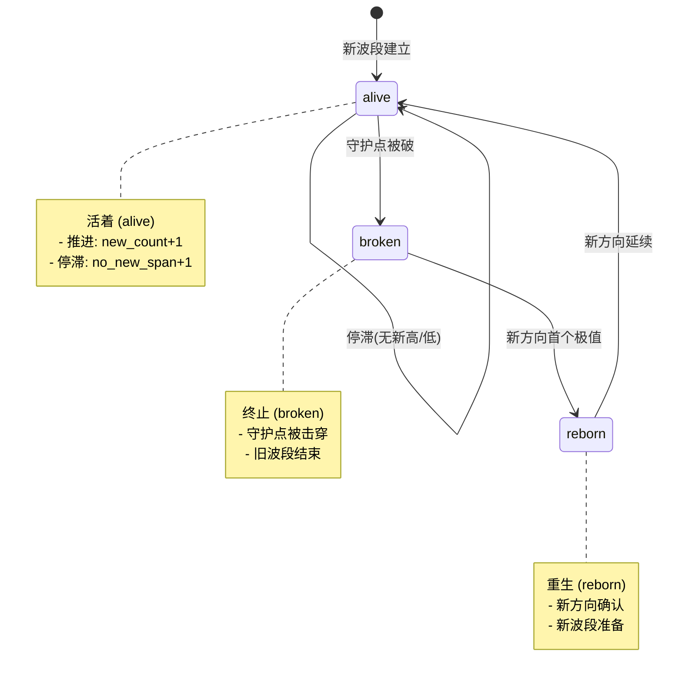

# 状态机图

**图解**: 交易生命的3个状态与转移  
**更新日期**: 2026-11-23

---

## 🎯 核心概念

**交易生命体有3个状态**: alive（活着）→ broken（终止）→ reborn（重生）

---

## 📊 完整状态机



---

## 🔄 三个状态详解

### 状态1: alive（活着）

**含义**: 波段存活中，结构未破

**触发条件**:
- 初始: 波段刚建立
- 推进: 出现HH/LL
- 停滞: 无新高/低

**状态内循环**:
```
alive状态下可以一直循环:
1. 推进 → new_count+1, no_new_span=0
2. 停滞 → no_new_span+1
3. 再推进 → new_count+1, no_new_span=0
4. 再停滞 → no_new_span+1
...

直到守护点被破 → 才离开alive
```

**示例**:
```
上升波(alive):
HH出现 → new_count=1, no_new_span=0
停滞3天 → new_count=1, no_new_span=3
HH出现 → new_count=2, no_new_span=0
停滞5天 → new_count=2, no_new_span=5
破HL位 → 进入broken
```

---

### 状态2: broken（终止）

**含义**: 守护点被破，波段终止

**触发条件**:
- 上升波: 价格跌破HL（守护点）
- 下降波: 价格涨破LH（守护点）

**特点**:
- **瞬时状态**: 不会停留
- **桥梁作用**: alive → broken → reborn
- **记录终点**: 波段在此结束

**示例**:
```
上升波破HL:
alive (HL=100) → 价格跌破100 → broken

下降波破LH:
alive (LH=200) → 价格涨破200 → broken
```

---

### 状态3: reborn（重生）

**含义**: 新方向首个极值出现，新生命建立

**触发条件**:
- 破位后出现新方向的HH或LL

**特点**:
- **确认新生**: 不是破位就重生，要等确认
- **方向可变**: 可能是反向，也可能是同向
- **快速转换**: 确认后立即进入alive

**示例**:
```
上升波破HL后:
1. broken
2. 出现LL → reborn (确认下降)
3. 进入新的alive (下降波)

下降波破LH后:
1. broken
2. 出现HH → reborn (确认上升)
3. 进入新的alive (上升波)
```

---

## 🔀 状态转移规则

### 转移1: alive → broken

**条件**:
```python
# 上升波
if direction == "UP" and 价格 < guard_low:
    state = "broken"

# 下降波
if direction == "DOWN" and 价格 > guard_high:
    state = "broken"
```

**关键点**:
- 守护点 = current_effective_guard
- 上升波守护点 = 最新的HL
- 下降波守护点 = 最新的LH

---

### 转移2: broken → reborn

**条件**:
```python
# 新方向首个极值
if 出现HH or 出现LL:
    state = "reborn"
```

**关键点**:
- **break ≠ confirmation**
- 破位只是触发（broken）
- 确认来自新极值（reborn）

---

### 转移3: reborn → alive

**条件**:
```python
# 新方向延续
if 新方向建立:
    state = "alive"
    # 重置寿命
    new_count = 0
    no_new_span = 0
```

**关键点**:
- 自动转换
- 寿命重置
- 开始新循环

---

## 📈 完整生命周期示例

### 示例1: 上升波 → 下降波

```
阶段1: 建立上升波
  → state = alive (UP)
  
阶段2: 推进期（alive内循环）
  HH出现 → new_count=1, no_new_span=0
  停滞2天 → new_count=1, no_new_span=2
  HH出现 → new_count=2, no_new_span=0
  停滞3天 → new_count=2, no_new_span=3
  HH出现 → new_count=3, no_new_span=0
  
阶段3: 终止
  破HL位 → state = broken
  
阶段4: 重生
  LL出现 → state = reborn (确认下降)
  
阶段5: 新生命
  → state = alive (DOWN)
  → new_count=0, no_new_span=0
  → 开始新的下降波
```

---

### 示例2: 下降波 → 上升波

```
阶段1: 建立下降波
  → state = alive (DOWN)
  
阶段2: 推进期
  LL出现 → new_count=1
  停滞 → no_new_span累积
  LL出现 → new_count=2
  
阶段3: 终止
  破LH位 → state = broken
  
阶段4: 重生
  HH出现 → state = reborn (确认上升)
  
阶段5: 新生命
  → state = alive (UP)
  → 开始新的上升波
```

---

## 🎨 状态机简化图

```
alive (活着)
  │
  ├─ 推进 ──┐
  │         │
  └─ 停滞 ──┘  (循环)
  │
  └─ 破位
      ↓
   broken (终止) ← 瞬时
      ↓
   reborn (重生) ← 确认
      ↓
   alive (新生) ← 重新开始
```

---

## 🔑 关键原则

### 原则1: break ≠ confirmation

```
❌ 错误理解:
  破位 = 新方向开始

✅ 正确理解:
  破位 = 旧方向终止 (broken)
  新极值 = 新方向确认 (reborn)
```

**图示**:
```
价格破HL → broken ─┐
                   ├→ 等待
出现LL → reborn ───┘  确认
```

---

### 原则2: alive是核心状态

```
alive:
  - 大部分时间停留
  - 可以内部循环（推进停滞）
  - 记录寿命（new_count, no_new_span）

broken/reborn:
  - 瞬时状态
  - 只是过渡
  - 不记录寿命
```

---

### 原则3: 寿命在alive中积累

```
只有alive状态下:
  - new_count才增加
  - no_new_span才累积

broken/reborn时:
  - 寿命暂停
  - 等待新alive重置
```

---

## 🎯 状态判定决策树

```
当前bar到来:
  │
  ├─ 当前状态 = alive?
  │   ├─ 是 → 检查推进/停滞/破位
  │   │       ├─ HH/LL → 推进 (仍alive)
  │   │       ├─ 无新极值 → 停滞 (仍alive)
  │   │       └─ 破守护点 → broken
  │   │
  │   └─ 否 → 检查是否broken
  │           └─ 是 → 等待新极值 → reborn → alive
  │
  └─ 输出WavePosition
```

---

## 📊 状态统计

**典型分布**（经验值）:
```
alive:  85-90% 时间
broken: 5-10% 时间
reborn: 5-10% 时间
```

**说明**: 大部分时间处于alive，快速经过broken/reborn

---

## 🔗 相关图解

| 图解 | 位置 |
|------|------|
| **寿命呼吸图** | `05-寿命呼吸图.md` |
| **推进守护图** | `06-推进守护图.md` |
| **功能流程图** | `02-功能流程图.md` |
| **数据流图** | `04-数据流图.md` |

---

## 🔗 相关文档

| 文档 | 位置 |
|------|------|
| **Mini定义** | `../MALF-Mini（核心版）/01-定义.md` |
| **术语对照** | `../术语表/01-中英术语对照.md` |

---

**状态**: ✅ 完整

**核心**: 3状态 (alive/broken/reborn)，alive是主要状态！

