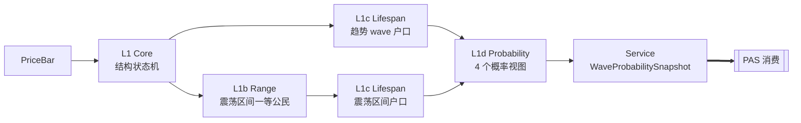
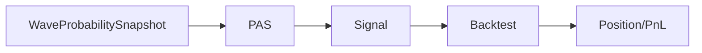

# MALF v2.0 终极版 · 全景导航

> **MALF = Market Analysis Logical Framework**
> v2.0 的宗旨：**抛开细节看大概率**。从价格构建走势 → 把走势分类 → 把分类转为概率位姿 → 输出给 PAS 玩概率。
>
> v2.0 是 v1.4 的**正系后继**：Core 语义不动，砍掉 v1.5 行为层（6 regime / life_state / position_quadrant 全部作废），新增 **L1b 震荡区间**与 **L1d 概率层**。
>
> **🎯 MALF 的终点是 L1d Probability，不是 L1 Core。** Core/Range/Lifespan 都是材料，Probability 才是 MALF 对外承诺的"概率位姿"。
> **📦 `WaveProbabilitySnapshot` = Wave + Range + Probability 三件套**，命名以 Wave 起头但**实际包含全部三层数据**，下游不要误读为"只看 wave 那一层"。

---

## -1. 全系统模块构造原则（不止 MALF）

> 用户原则（2026-06-16 立项）：
> **每个系统模块（MALF / PAS / Signal / Regime / Backtest）都遵循同一套四行为构造法，并且概率思维高于一切别的市场概念。**

| 行为 | MALF v2.0 体现 | 应用到所有模块 |
|---|---|---|
| **构造行为** | L1 Core 把 PriceBar 构造成 wave；L1b 把 transition 构造成 Range | 每个模块都有自己的"原始素材 → 类型化事实"步骤 |
| **记录行为** | L1c Lifespan 给 wave / Range 入户口（双轨） | 每个模块都给自己的对象一份生命周期账本 |
| **统计行为** | L1c rank（peer_sample 同类样本经验分位） | 每个模块都报 rank / 分位 / 计数，**永远不报 bucket / 强弱分** |
| **提供服务** | L1d Probability + Service 出 `WaveProbabilitySnapshot` | 每个模块只暴露一份只读 Snapshot，下游不准写回 |

**概率铁律（跨模块）：**
- 对照样本不足 → 字段 `None`，**严禁 fallback**
- 只报 **rank / 标签**（accelerating/decelerating/flat、dominant_side），**永不报"综合强弱分"**
- "特殊场景 / bucket切片 / 硬编码胜率" = 刻舟求剑 = 永久禁止

---

## 0. 设计哲学（一句话）

> **"概率世界，只讲概率思维。特殊场景=刻舟求剑。"**

| ✅ MALF v2.0 干 | ❌ MALF v2.0 不干 |
|---|---|
| 从价格构建有向 wave + 守护点 | 输出强弱分 / setup / 买卖建议 |
| 把 transition 升格为震荡区间一等公民 | 罗列"延续 / 转折 / 反弹"等场景 bucket |
| 给当前 wave 算 4 个概率视图 | 给场景配权重、配胜率、配预期收益 |
| 失对照样本就报 None，绝不 fallback | 用 fallback 弥补样本不足 |

---

## 1. 四层结构

| 层 | 文件 | 一句话 |
|---|---|---|
| **L1 Core** | [[MALF_01_Core_v2_0]] | 趋势 wave 状态机：HH/HL/LL/LH 成对 → 数 new 价第几只 → 守护点 → break |
| **L1b Range** | [[MALF_02_Range_v2_0]] | 旧 transition 升格：震荡区间有上下限、持续 bar、突破方向，是一等公民 |
| **L1c Lifespan** | [[MALF_03_Lifespan_v2_0]] | 双轨户口：WaveLifespan（趋势波）+ RangeLifespan（震荡区间），各自排名 |
| **L1d Probability** | [[MALF_04_Probability_v2_0]] | 4 个概率视图：自身分位 / 同向对照 / 反向对照 / 正反对照 |
| **Service** | [[MALF_05_Service_v2_0]] | 唯一对外快照 `WaveProbabilitySnapshot`，PAS 只读消费 |

---

## 2. MALF v2.0 vs v1.5 增量与作废

| 项 | v1.5 | v2.0 | 处理 |
|---|---|---|---|
| L1 Core 状态机 | D1–D17 + T1–T8 + O1–O8 | 全部保留 | ✅ 不动 |
| pivot 检测（fractal-k2-v1） | 实现层规则 | 实现层规则 | ✅ 不动 |
| Transition 双边界 | D12/D13 | **升格为 Range 一等公民**，新增 R1–R8 | 🔼 扩展 |
| L1b Lifespan（v1.4）| 只覆盖趋势 wave | **双轨**：WaveLifespan + RangeLifespan | 🔼 扩展 |
| **life_state 5 档** | early/developing/extended/stagnant/terminal | — | ❌ 作废 |
| **position_quadrant** | 4 + 中间区 | — | ❌ 作废 |
| **v1.5 六个 regime bucket** | continuation / boundary_pressure / directional_continuity / stagnation / transition / birth_quality | — | ❌ **全部作废** |
| **WaveBehaviorSnapshot** | v1.5 主接口 | — | ❌ 作废 |
| **L1d Probability**（新）| — | self_rank + same_dir_compare + opp_dir_compare + cross_compare | 🆕 **新增** |
| **WaveProbabilitySnapshot**（新）| — | 唯一对外接口 | 🆕 **新增** |

### 2.1 为什么砍掉 v1.5 六个 regime

| 旧 regime bucket | 为什么砍 |
|---|---|
| continuation_regime (advancing/slowing/stalled/transitioning) | "stalled" 是阈值切片，不是概率；用 P1 自身分位 + P2 同向对照即可表达 |
| boundary_pressure_regime | 守护点距离是 Core 已发布事实，不需要再起一个 bucket |
| directional_continuity_regime | birth_type 已是 Core 字段，bucket 是冗余 |
| stagnation_regime | "fresh/watchful/stalled/terminal_pressure" 是切片，用 P1 stagnation_rank 替代 |
| transition_regime | Range 升格为一等公民后，自身已有 RangeLifespan 排名，不需要 bucket |
| birth_quality_regime | "clean/negotiated/costly/unknown" 是切片，用 candidate_replacement_count / confirmation_distance_pct 直接报数 |

铁律：**bucket = 阈值切片 = 刻舟求剑。MALF v2.0 只报数（rank / 距离 / 计数）和方向标签（accel/decel/flat），不报 bucket。**

---

## 3. 编号体系

| 前缀 | 含义 | 来源 |
|---|---|---|
| `D` | Core 定义 | v1.4 沿用 |
| `T` | Core 定理 | v1.4 沿用 |
| `O` | Core 操作边界 | v1.4 沿用 |
| `L` | WaveLifespan（趋势波户口） | v1.4 沿用 |
| **`R`** | Range 定义 / 定理 | v2.0 新增 |
| **`RL`** | RangeLifespan（震荡区间户口） | v2.0 新增 |
| **`P`** | Probability 视图定义与铁律 | v2.0 新增 |
| `S` | Service 接口约束 | v2.0 重写 |

---

## 4. 与下游的边界（铁律不变）

| 谁 | 唯一职责 | 严禁 |
|---|---|---|
| MALF | 结构事实 + 概率位姿 | 强弱分 / setup / accept-reject / 仓位 / 盈亏 |
| PAS | 5 族裸 K 线识别 + usage posture + quality_score | accept-reject |
| Signal | accept/reject + 风报比 | 仓位语义 |
| Backtest | 仓位 / 订单 / 成交 / PnL | 无 |

**MALF v2.0 永不输出**：
`strength_score · strength_bucket · setup_family · triggered · accepted · rejected · order_intent · profit · position_size`

---

## 5. 实现映射

| 设计层 | 代码 | 状态 |
|---|---|---|
| Core 状态机 | `src/asteria/malf/core.py` | ✅ 已实现（v1.4 语义） |
| pivot 检测 | `src/asteria/malf/pivot.py` | ✅ 已实现 |
| 数据契约 | `src/asteria/malf/types.py` | ⏳ v2.0 需新增 Range / Probability 字段 |
| Lifespan（双轨） | `src/asteria/malf/lifespan.py` | ⏳ v2.0 重写 |
| Probability 层 | `src/asteria/malf/probability.py` | 🆕 v2.0 新建 |
| Service 组装 | `src/asteria/malf/service.py` | ⏳ v2.0 重写 |
| 持久化 | `src/asteria/storage/schema.sql` | ⏳ v2.0 新增 range / probability 表 |

> 🔒 v2.0 文档发布后，code 改造不在此文档范围；以 M5 计划为准。

---

## 6. 阅读顺序

1. **必读**：[[MALF_01_Core_v2_0]]（理解 wave 怎么来的）
2. **必读**：[[MALF_02_Range_v2_0]]（理解震荡为什么是一等公民）
3. **必读**：[[MALF_04_Probability_v2_0]]（理解 MALF 的最终交付）
4. 实现时参照：[[MALF_03_Lifespan_v2_0]] + [[MALF_05_Service_v2_0]]

> 单文件版工程规范见 `G:\Asteria-malf-pas\docs\02-module-design\MALF_DESIGN.md`（v2.0 已覆盖）。
