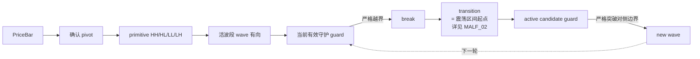
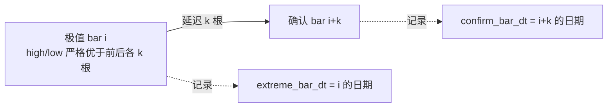
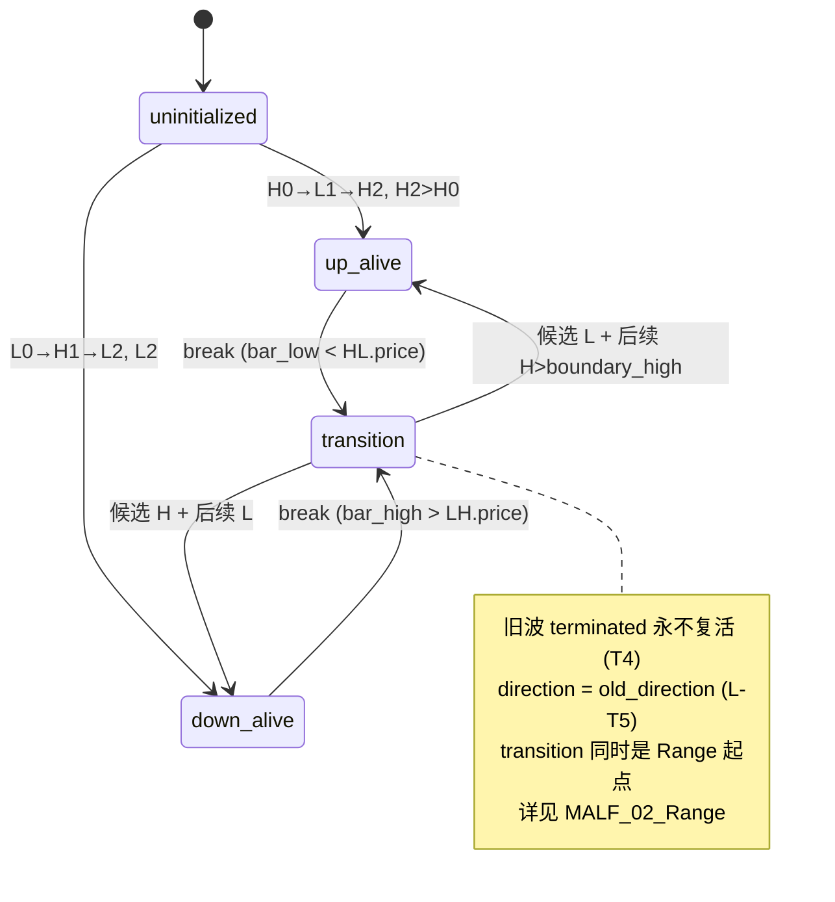
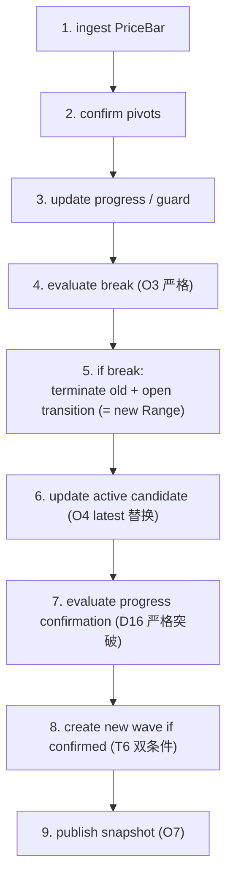

# MALF v2.0 · L1 Core 结构状态机

> 从价格构建有向 wave。**只输出结构事实，不输出任何概率/强弱/动作。**
> v2.0 在 v1.4 上仅做收紧与清理，**语义不动**。

---

## 1. Core 心智模型

> **核心 8 字**：成对 new 价，越界破之。

---

## 2. 基础对象（D1–D9）

| 对象 | 定义 | 关键点 |
|---|---|---|
| **PriceBar** (D1) | `symbol + timeframe + bar_dt + OHLC` | 一切结构最终追溯到它 |
| **Pivot** (D2) | 确认的 H 或 L | 实现：分形确认（见 §3） |
| **Primitive** (D4) | HH / HL / LL / LH | 当前极值 vs 结构 reference 比较 |
| **Direction** (D5) | up / down | up: 推进=HH 守护=HL；down: 推进=LL 守护=LH |
| **Wave** (D8) | 有向 + 起点 + 推进 + 守护 + 终止 | `wave_core_state ∈ {alive, terminated}` |
| **Current Effective Guard** (D9) | up=最近确认 HL；down=最近确认 LH | **唯一性**：任一时刻只有一个 |

### 🔒 D9 / T3 守护唯一性铁律

> HH/LL 推进只更新 `progress_extreme`；
> **只有后续确认的 HL（up）或 LH（down）才能替换 guard**。
> 这是 break 判定的根基，不可松动。

---

## 3. pivot 检测（实现层规则，固定）

| 项 | 值 |
|---|---|
| 默认 k | `2` |
| 规则版本 | `fractal-k2-v1`（必须随快照记录） |
| 实现 | `src/asteria/malf/pivot.py::detect_pivots_incremental` |
| 比较 | 严格 `>` / `<`（O3），不等于 |

---

## 4. 初始化（D18 / O6）

| 初始方向 | 确认序列 | first guard |
|---|---|---|
| initial up | `H0 → L1 → H2` 且 `H2 > H0` | L1 |
| initial down | `L0 → H1 → L2` 且 `L2 < L0` | H1 |

> 🔒 **O6 失败规则**：结构不足时保持 `uninitialized`，**绝不**产生 break/transition。
> 期间：更高的 H 可替换 H0，更低的 L 可替换 L0。

---

## 5. System State 状态机（D11）

> `system_state` 与 `wave_core_state` 永不混用（D11）。
> `wave_core_state` 只有 `alive / terminated`，不会出现 transition。

---

## 6. Break（D10 / O3 严格比较）

| 方向 | break 条件 | 比较 |
|---|---|---|
| up wave | `bar_low < current_effective_HL.price` | 严格 `<` |
| down wave | `bar_high > current_effective_LH.price` | 严格 `>` |

### 🔒 O3 铁律

> `bar_low == guard_price` **不构成** break。
> 价格比较前先归一化精度（`round` 2 位，`epsilon_policy = none_after_price_normalization`）。

### Break 后记录 8 字段（D10）

`old_wave_id / old_direction / broken_guard_primitive / broken_guard_pivot_id / broken_guard_price / old_final_progress_extreme_pivot_id / old_final_progress_extreme_price / break_dt`

> Break 触发后：`old_wave → terminated`，`system_state → transition`，旧波永不复活（T4）。
> 同时新建 `Range`（参 [[MALF_02_Range_v2_0]] §1）。

---

## 7. Transition / Candidate / New Wave（D12–D17 / O4 / T5 / T6）

> ⚠️ 这一节只讲 Core 状态机层面，**震荡区间的语义**见 [[MALF_02_Range_v2_0]]。

### 7.1 双边界（D12 / D13）

| 旧波方向 | boundary_high | boundary_low |
|---|---|---|
| 旧 up wave break | old final HH price | broken HL price |
| 旧 down wave break | broken LH price | old final LL price |

> 🔒 **D13 禁用**：
> - 不可用 break bar 的 high/low
> - 不可用 transition 内临时高低（除非成为 active candidate）
> - 不可用任意历史 H/L
> - Transition 不是 wave（T8），但**是** Range（v2.0 新约定）

### 7.2 Candidate 替换（O4 / T5）

| 规则 | 内容 |
|---|---|
| Active candidate | = latest candidate_guard；新候选一出现就替换旧的，不分同向反向 |
| candidate direction | latest L → up；latest H → down（D15） |

### 7.3 New Wave 双条件（T6）

| 方向 | progress confirmation | 严格性 |
|---|---|---|
| up | active candidate L 之后 H 且 `H > boundary_high` | 严格 `>` |
| down | active candidate H 之后 L 且 `L < boundary_low` | 严格 `<` |

> 🔒 New Wave 必须同时满足：active_candidate_guard 存在 **且** 其后 confirmation 严格突破对侧边界。**缺一不可。**

---

## 8. 事件顺序（O2，9 步固定）

同一 `symbol + timeframe + bar_dt` 内**严格 9 步**：

### 🔑 step6 / step7 表面矛盾的裁决（v1.4 沿用）

> transition 内处理新 pivot P 时：
> **先**判 P 是否确认现有 active candidate（D16 的 "after"）；
> 不确认才让 P 成为新 active candidate（T5 flip-flop）。
> 实现：`src/asteria/malf/core.py::CoreEngine._handle_transition_pivot`

---

## 9. CoreStateSnapshot（O7 发布契约）

逐 bar 发布。最小字段：

| 字段组 | 字段 |
|---|---|
| identity | `symbol / timeframe / bar_dt` |
| system | `system_state` |
| wave | `active_wave_id / old_wave_id / direction / wave_core_state` |
| guard | `current_effective_guard_pivot_id / current_effective_guard_price` |
| progress | `progress_extreme_pivot_id / progress_extreme_price` |
| transition | `open_transition_id / active_candidate_guard_pivot_id / active_candidate_direction / transition_boundary_high / transition_boundary_low` |
| version | `core_rule_version` |

实现：`src/asteria/malf/types.py::CoreStateSnapshot`。

> 🔒 当 `system_state = transition` 时，`direction = old_direction`（L-T5）。

---

## 10. 不变量速查（改 Core 前务必通读）

| # | 不变量 | 源 |
|---|---|---|
| 1 | 比较一律严格 `<` / `>`，等于不触发，价格先 round 2 位 | O3 |
| 2 | guard 唯一：HH/LL 只更新 progress_extreme；只有确认的 HL/LH 才替换 guard | D9 / T3 |
| 3 | 旧波 terminated 永不复活 | T4 |
| 4 | transition 内 direction = old_direction | L-T5 |
| 5 | New wave 必须 active_candidate + 严格突破对侧边界 | T6 |
| 6 | break 用 bar.low/high；极值 bar 早于其确认 bar k 根 → break 天然先于"违反 guard 的 pivot 确认"触发 | — |
| 7 | uninitialized 时永不产生 break/transition | O6 |
| 8 | rule version 必须随快照记录（可 replay） | O1 |

---

## 11. 与 v1.5 的差异（小）

| 项 | v1.5 | v2.0 |
|---|---|---|
| D / T / O 编号 | D1–D17 / T1–T8 / O1–O8 | **不变** |
| 状态机 9 步 | O2 | **不变** |
| transition 性质 | 状态机中间态 | 升格为 Range 一等公民（**语义扩展**，状态机本身不变） |
| 发布字段 | CoreStateSnapshot | **不变**，但下游消费者改为 Service 层 |
