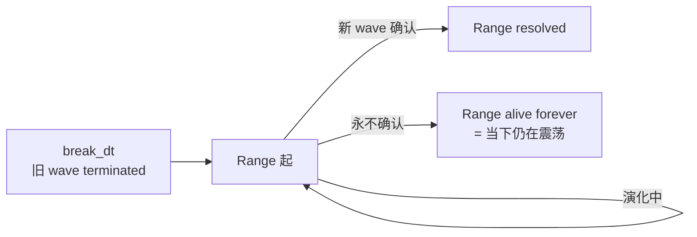
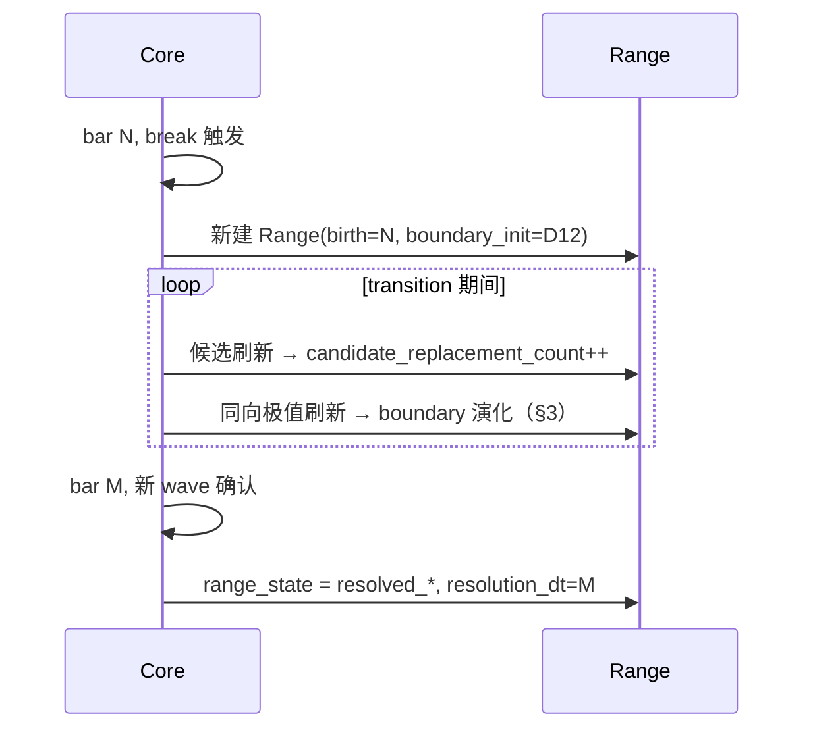
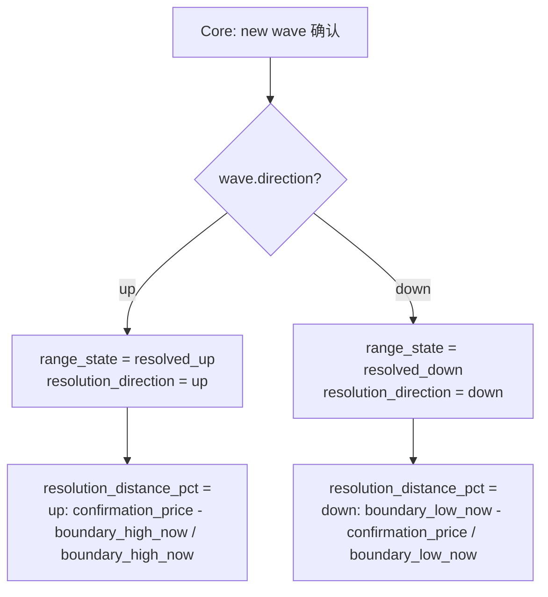

# MALF v2.0 · L1b Range 震荡区间一等公民

> 旧 v1.5 把 transition 当"中间未决态"。v2.0 把它升格为**一等公民 Range**：
> 震荡有上下限、上下限会演化、持续 bar 数、最终突破方向，全部入册排名。
> 因为只有承认震荡是有结构的，"打破震荡 = 新趋势 wave"这句话才有 Lifespan / Probability 可挂。

---

## 1. R1 · Range 定义

**Range = 从 break 触发开始，到新 wave 确认（或当下仍未决）之间的结构区域。**

| Range 字段 | 含义 | 来源 |
|---|---|---|
| `range_id` | 区间唯一标识 | open_transition_id（一一对应） |
| `birth_bar_dt` | break 触发 bar | Core D10 |
| `birth_break_direction` | 触发 break 的旧 wave 方向（up/down） | Core D10 |
| `boundary_high_init` | 初始上限 | Core D12 |
| `boundary_low_init` | 初始下限 | Core D12 |
| `boundary_high_now` | 当前上限（可演化，§3） | Range R3 |
| `boundary_low_now` | 当前下限（可演化，§3） | Range R3 |
| `boundary_high_evolution_count` | 上限被刷高次数 | R3 |
| `boundary_low_evolution_count` | 下限被刷低次数 | R3 |
| `candidate_replacement_count` | active candidate 替换次数 | Core O4 |
| `span_bars` | 持续 bar 数 | R4 |
| `range_state` | `alive` / `resolved_up` / `resolved_down` | R5 |
| `resolution_dt` | 突破被新 wave 确认的 bar | R5 |
| `resolution_direction` | 突破方向：up / down / None | R5 |
| `resolution_distance_pct` | 突破点距 boundary 的幅度 % | R5 |

> 🔒 Range = open_transition（Core 概念）的"持久化生命周期载体"。一个 break 一个 Range，永不复用。

---

## 2. R2 · Range 与 Core 状态机的对齐

| Core 事件 | Range 动作 |
|---|---|
| break 触发 | 新建 Range（state=alive） |
| transition 内同向新极值（§3 条件满足）| boundary 演化 |
| active candidate 替换 | candidate_replacement_count++ |
| new wave 确认 | Range → resolved_{up/down} |

---

## 3. R3 · 上下限演化规则（v2.0 核心新增）

> 旧 D13 禁止用 transition 内临时高低修边界。
> v2.0 放开一道口子：**当 transition 内某个 pivot 严格突破当前 boundary，但尚未被 progress confirmation 确认为 new wave 时，boundary 跟随该 pivot 移动**。
>
> 这道口子只对 **Range 自己的统计**生效，**不改变 Core 状态机的 break / new-wave 判定**。

### 3.1 演化条件（严格）

| 边界 | 演化触发 | 严格性 |
|---|---|---|
| `boundary_high_now` | transition 内确认的 H 价 严格 > `boundary_high_now` | `>` |
| `boundary_low_now` | transition 内确认的 L 价 严格 < `boundary_low_now` | `<` |

> 🔒 演化只用**已确认的 pivot**（k=2 分形已落地）。bar 实时 high/low **永不**直接改 boundary。

### 3.2 演化后果

| 事件 | 效果 |
|---|---|
| 上限刷高 | `boundary_high_now` 替换；`boundary_high_evolution_count++` |
| 下限刷低 | `boundary_low_now` 替换；`boundary_low_evolution_count++` |
| 上限刷高 | **不**直接判 new wave；仍走 Core 的 active candidate + progress confirmation 双条件（T6） |

### 3.3 与 Core 的兼容性证明

> Core 状态机里 `boundary_high / boundary_low` 用的是 `init` 值（D12），R3 演化只在 Range 表里发生。
> **Core 状态机零变更**，只是 Range 表多记几个演化字段。

---

## 4. R4 · 持续 bar 数

| 字段 | 计算 |
|---|---|
| `span_bars` | `current_bar_dt - birth_bar_dt` 的 bar 数（含 birth bar） |

> 🔒 R4 与 Core 的 `transition_span` 等价；v2.0 统一在 Range 表里。

---

## 5. R5 · Range 终结（resolved）

| 字段 | 公式 |
|---|---|
| `resolution_distance_pct`（up） | `(confirmation_H_price - boundary_high_now) / boundary_high_now` |
| `resolution_distance_pct`（down） | `(boundary_low_now - confirmation_L_price) / boundary_low_now` |

> 🔒 用**最终的** boundary_now（已演化过的），不是 init。
> resolution_direction 与 birth_break_direction 的关系给 [[MALF_03_Lifespan_v2_0]] §3 的 `range_kind` 用：
> - **continuation_range**：resolution_direction = birth_break_direction（破上升 wave 后又向下突破 → 顺势震荡）
>   ⚠️ 修正：见 §6 表
> - **reversal_range**：resolution_direction ≠ birth_break_direction

---

## 6. R6 · Range 性质分类（continuation vs reversal）

| birth_break_direction | resolution_direction | range_kind | 含义 |
|---|---|---|---|
| 旧 up wave break（向下破 HL） | down | `continuation_range` | 顺势震荡，最终向下走出 |
| 旧 up wave break（向下破 HL） | up | `reversal_range` | 假摔，最终向上反扑出新 up wave |
| 旧 down wave break（向上破 LH） | up | `continuation_range` | 顺势震荡，最终向上走出 |
| 旧 down wave break（向上破 LH） | down | `reversal_range` | 假突，最终向下反扑出新 down wave |
| 任一 | None（仍 alive） | `unresolved` | 当下仍在震荡 |

> 🔒 R6 是 RangeLifespan 排名的关键维度：continuation_range 与 reversal_range **不混池**排名。

---

## 7. R7 · Range 与新 wave 的因果连结

新 wave 必有且唯一对应一个 resolved Range：

| 关系 | 字段 |
|---|---|
| `new_wave.birth_range_id` | 指向 resolved 它的 Range |
| `new_wave.birth_range_kind` | continuation_range / reversal_range |
| `new_wave.birth_range_span_bars` | 该 Range 的 span_bars |
| `new_wave.birth_range_boundary_evolution_count` | high + low 演化总次数 |

> 这些字段是 v2.0 替换 v1.5 `birth_quality_regime` 的方式：**报数，不报 bucket**。

---

## 8. R8 · RangeSnapshot 发布契约

每 bar 发布 0 或 1 条（无 alive Range 时不发布）：

| 字段组 | 字段 |
|---|---|
| identity | `symbol / timeframe / bar_dt` |
| range | `range_id / birth_bar_dt / birth_break_direction` |
| boundary | `boundary_high_init / boundary_low_init / boundary_high_now / boundary_low_now / boundary_high_evolution_count / boundary_low_evolution_count` |
| metric | `span_bars / candidate_replacement_count` |
| state | `range_state / resolution_dt / resolution_direction / resolution_distance_pct / range_kind` |
| version | `range_rule_version` |

---

## 9. 持久化（与 storage 对齐）

`storage/schema.sql` 在 `malf_pas.sqlite` 新增：

| 表 | 一行代表 |
|---|---|
| `range_snapshot` | 一条 RangeSnapshot |
| `range_lifecycle` | Range 完整生命周期（一个 range_id 一行，含 resolution） |

> ⚠️ schema 落地以 M5 计划为准；本节只钉数据模型，不钉 DDL。

---

## 10. 不变量速查

| # | 不变量 |
|---|---|
| 1 | 一个 break 一个 Range，range_id 永不复用 |
| 2 | boundary 演化只用已确认 pivot，严格 `>` / `<` |
| 3 | boundary 演化不改 Core 状态机的 break/new-wave 判定 |
| 4 | range_kind = continuation/reversal/unresolved 三选一 |
| 5 | 新 wave 必有且唯一对应一个 resolved Range |
| 6 | Range 不输出强弱、不输出概率，只输出数与方向标签 |
