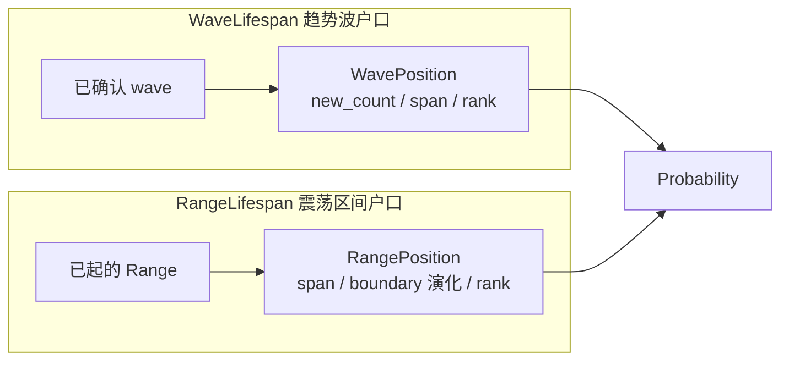
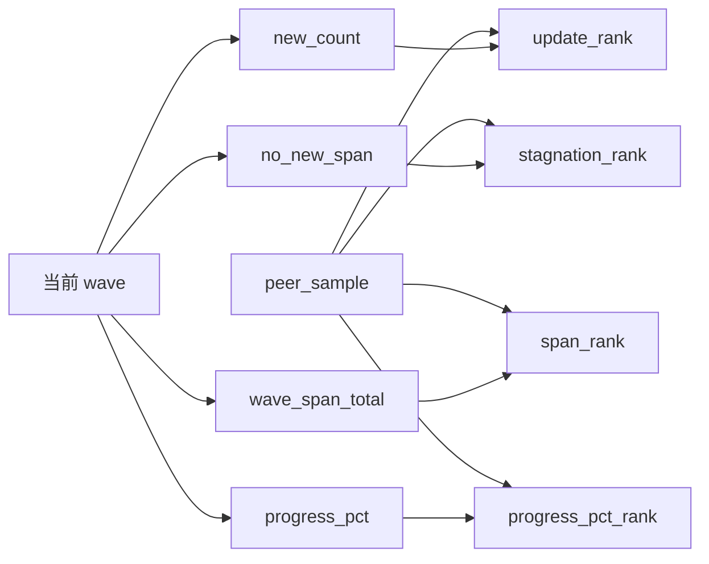

# MALF v2.0 · L1c Lifespan 双轨户口

> **为 wave 和 Range 做户口入册**，目的只有一个：给 [[MALF_04_Probability_v2_0]] 备料。
>
> Lifespan 只描述生命统计位置，**不**确认 wave/Range 是否成立（成立是 Core/Range 的事），**不**做任何概率判断（概率是 L1d 的事）。

---

## 1. 双轨设计

| 轨 | 主体 | 何时入册 | 何时归档 |
|---|---|---|---|
| WaveLifespan | 趋势 wave（含 alive 与 terminated） | wave 一被 Core 确认就入册 | 永不删除，terminated 后冻结 |
| RangeLifespan | 震荡区间（含 alive 与 resolved） | Range 一被建立就入册 | 永不删除，resolved 后冻结 |

> 🔒 不混池：rank 计算时 Wave 与 Range **绝不混用**。

---

## 2. L2–L6 · WaveLifespan 计数（v1.4 沿用）

| 字段 | 定义 | 边界 |
|---|---|---|
| `new_count` (L3) | progress primitive 更新累计（up 数 HH，down 数 LL） | guard primitive 不计数 |
| `no_new_span` (L4) | 自上次 progress update 的 bar 数 | 新波确认 bar=0；推进=0；alive 无推进=+1；terminated=冻结 |
| `wave_span_total` (L5) | wave 总 bar 数（confirmation_dt → 当前/terminated_dt） | terminated 后冻结 |
| `progress_pct` (L6) | up: `(progress_extreme - wave_start_price) / wave_start_price`；down 反之 | 用 confirmation_price 而非 OHLC 中间值 |

> 🔒 L5 / L-T3：`transition_span` **不并入** 下一 wave 的 no_new_span，转给 RangeLifespan。

---

## 3. L7–L9 · WaveLifespan 同类样本与 rank

**peer_sample 定义（L7）：**

| 维度 | 取值 |
|---|---|
| timeframe | 同 timeframe（day） |
| direction | 同 direction（up 只与 up 比） |
| 池范围 | 全市场 / 同 board（默认全市场） |
| sample_cutoff | `≤ 当前 bar_dt`（**防前视铁律**） |
| state | 已完成（terminated）wave |

| rank 字段 | 公式 | 含义 |
|---|---|---|
| `update_rank` | `percentile_rank(new_count, peer_sample)` | 推进次数历史位 |
| `stagnation_rank` | `percentile_rank(no_new_span, peer_sample)` | 停滞 bar 数历史位 |
| `span_rank` (v2.0 新) | `percentile_rank(wave_span_total, peer_sample)` | 总用时历史位 |
| `progress_pct_rank` (v2.0 新) | `percentile_rank(progress_pct, peer_sample)` | 推进幅度 % 历史位 |

> 🔒 L-T6：**rank 是历史位置，不是概率**。把 rank 当概率用，立刻刻舟求剑。概率请见 [[MALF_04_Probability_v2_0]]。

---

## 4. L13–L17 · WaveLifespan birth descriptors（v1.4 沿用，**v2.0 接入 Range**）

| 字段 | 定义 | v2.0 变化 |
|---|---|---|
| `birth_type` (L13) | initial / same_direction_after_break / opposite_direction_after_break | 不变 |
| `birth_range_id` (新) | 指向产生它的 Range | 新增 |
| `birth_range_kind` (新) | continuation_range / reversal_range | 从 Range R6 取 |
| `birth_range_span_bars` (新) | 该 Range 的 span_bars | 从 Range R4 取 |
| `birth_range_boundary_evolution_count` (新) | high + low 演化总次数 | 从 Range R3 取 |
| `candidate_wait_span` (L15) | active candidate guard 出现 → confirmation 的 bar 数 | 不变 |
| `candidate_replacement_count` (L16) | 该 Range 内候选替换次数 | 不变 |
| `confirmation_distance_pct` (L17) | confirmation 突破 boundary 的距离 % | 不变 |

> v1.5 的 `birth_quality_regime` 4 档 bucket **已作废**。
> 取而代之：直接报 `birth_range_span_bars / birth_range_boundary_evolution_count / candidate_replacement_count / confirmation_distance_pct` 四个数。

---

## 5. RL1–RL4 · RangeLifespan 计数与 rank（v2.0 新）

### 5.1 计数

| 字段 | 定义 |
|---|---|
| `range_span_bars` (RL1) | 等于 Range R4 的 `span_bars` |
| `range_boundary_evolution_count` (RL2) | high + low 演化次数和 |
| `range_candidate_replacement_count` | = Range 的 `candidate_replacement_count` |
| `range_amplitude_pct` (RL3) | `(boundary_high_now - boundary_low_now) / boundary_low_now` |

### 5.2 peer_sample（RangeLifespan 专用）

| 维度 | 取值 |
|---|---|
| timeframe | 同 timeframe |
| **range_kind 分池** | continuation_range / reversal_range / unresolved 三个池，**绝不混** |
| sample_cutoff | `≤ 当前 bar_dt` |
| state | 已 resolved 的 Range |

### 5.3 rank（RL4）

| rank 字段 | 公式 | 含义 |
|---|---|---|
| `range_span_rank` | `percentile_rank(range_span_bars, peer_sample)` | 持续时长历史位 |
| `range_evolution_rank` | `percentile_rank(range_boundary_evolution_count, peer_sample)` | 边界演化激烈度历史位 |
| `range_amplitude_rank` | `percentile_rank(range_amplitude_pct, peer_sample)` | 振幅历史位 |

> 🔒 RL-T1（铁律）：unresolved Range **可以**算 span_rank（用 alive 时长），**禁止**算 evolution_rank 与 amplitude_rank（未定型）。

---

## 6. WavePosition（v2.0 主坐标）

= Core snapshot 字段 + L1c WaveLifespan 字段 + 版本字段。

| 字段组 | 字段 |
|---|---|
| from Core | `system_state / wave_core_state / direction / new_count / wave_id / current_effective_guard_price / progress_extreme_price` |
| Lifespan 计数 | `new_count / no_new_span / wave_span_total / progress_pct` |
| Lifespan rank | `update_rank / stagnation_rank / span_rank / progress_pct_rank` |
| birth | `birth_type / birth_range_id / birth_range_kind / birth_range_span_bars / birth_range_boundary_evolution_count / candidate_wait_span / candidate_replacement_count / confirmation_distance_pct` |
| version | `lifespan_rule_version / peer_sample_version` |

> 🔒 v1.5 的 `life_state` / `position_quadrant` **已作废**，从 WavePosition 移除。

---

## 7. RangePosition（v2.0 新）

= Range snapshot 字段 + L1c RangeLifespan 字段 + 版本字段。

| 字段组 | 字段 |
|---|---|
| from Range | `range_id / range_state / range_kind / boundary_*_now / boundary_*_evolution_count / span_bars` |
| Lifespan 计数 | `range_amplitude_pct` |
| Lifespan rank | `range_span_rank / range_evolution_rank / range_amplitude_rank` |
| version | `lifespan_rule_version / peer_sample_version` |

---

## 8. peer_sample MVP 简化（与 v1.4 等价）

| 规范项 | MVP 取舍 |
|---|---|
| peer_sample 实现 | 用全历史已完成 wave/Range 的经验分布预计算分位表 |
| `peer_sample_version` | 写死常量，但接口字段保留 |
| sample_cutoff | 严格 `≤ 当前 bar_dt`，**不准放松**（防前视铁律） |
| 多 timeframe / index / block | 只做 day + stock，字段保留 |

---

## 9. 不变量速查

| # | 不变量 | 源 |
|---|---|---|
| 1 | rank 是历史位置不是概率 | L-T6 |
| 2 | birth 描述形成过程不描述未来收益 | L-T7 |
| 3 | system_state=transition 时 direction = old_direction | L-T5 |
| 4 | sample_cutoff 严格 `≤ 当前 bar_dt` | 防前视 |
| 5 | Wave 与 Range 不混池 | v2.0 新 |
| 6 | range_kind 分池：continuation/reversal/unresolved 三池绝不混 | RL peer 定义 |
| 7 | unresolved Range 禁止算 evolution_rank 与 amplitude_rank | RL-T1 |
