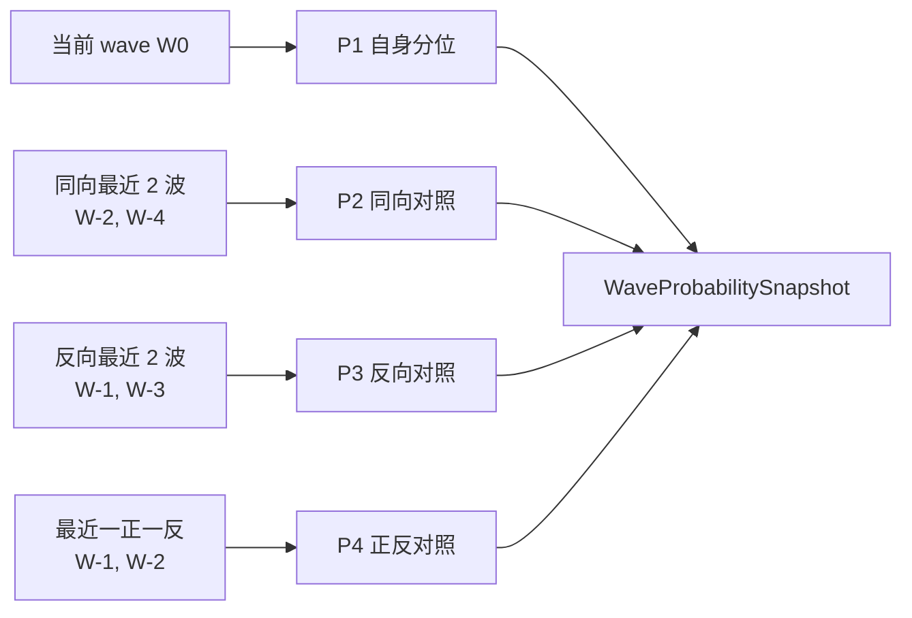
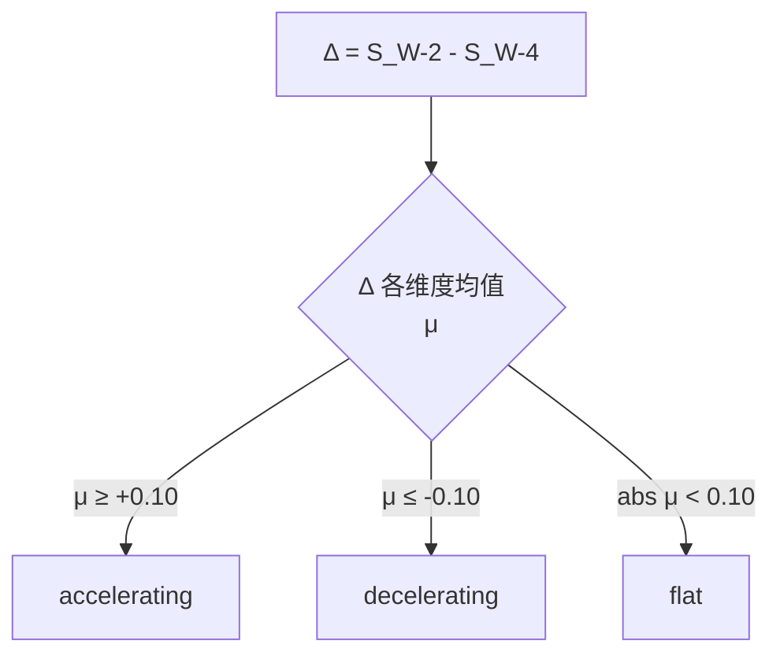
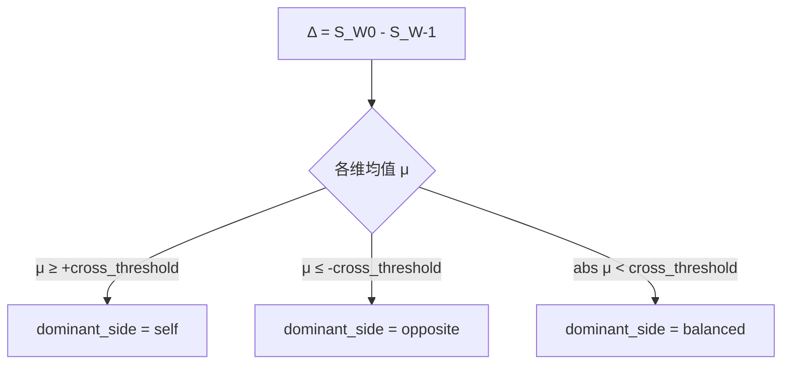

# MALF v2.0 · L1d Probability 概率层（核心新增）

> **MALF 的最终交付。** 把 Lifespan 的"数"转换成"当前 wave 的概率位姿"，PAS 玩概率就靠它。
>
> 哲学：**没有对照样本，就没有概率。** 严禁 fallback、严禁 bucket 切片、严禁基于"特殊场景"的硬编码胜率。

---

## 0. P-T1 概率铁律

| # | 铁律 | 违反后果 |
|---|---|---|
| **P-T1** | 对照样本不足 → 概率字段一律为 `None`，绝不 fallback | 立即视为实现 bug |
| **P-T2** | 概率层只**算**和**报**，不**判**（不出 bucket / 不出强弱） | 边界越权 |
| **P-T3** | 所有比较只用 [[MALF_03_Lifespan_v2_0]] 的 rank 与计数，**不**回读 PriceBar | 越界回算 MALF |
| **P-T4** | 概率字段必须随 lineage 发布（参考 [[MALF_05_Service_v2_0]]） | 不可 replay |

---

## 1. 四个概率视图全景



> 🔒 W 编号约定：W0 = 当前 wave；W-1 = 紧邻前一波（反向）；W-2 = 再前一波（与 W0 同向）。
> 同向序列：W0、W-2、W-4、W-6 …
> 反向序列：W-1、W-3、W-5 …

---

## 2. P1 · 自身分位（self_progress_rank）

> 当前 wave 在自己同类历史里走到哪了。

### 2.1 输入

| 输入 | 来源 |
|---|---|
| `update_rank` | [[MALF_03_Lifespan_v2_0]] §3 |
| `stagnation_rank` | 同上 |
| `span_rank` | 同上 |
| `progress_pct_rank` | 同上 |

### 2.2 输出

| 字段 | 类型 | 含义 |
|---|---|---|
| `self_update_rank` | `[0,1]` | = update_rank 透传 |
| `self_stagnation_rank` | `[0,1]` | = stagnation_rank 透传 |
| `self_span_rank` | `[0,1]` | = span_rank 透传 |
| `self_progress_pct_rank` | `[0,1]` | = progress_pct_rank 透传 |
| `self_quartile` | `Q1 / Q2 / Q3 / Q4` | 四个 rank 的**最大值**所在四分位 |

> 🔒 **不**做"综合自身评分"。四个 rank 全保留，下游想用哪个用哪个。`self_quartile` 只是便利字段。

### 2.3 None 条件

| 字段 | 何时 None |
|---|---|
| 任一 rank | 该 rank 字段在 Lifespan 层就是 None（peer_sample 太小，N < 30） |
| `self_quartile` | 四个 rank 全 None |

---

## 3. P2 · 同向对照（same_dir_compare）

> 当前 wave 前的最近两条**同向**已完成 wave，比较其相对强度演化。

### 3.1 输入

| 输入 | 来源 |
|---|---|
| W0 的 lifespan 字段 | 当前 |
| W-2 的 lifespan 字段（同向，紧邻当前同向那一波） | 历史 |
| W-4 的 lifespan 字段（同向，再前一波同向） | 历史 |

> 🔒 W-2 与 W-4 必须是**已 terminated** 的，alive 不算入对照。

### 3.2 强度向量

每条 wave 计算 4 维强度向量 **S**：

| 维度 | 取值 | 备注 |
|---|---|---|
| `update` | `update_rank` | 推进次数 |
| `progress` | `progress_pct_rank` | 推进幅度 |
| `pace`（v2.0 新派生）| `update_rank - stagnation_rank` 归一化到 `[0,1]`（线性映射 `(x+1)/2`） | "走得多 + 不停" 越好 |
| `efficiency`（v2.0 新派生） | `progress_pct_rank - span_rank` 归一化到 `[0,1]`（同上） | "走得远 + 用时少" 越好 |

> 🔒 强度向量**只**由 rank 派生，不引入价格。

### 3.3 对照公式

| 对照对象 | 计算 |
|---|---|
| `S(W-2) vs S(W-4)` | 向量差 `Δ = S(W-2) - S(W-4)` |
| `momentum_label` | `accelerating` / `decelerating` / `flat` |



| 阈值 | 默认值 | 配置 |
|---|---|---|
| `same_dir_threshold` | `0.10` | `params_default.toml` |

### 3.4 输出

| 字段 | 类型 | 含义 |
|---|---|---|
| `same_dir_strength_w_minus_2` | `S` 向量 4 维 | W-2 强度 |
| `same_dir_strength_w_minus_4` | `S` 向量 4 维 | W-4 强度 |
| `same_dir_delta_mean` | `[-1,1]` | μ |
| `same_dir_momentum` | `accelerating / decelerating / flat` | 标签 |

### 3.5 None 条件

| 字段 | 何时 None |
|---|---|
| 全部 P2 字段 | 同向对照波数不足 2（W-2 或 W-4 缺）|
| 单维 | 该维 rank 缺失 |

> 🔒 P-T1：**严禁**用一波同向对照硬出标签；同向对照不足直接 None。

---

## 4. P3 · 反向对照（opp_dir_compare）

> 与 P2 对称，但比的是**反向**最近两波。

### 4.1 输入

| 输入 | 含义 |
|---|---|
| W-1 lifespan | 紧邻前一波（反向） |
| W-3 lifespan | 再前一波反向 |

### 4.2 输出

| 字段 | 含义 |
|---|---|
| `opp_dir_strength_w_minus_1` | W-1 强度向量 |
| `opp_dir_strength_w_minus_3` | W-3 强度向量 |
| `opp_dir_delta_mean` | `S(W-1) - S(W-3)` 各维均值 μ |
| `opp_dir_momentum` | `accelerating / decelerating / flat` |

### 4.3 None 条件

反向对照波数不足 2 → 全 None。

> 阈值同 §3.3，复用 `same_dir_threshold`。

---

## 5. P4 · 正反对照（cross_compare）

> 最近一正一反两波直接较量：W0 自己 vs W-1（紧邻反向）。

### 5.1 输入

| 输入 | 含义 |
|---|---|
| W0 强度向量（基于当前 alive rank） | 当前 |
| W-1 强度向量（已 terminated） | 历史 |

> 🔒 W0 是 alive，rank 也是 alive 时刻的 rank（可能不稳定），所以 P4 比 P2/P3 噪声更大，必须明示。

### 5.2 dominant_side



| 阈值 | 默认 | 配置 |
|---|---|---|
| `cross_threshold` | `0.15` | 比 same/opp 严，因 W0 alive 噪声大 |

### 5.3 输出

| 字段 | 含义 |
|---|---|
| `cross_strength_w0` | W0 强度向量（alive） |
| `cross_strength_w_minus_1` | W-1 强度向量（terminated） |
| `cross_delta_mean` | μ |
| `dominant_side` | `self / opposite / balanced` |
| `cross_alive_warning` | `bool`，恒 True，提示 W0 alive 噪声 |

### 5.4 None 条件

| 字段 | 何时 None |
|---|---|
| 全部 P4 字段 | W-1 不存在（W0 是 initial wave） |

---

## 6. 综合视图（仅汇总，**不**做综合分）

> 🔒 **MALF v2.0 永不输出"综合概率分"。** 综合判断是 PAS 与 Signal 的事。

| 服务字段 | 含义 |
|---|---|
| `probability_lineage_hash` | 输入向量与样本版本的哈希，用于 replay 校验 |
| `probability_completeness` | `full / partial_missing_p2 / partial_missing_p3 / partial_missing_p4 / minimal_only_p1 / empty` |

---

## 7. 阈值配置（params_default.toml）

```toml
[malf.probability]
same_dir_threshold = 0.10
opp_dir_threshold = 0.10  # 复用 same_dir 默认值，但允许独立调
cross_threshold   = 0.15
self_quartile_uses = "max"  # max | mean，默认 max
peer_sample_min_n = 30      # rank 最少样本数
```

---

## 8. 输出契约（4 视图字段总览）

| 视图 | 字段前缀 | 字段数 |
|---|---|---|
| P1 自身 | `self_*` | 5 |
| P2 同向 | `same_dir_*` | 4 |
| P3 反向 | `opp_dir_*` | 4 |
| P4 正反 | `cross_*` | 5（含 alive_warning） |
| 总计 | — | 18 + lineage |

实现：`src/asteria/malf/probability.py::compute_probability_view(WavePosition, history) -> WaveProbabilityView`

---

## 9. 不变量速查

| # | 不变量 |
|---|---|
| 1 | 对照样本不足 → None，不 fallback |
| 2 | 概率层只算不判，不出 bucket / 不出综合分 |
| 3 | 强度向量只由 rank 派生，不读 PriceBar |
| 4 | W-2 / W-4 必须 terminated；W0 alive 时 P4 必须带 cross_alive_warning |
| 5 | 阈值进 params，不写死代码 |
| 6 | lineage_hash 必随快照 |
| 7 | 没有"特殊场景"，只有概率位姿 |

---

## 10. 与 PAS 的边界（再确认）

| MALF v2.0 概率层提供 | PAS 不能 |
|---|---|
| 4 视图原始向量 + 标签 + completeness | 自己重算 update_rank / stagnation_rank |
| 阈值化的 momentum / dominant_side 标签 | 不喜欢标签就退回 alive bar OHLC 重新算结构 |
| lineage_hash | — |

| MALF v2.0 概率层**不**提供 | 由 PAS / Signal 接手 |
|---|---|
| "买这只 / 卖这只" 的判断 | Signal accept/reject |
| "现在多大概率创新高" 的预测 | 不属于本系统范围（任一层都不出胜率预测）|
| 强弱综合分 / setup family | PAS 5 族识别 + quality_score |
