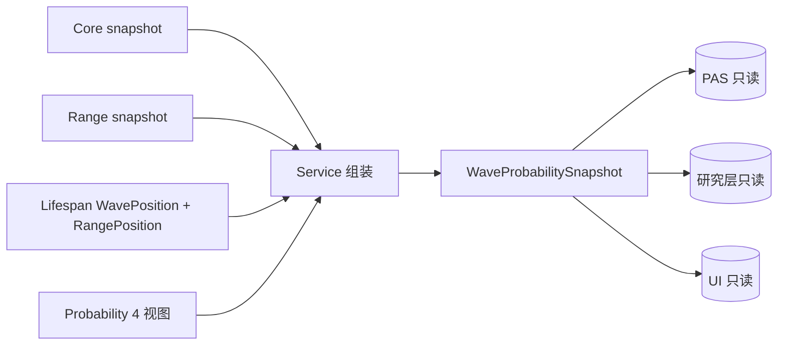
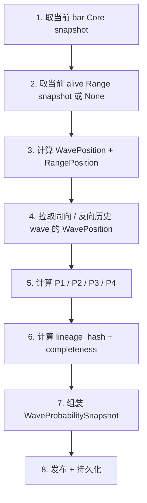

# MALF v2.0 · Service 对外接口

> MALF 对外**唯一**消费入口：`WaveProbabilitySnapshot`。
> PAS / 研究层 / UI 都只读它，**不准**反向回算 MALF。
>
> ⚠️ **关键提醒（命名澄清，避免误读）**：
> `WaveProbabilitySnapshot` 虽然以 "Wave" 起头，但它**是 Wave + Range + Probability 三件套的合订快照**：
> - **Wave 部分**：当前 wave 的 Core 状态 + WaveLifespan rank
> - **Range 部分**：当前 alive 或最近 resolved 的 Range 全字段 + RangeLifespan rank
> - **Probability 部分**：P1–P4 四视图共 18 字段（**MALF 的最终交付**）
>
> 下游消费时不要只读 wave 段忽略 range / probability。三段是同一份"概率位姿"的三个视图，缺一段就丢一半信息。
> 同样，**MALF 的终点是 L1d Probability**，不是 L1 Core。Core/Range/Lifespan 都是为 Probability 备料的中间层。

---

## 1. S1 服务全景

| 阶段 | 实现 |
|---|---|
| Core 快照 | [[MALF_01_Core_v2_0]] §9 |
| Range 快照 | [[MALF_02_Range_v2_0]] §8 |
| Lifespan 计算 | [[MALF_03_Lifespan_v2_0]] §6 §7 |
| Probability 计算 | [[MALF_04_Probability_v2_0]] §1–§6 |
| Service 组装 | 本文件 §3 |

> 🔒 Service 只**组装**，不**计算**结构语义。所有语义都在上游层算好。

---

## 2. S2 WaveProbabilitySnapshot 全字段

| 字段组 | 字段（前缀） | 来源 |
|---|---|---|
| identity | `symbol / timeframe / bar_dt / service_version` | 本层 |
| lineage | `source_run_id / lineage_hash / rule_versions{core, range, lifespan, probability}` | 各层版本号汇总 |
| core | `system_state / wave_id / direction / wave_core_state / current_effective_guard_price / progress_extreme_price` | Core |
| range | `range_id / range_state / range_kind / boundary_high_now / boundary_low_now / span_bars / boundary_evolution_count_total` | Range |
| wave lifespan | `new_count / no_new_span / wave_span_total / progress_pct / update_rank / stagnation_rank / span_rank / progress_pct_rank` | Lifespan |
| birth | `birth_type / birth_range_id / birth_range_kind / birth_range_span_bars / birth_range_boundary_evolution_count / candidate_wait_span / candidate_replacement_count / confirmation_distance_pct` | Lifespan |
| range lifespan | `range_amplitude_pct / range_span_rank / range_evolution_rank / range_amplitude_rank` | Lifespan |
| **prob P1** | `self_update_rank / self_stagnation_rank / self_span_rank / self_progress_pct_rank / self_quartile` | Prob |
| **prob P2** | `same_dir_strength_w_minus_2 / same_dir_strength_w_minus_4 / same_dir_delta_mean / same_dir_momentum` | Prob |
| **prob P3** | `opp_dir_strength_w_minus_1 / opp_dir_strength_w_minus_3 / opp_dir_delta_mean / opp_dir_momentum` | Prob |
| **prob P4** | `cross_strength_w0 / cross_strength_w_minus_1 / cross_delta_mean / dominant_side / cross_alive_warning` | Prob |
| completeness | `probability_completeness / probability_lineage_hash` | Prob |
| audit | `reason_codes[]` | 本层（每个 None / 标签都附理由码） |

> 🔒 字段名一旦发布**永不重命名**，只可弃用 + 新增。

---

## 3. S3 组装顺序（固定）

> 🔒 同 bar_dt 内严格按顺序；任何并行都不许跨步。

---

## 4. S4 · Latest 视图

`WaveProbabilitySnapshotLatest` = 每 (symbol, timeframe) 最新一条 snapshot。

| 实现 | 取舍 |
|---|---|
| MVP | `MAX(bar_dt) GROUP BY symbol, timeframe` 查询 |
| 后续 | 物化表 + 触发器 |

---

## 5. S5 · 持久化

`malf_pas.sqlite` 新增 / 改动：

| 表 | 一行代表 | v2.0 状态 |
|---|---|---|
| `wave_position` | 一条 WavePosition | 改：移除 v1.5 行为字段、新增 birth_range_* |
| `range_snapshot` | 一条 RangeSnapshot | 🆕 新建 |
| `range_lifecycle` | 一个 Range 完整生命周期 | 🆕 新建 |
| `wave_probability_snapshot` | 一条 WaveProbabilitySnapshot | 🆕 新建 |
| `wave_behavior_snapshot` | v1.5 行为快照 | ❌ **删除**（含其历史数据） |

> ⚠️ DDL 落地以 M5 计划为准；本节钉数据模型，不钉 SQL。

---

## 6. S6 服务铁律（**最严的一组**）

| # | 铁律 | 等价禁止 |
|---|---|---|
| 1 | WaveProbabilitySnapshot 是 MALF **唯一**对外契约 | 不准下游绕过 service 直读 wave_position / range_snapshot |
| 2 | 任何下游都**不准**写回任何 MALF 表 | 包括 PAS / Signal / 回测 / UI |
| 3 | snapshot 是**只读快照**，发布即不可变 | 修订只能新版本号 + 新 service_version |
| 4 | 概率字段 None 不准被 PAS / Signal 替换为默认值 | 必须显式表达"无概率"，不准 fallback |
| 5 | rule_versions 完整记录 4 层版本（core/range/lifespan/probability）| 缺一不可 replay |
| 6 | reason_codes 必须列出每个 None / 标签的成因 | 黑盒输出禁止 |

---

## 7. S7 · 与下游消费的接缝

| 下游 | 怎么用 |
|---|---|
| **PAS** | 读 P1 / P2 / P3 / P4 标签做 quality_score 输入；读 `range_kind` 影响 5 族识别上下文 |
| **Signal** | 读 `dominant_side` + `same_dir_momentum` + `opp_dir_momentum` 作 accept/reject 输入；不准回算 |
| **回测** | 只读 `system_state / wave_core_state / current_effective_guard_price`；概率字段**不直接**进交易回路（避免过拟合） |
| **regime 层** | 跑指数月/周/日 → 各自的 WaveProbabilitySnapshot；只读发布 |
| **UI** | 只读 snapshot；可以可视化 P1–P4 |

> 🔒 v1.5 的"PAS 消费 WaveBehaviorSnapshot"已作废，全部走 WaveProbabilitySnapshot。

---

## 8. S8 · 失败模式 / 退化

| 场景 | snapshot 行为 |
|---|---|
| Core uninitialized | 发布 snapshot，但 wave / range / lifespan / probability 全部 None；reason_codes=`["uninitialized"]` |
| Range alive，无新 wave | 正常发布；range_state=alive；resolution_* 全 None |
| 同向对照不足 | P2 全 None；reason_codes 含 `same_dir_insufficient_history` |
| 反向对照不足 | P3 全 None；reason_codes 含 `opp_dir_insufficient_history` |
| W-1 不存在（initial wave） | P4 全 None；reason_codes 含 `cross_no_prior_wave` |
| peer_sample 太小（N < 30）| 对应 rank 字段 None；reason_codes 含 `peer_sample_too_small` |

> 🔒 任何失败都用 None + reason_code，**不**抛异常、**不**跳过 bar。

---

## 9. 实现映射

| 文件 | 职责 |
|---|---|
| `src/asteria/malf/types.py` | `WaveProbabilitySnapshot` dataclass + 枚举 |
| `src/asteria/malf/service.py` | 组装与发布 |
| `src/asteria/malf/probability.py` | P1–P4 计算 |
| `src/asteria/malf/range.py` | Range 生命周期管理（v2.0 新建） |
| `src/asteria/malf/lifespan.py` | 双轨 Lifespan（v2.0 重写） |
| `src/asteria/storage/schema.sql` | 新增 4 表 / 改 1 表 / 删 1 表 |

---

## 10. 不变量速查

| # | 不变量 |
|---|---|
| 1 | WaveProbabilitySnapshot 是唯一对外契约 |
| 2 | 字段不重命名，只弃用 + 新增 |
| 3 | 任何下游不准写回 MALF 表 |
| 4 | 任何 None 都必有 reason_code |
| 5 | rule_versions 必含 core/range/lifespan/probability 四个 |
| 6 | snapshot 只读，发布即不可变 |
