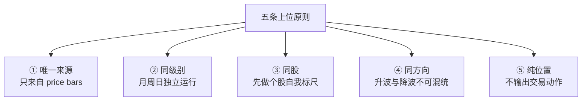
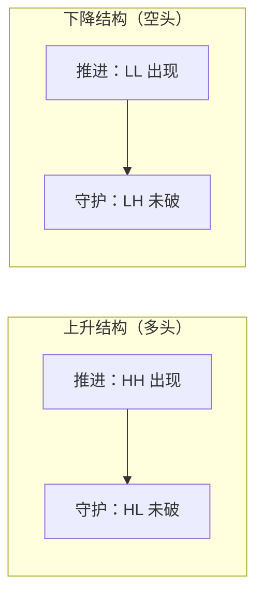
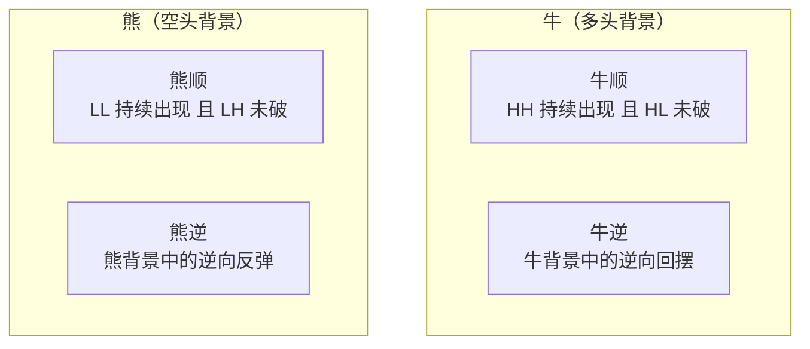
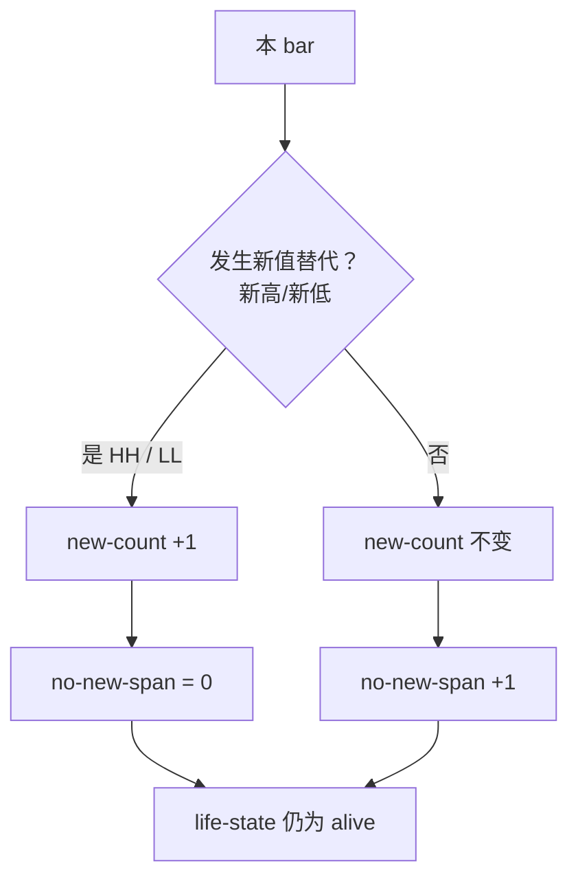
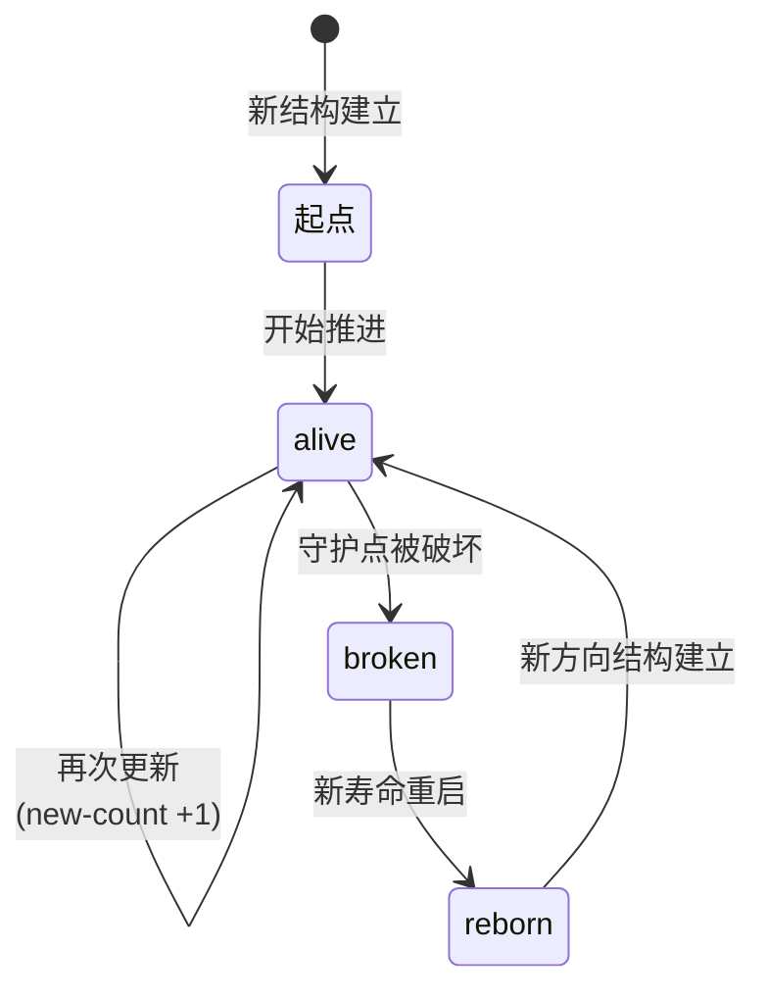
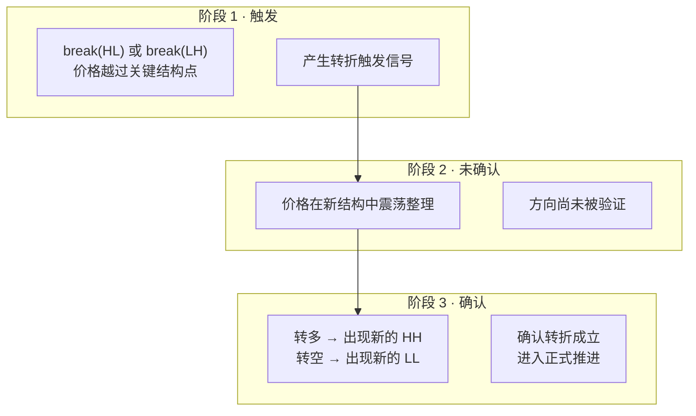
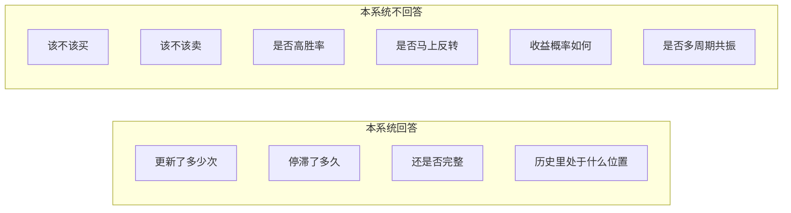
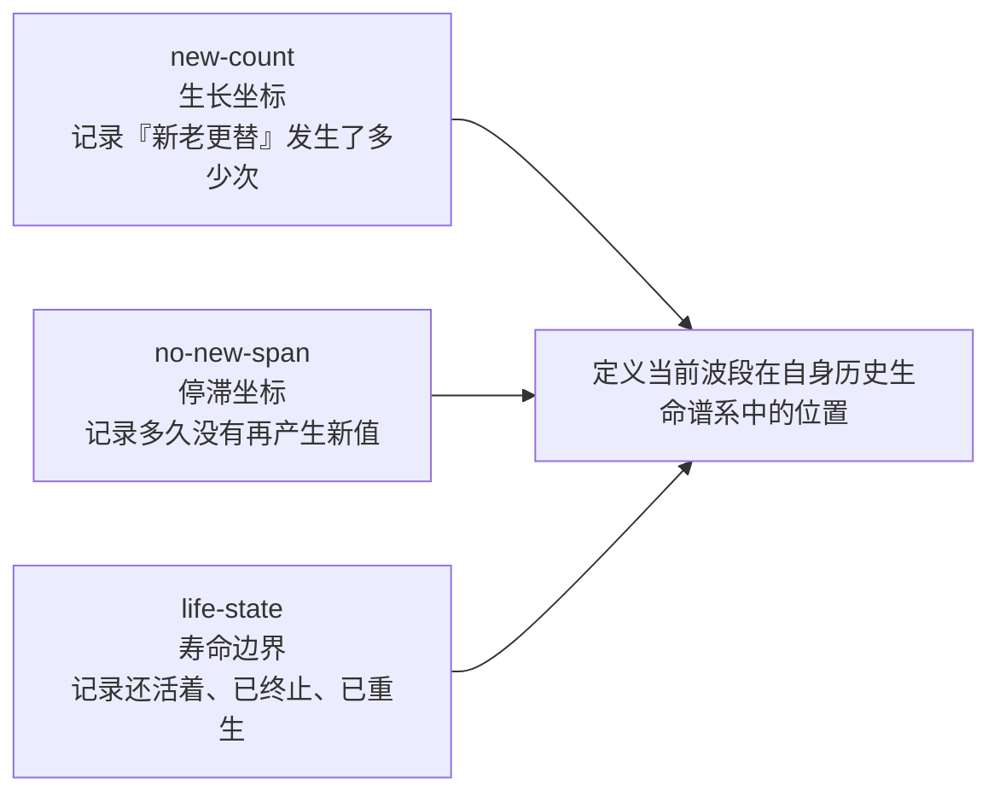

# MALF v1.0 — 波段标尺正式语义规格（图示化重生成）

> **文档性质**: T9.2 交付物。本文件是 v1.0 四个图版 PDF 的**重生成文本版**（T9.1 OCR 提取 → 图示化重组）。
> **重要声明**:
> - 本文件**代表 v1.0 自身语义**，不掺入 v2.1 概念；v1.0↔v2.1 对齐关系见 `docs/03-MALF-v1_0-v2_1-对齐.md`
> - 本文件由 OCR 提取后人工重排，个别字词可能与原图版有细微出入，**以原 PDF 为准**（权威目录只读）
> - 本文件是历史研究参考，**不构成任何施工授权**
> - 图示法：Mermaid（` ```mermaid `）+ ASCII 图 + 表格；GitHub/WPS 等支持 Mermaid 渲染
> - 日期: 2026-08-05 ｜ 任务: T9.2 ｜ 来源: 见附录 A

---

## 源图版速览

| 图版 | 页数 | 定位 | 本文件对应章 |
|------|:--:|------|------|
| 波段标尺正式语义规格 v1 图版 · 6页稿 | 7 | 超精简核心版 | 全章（精简视角） |
| 波段标尺正式语义规格 v1 图版 · 18页稿 | 19 | 正式完整版 | 全章（完整视角） |
| MALF 第四战场 · 波段标尺正式语义规格 v1 图版 | 7 | 图示版 + 母定义压缩句 | 全章（图示视角） |
| MALF 终极定义文件 · 六图合并版 | 6 | 公理/结构/寿命/转折/标尺 | 全章（终极视角） |

---

## 一、系统定位与上位原则

> 来源：六图合并版 p1-p2、第四战场 p1、18页稿 p1、6页稿 p1

**一句话定义**（六图合并版 p1）：

> MALF 是一个按时间级别独立运行的走势记账系统：用极值与回摆构造结构，用结构破坏定义状态转移，用极值推进与停滞刻画波段寿命位置。

**口号**（6页稿 p1 / 18页稿 p1）：

> 给位置，不给动作。
> 以结构更新、停滞持续与寿命边界，定位当前波段在自身历史谱系中的位置。

### 五条上位原则（六图合并版 p2）



### MALF 不做什么（六图合并版 p2）


---

## 二、总流水线：从价格到寿命坐标

> 来源：第四战场 p2、6页稿 p2、18页稿 p2、六图合并版 p1


> 「输入是结构事实，输出是寿命位置。」（18页稿 p2）
> 「先记寿命，再放回历史里定位。」（6页稿 p2）
> 「唯一来源：只来自价格结构事实；不引入外部指标。」（第四战场 p1）

---

## 三、结构本体：极值、原语、推进 × 守护

> 来源：六图合并版 p2-p3、18页稿 p3-p4

### 3.1 唯一原语（六图合并版 p2）

| 原语 | 全称 | 含义 |
|------|------|------|
| HH | 更高高点 | Higher High |
| HL | 更高低点 | Higher Low |
| LL | 更低低点 | Lower Low |
| LH | 更低高点 | Lower High |
| break | 结构破坏 | 价格越过关键结构点 |
| new-count | 新值计数 | 新老更替累计 |
| no-new-span | 未创新值跨度 | 停滞持续 |

### 3.2 推进 × 守护（六图合并版 p3 / 18页稿 p4）



> 「HH/LL 负责推进；HL/LH 负责守护。一段波 = 推进在守护之内延续。」（18页稿 p4）

### 3.3 职责分离（六图合并版 p3）

| 原语 | 职责 | 作用 |
|------|------|------|
| HH / LL | **推进** | 创造趋势与空间 |
| HL / LH | **守成** | 维持结构与节奏 |
| break | **转移** | 结构被破，状态转移 |

### 3.4 四种状态（六图合并版 p3）

> ⚠️ v1.0 原文说明：「状态是描述，不是预测」（六图合并版 p3）



---

## 四、寿命三轴：new-count × no-new-span × life-state

> 来源：18页稿 p5-p9、6页稿 p3、第四战场 p3、六图合并版 p4

### 4.1 波段寿命三元

| 轴 | 中文名 | 一句话定义 |
|----|--------|-----------|
| **new-count** | 更新次数 | 改写历史多少次（新老更替的累计） |
| **no-new-span** | 停滞长度 | 离上次更新已多久 |
| **life-state** | 寿命边界 | 这段寿命还活着吗 |

> 「生长、停顿、边界，构成一段波的最小寿命描述。」（18页稿 p5 / 六图合并版 p4）

### 4.2 new-count：只记严格新值替代（18页稿 p6 / 六图合并版 p4）

```
高点序列（HH）：  H0 ──HH1──> HH2 ──> HH3
                  旧高   第1次更新 第2次更新 第3次更新
低点序列（LL）：  L0 ──LL1──> LL2 ──> LL3

规则：只记严格新值替代；不记接近、不记并列、不记 HL/LH。
上升波：HH 出现 → new-count +1
下降波：LL 出现 → new-count +1
```

> 「new-count 不是数量，而是『新老更替』的累计。」（18页稿 p6）

### 4.3 no-new-span：离上次更新过去了多久（18页稿 p7 / 六图合并版 p4）

```
价格 ▲
     │  新高            新高
     │    │               │
     │    ├──┬──┬──┬──►  ├──► 时间
no-new-span  1  2  3  4    0

规则：每次新高/新低发生 → 归零（=0）；
     未发生 → 累加（+1）。
```

### 4.4 一个记生长，一个记停顿（18页稿 p8 / 第四战场 p3 / 6页稿 p3）



> 「波段不是直线前进，而是在更新与停滞之间呼吸。」（18页稿 p8）

### 4.5 life-state：寿命边界（18页稿 p9 / 六图合并版 p4）

| 状态 | 含义 | 触发 |
|------|------|------|
| **alive** | 活着 | 结构存活中 |
| **broken** | 终止 | 守护点被破坏 |
| **reborn** | 重生 | 新方向结构建立 |

> 「life-state 不判断好坏，只划定生死边界。」（18页稿 p9）

---

## 五、寿命流：生 → 长 → 停 → 亡 → 重生

> 来源：18页稿 p10、6页稿 p4、第四战场 p4、六图合并版 p4



> 「推进、停滞、终止、重生，构成波段寿命循环。」（18页稿 p10）
> 「结构不是线性增长，而是在『推进－停滞』的交替中延续寿命，直到被守护点突破所终止。」（第四战场 p4）

### 寿命流四阶段一览（第四战场 p4）

| 阶段 | new-count | no-new-span | life-state |
|------|-----------|-------------|------------|
| 初生 | 0 ~ 1 | 低 | alive |
| 推进 | 上升 | 停滞反复归零 | alive |
| 停滞 | 不变 | 上升 | alive |
| 终止 | 定格 | 定格 | broken（break 发生） |
| 重生 | 重新起记 | 重新起记 | reborn（新方向建立） |

---

## 六、样本口径：一把尺，只量同一种寿命

> 来源：18页稿 p11、6页稿 p5、第四战场 p6、六图合并版 p6


| 维度 | 不可混统 | 含义 |
|------|---------|------|
| 同股 | 甲股与乙股不可混 | 个股自我标尺 |
| 同级别 | 月与日不可混 | 周期独立 |
| 同方向 | 上升与下降不可混 | 升波降波独立建尺 |

> 「同股、同级别、同方向，才是同一把寿命尺。」（18页稿 p11）
> 「不可混统：月与日不可混、上升与下降不可混、甲股与乙股不可混。」（第四战场 p6）

> ⚠️ **v1.0 内部矛盾（T9.1 已标注）**：六图合并版 p6 写「历史同类波段样本池（多级别·同类型）」，与其余图版「同级别」冲突；经用户裁决 v2.1 采纳「同级别」，六图合并版 p6 记为过期表述。

---

## 七、转折三阶段与波段边界

> 来源：六图合并版 p5

### 7.1 最关键原则：break ≠ confirmation

> **破坏只是触发，不是确认；确认来自新的极值（HH 或 LL）。**（六图合并版 p5）



### 7.2 两种典型案例（破坏 → reborn → 确认）（六图合并版 p5）


### 7.3 波段边界（六图合并版 p5）

```
旧波（已结束） │ 重组 / reborn（未确认） │ 新波（正式开始）
               │                          │
        break_bar                  first_confirmed_extreme
        （旧波终止点）             （新波出生点）
```

---

## 八、历史位置与 WavePosition

> 来源：18页稿 p12-p13、第四战场 p5、6页稿 p6

### 8.1 原始值如何变成历史位置（18页稿 p12）


> 「波段标尺不是看数值本身，而是看它在历史里站在哪。」（18页稿 p12）

### 8.2 WavePosition：当前波段的寿命坐标（18页稿 p13 / 第四战场 p1）

```text
WavePosition = ( direction, update-rank, stagnation-rank, life-state )

示例：  ( up, 高更新位置, 高停滞位置, alive )
        ( up, 0.84,        0.79,          alive )   ← 第四战场 p5 数值例
```

> 「第四战场最终输出的，不是结论，而是位置坐标。」（18页稿 p13）

### 8.3 一段波通常死在哪（18页稿 p16）

```
活着时的点              终点坐标
(rank, rank, alive) →  (final ranks, broken)

波不仅要看活着时的位置，还要看历史上的波经常死在哪个区。
```

> 「看寿命，不只看成长，也看死法。」（18页稿 p16）
> （T9.1 裁决：死法分区统计属粗框架概率分类，v2.1 未实现，进化淘汰。）

---

## 九、寿命平面：update-rank × stagnation-rank

> 来源：18页稿 p14-p15、6页稿 p6、第四战场 p5、六图合并版 p6

### 9.1 统一坐标系（四象限）

```
                高 ▲  stagnation-rank（停滞排序）
                   │
   弱生停滞区       │      成熟停滞区
   低更新 │ 高停滞  │      高更新 │ 高停滞
   未长成，已停久   │      已走远，近期停久
   （易衰竭）       │      （滞涨/筑顶）
                   │
  ─────────────────┼──────────────────►  update-rank（更新排序）
                   │
   初生推进区       │      成熟推进区
   低更新 │ 低停滞  │      高更新 │ 低停滞
   刚建立，仍活跃   │      已长成，仍推进
                   │
                低 ▼
```

### 9.2 四个寿命区详解（18页稿 p15 / 六图合并版 p6）

| 区域 | 特征 | 位置语言 |
|------|------|---------|
| 初生推进区 | 低更新 + 低停滞 | 刚建立，仍活跃；处于早期推进阶段 |
| 成熟推进区 | 高更新 + 低停滞 | 已长成，仍推进；趋势延续、动能充足 |
| 成熟停滞区 | 高更新 + 高停滞 | 已走远，近期停久；进入滞涨或筑顶阶段 |
| 弱生停滞区 | 低更新 + 高停滞 | 未长成，已停久；易衰竭，风险较高 |

> 「横轴看生长程度，纵轴看停滞程度。」（18页稿 p14）
> 「这四区是位置语言，不是交易信号。」（18页稿 p15）
> （T9.1 裁决：life-zone 四象限属粗框架概率分类，v2.1 无对应字段，进化淘汰。）

---

## 十、输出模板与系统边界

> 来源：6页稿 p7、18页稿 p17-p18、第四战场 p6、六图合并版 p6

### 10.1 标准输出模板（6页稿 p7 / 18页稿 p17）

| 字段 | 示例 | 说明 |
|------|------|------|
| symbol | XXX | 标的 |
| timeframe | 日线 | 级别 |
| direction | 上升波 | 方向 |
| new-count | 5 | 更新次数 |
| no-new-span | 9 | 停滞长度 |
| life-state | alive | 寿命边界 |
| update-rank | 0.81 | 更新排序 |
| stagnation-rank | 0.76 | 停滞排序 |
| life-zone | 成熟停滞区 | 寿命分区 |

> 「输出应像坐标读数，而不是主观判断。」（18页稿 p17）

### 10.2 系统边界（6页稿 p7 / 18页稿 p18 / 六图合并版 p6）



> 「第四战场给位置，不给动作。」（6页稿 p7）
> 「只回答：这段波走到哪。不回答：该不该做、未来是否反转、收益概率如何。」（第四战场 p6）

---

## 十一、终极压缩表达（母定义）

> 来源：第四战场 p7（母定义压缩版）、18页稿 p19、六图合并版 p6

### 11.1 母定义压缩句（第四战场 p7）

> **波段标尺**是在**同股、同级别、同方向**的历史波段样本中，
> 以 **new-count** 所代表的**更新成熟度**、以 **no-new-span** 所代表的**停滞持续**、
> 并以 **life-state** 所代表的**寿命边界**，共同定位当前波段寿命阶段的**统一语义坐标系**。

### 11.2 三轴合一（18页稿 p19 / 六图合并版 p6）



> 「波段标尺不是预测器，而是寿命坐标系。」（18页稿 p19）
> 「new-count 给出生长坐标，no-new-span 给出停滞坐标，life-state 给出寿命边界。」（第四战场 p7 / 六图合并版 p6）

---

## 附录 A：来源映射

| 本文件章节 | 来源图版与页码 |
|-----------|---------------|
| 一、系统定位与上位原则 | 六图合并版 p1-p2；第四战场 p1；18页稿 p1；6页稿 p1 |
| 二、总流水线 | 第四战场 p2；6页稿 p2；18页稿 p2；六图合并版 p1 |
| 三、结构本体 | 六图合并版 p2-p3；18页稿 p3-p4 |
| 四、寿命三轴 | 18页稿 p5-p9；6页稿 p3；第四战场 p3；六图合并版 p4 |
| 五、寿命流 | 18页稿 p10；6页稿 p4；第四战场 p4；六图合并版 p4 |
| 六、样本口径 | 18页稿 p11；6页稿 p5；第四战场 p6；六图合并版 p6 |
| 七、转折三阶段与波段边界 | 六图合并版 p5 |
| 八、历史位置与 WavePosition | 18页稿 p12-p13、p16；第四战场 p1、p5 |
| 九、寿命平面 | 18页稿 p14-p15；6页稿 p6；第四战场 p5；六图合并版 p6 |
| 十、输出模板与系统边界 | 6页稿 p7；18页稿 p17-p18；第四战场 p6；六图合并版 p6 |
| 十一、终极压缩表达 | 第四战场 p7；18页稿 p19；六图合并版 p6 |

## 附录 B：与其他文档的关系

| 文档 | 关系 |
|------|------|
| `docs/03-MALF-v1_0-v2_1-对齐.md`（T9.1） | 本文件 v1.0 语义 → v2.1 条款的逐条对齐与裁决 |
| `docs/spec/术语表.md` §十 | v1.0 → v2.1 术语映射 |
| 原图版 PDF（权威目录） | 本文件的唯一权威来源；与本文件冲突时以原 PDF 为准 |

---

**最后更新**: 2026-08-05（T9.2：v1.0 定义图示化重生成）
