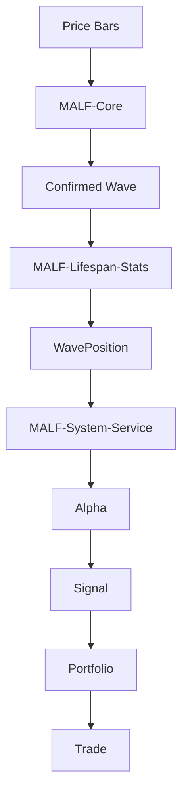
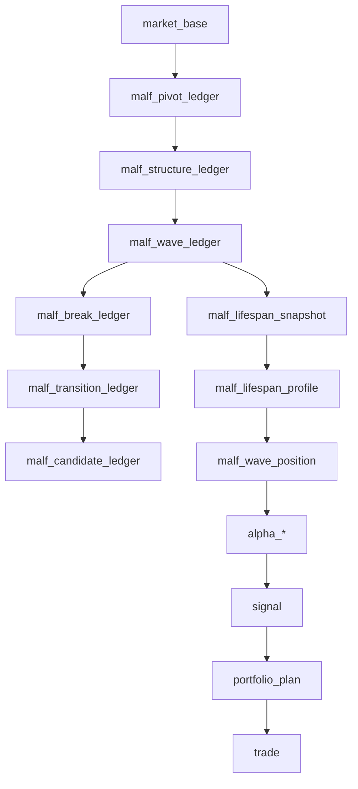

# MALF 三份设计文件总纲与关联图 v1.2

> 本文件说明三份 MALF 文件之间的关系。  
>
> 1. **MALF-Core**：结构如何成立、终止、转换、确认新波。  
> 2. **MALF-Lifespan-Stats**：波段如何被统计、比较、定位。  
> 3. **MALF-System-Service**：MALF 如何服务系统其它模块。

---

# 1. 三份文件的分工

| 文件 | 核心问题 | 关键词 |
|---|---|---|
| MALF-Core | 结构是什么？如何形成、终止、转换、确认新波？ | H/L, HH/HL/LL/LH, wave, break, transition, candidate guard |
| MALF-Lifespan-Stats | 一个 wave 活到哪里了？统计位置在哪里？ | new-count, no-new-span, rank, life-state, WavePosition |
| MALF-System-Service | MALF 如何作为系统服务被消费？ | DuckDB, Alpha, Signal, Portfolio, Trade, Pipeline |

---

# 2. 总关系图



---

# 3. 本版关键修正汇总

| 评审问题 | 修正位置 | 修正结果 |
|---|---|---|
| transition 中 candidate 方向切换规则缺失 | Core D15 / T5 | 最新 candidate guard 决定唯一 active candidate，旧 candidate 作废 |
| candidate context reference H/L 来源不明确 | Core D13 / D16 | transition 中使用 old wave 最终 progress extreme |
| transition 中 direction 表述不一致 | Lifespan L13 / System §1.2 | transition 中 direction = old_direction，必填 |

---

# 4. 数据流



---

# 5. 不允许反向依赖

| 禁止依赖 | 原因 |
|---|---|
| Core 依赖 Lifespan | Core 必须纯结构 |
| Lifespan 依赖 Alpha | Lifespan 不能引入策略解释 |
| MALF 依赖 Signal | MALF 不能受交易结果污染 |
| MALF 依赖 Portfolio | MALF 不能受仓位逻辑污染 |
| MALF 依赖 Trade | MALF 不能受执行结果污染 |

---

# 6. 最终总句

**MALF 的三份文件共同定义一个从价格结构到统计位置再到系统服务的分层结构：Core 固定结构事实，Lifespan-Stats 固定波段统计意义，System-Service 固定与 Alpha、Signal、Portfolio、Trade 的服务边界。**

铁律：

```text
Core defines structure.
Lifespan defines position.
System-Service defines interface.
Alpha interprets opportunity.
Portfolio allocates capital.
Trade executes orders.
```
