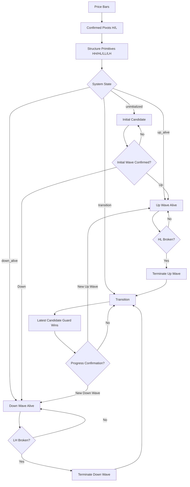
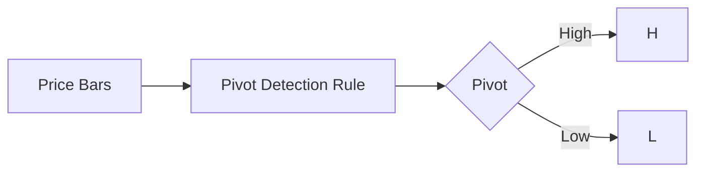
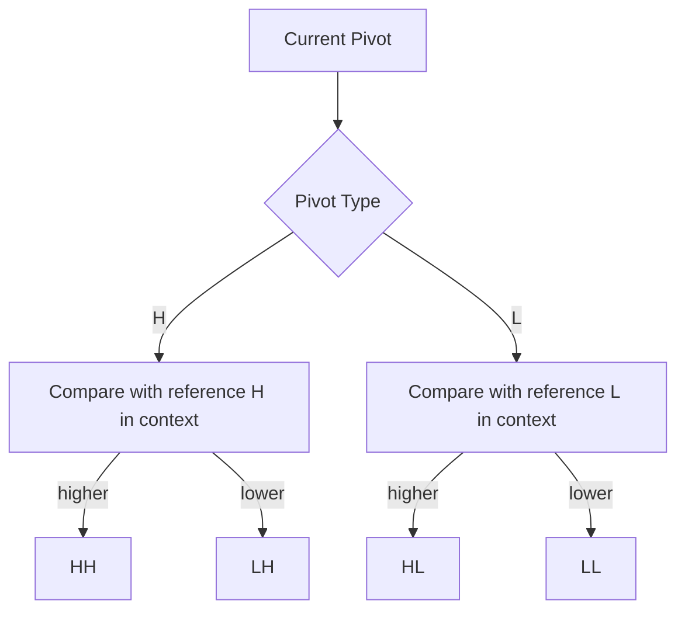
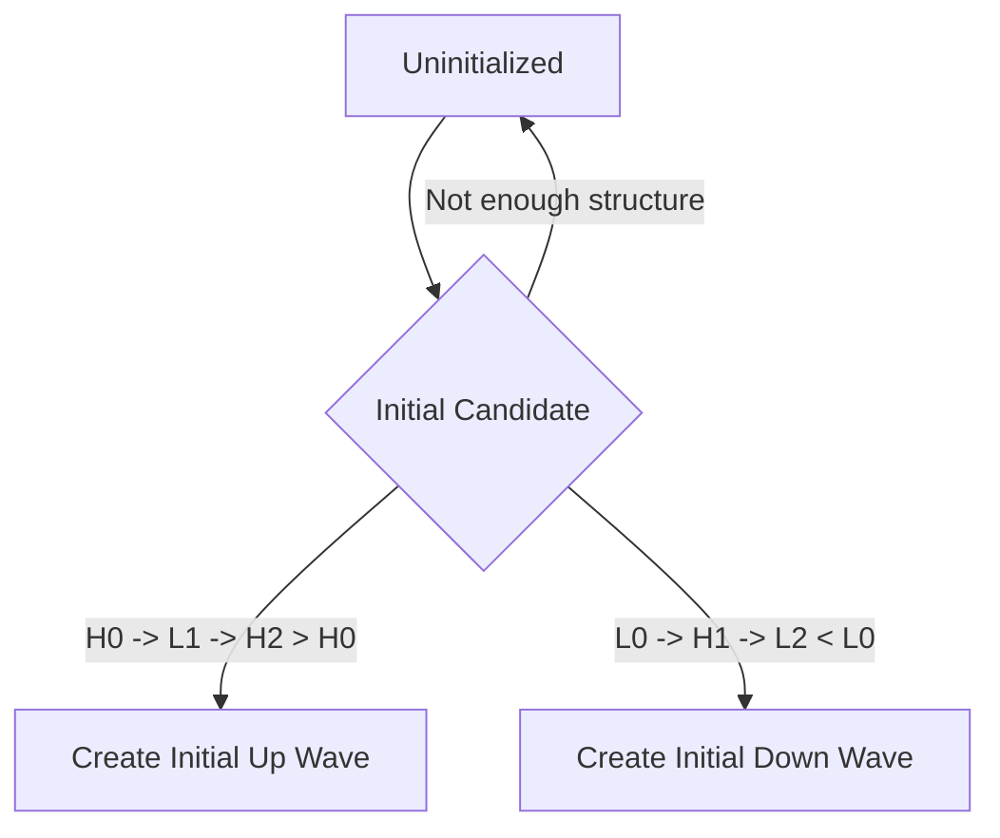
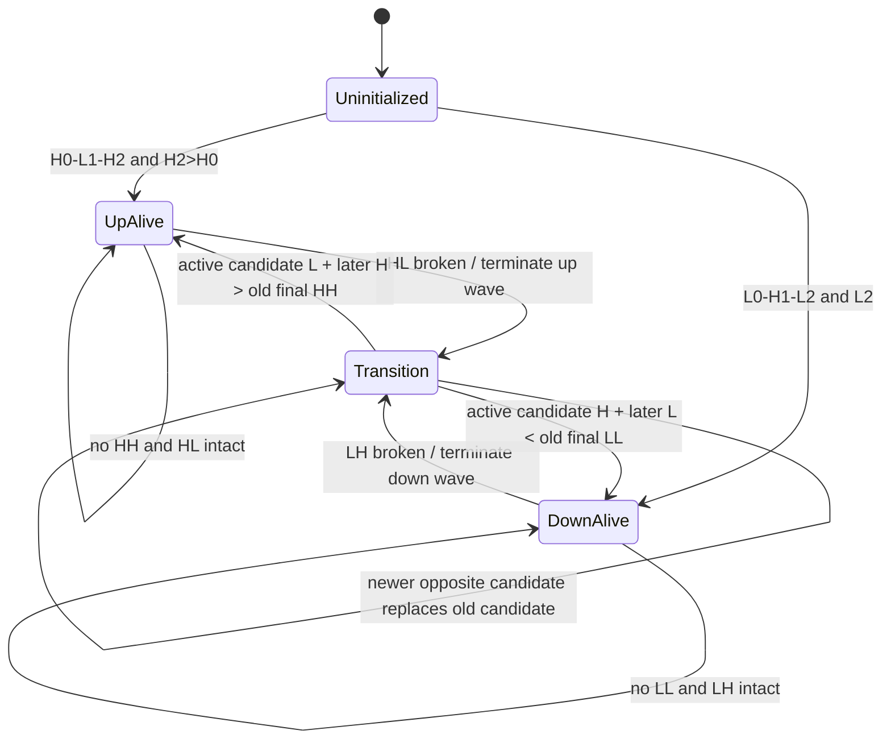
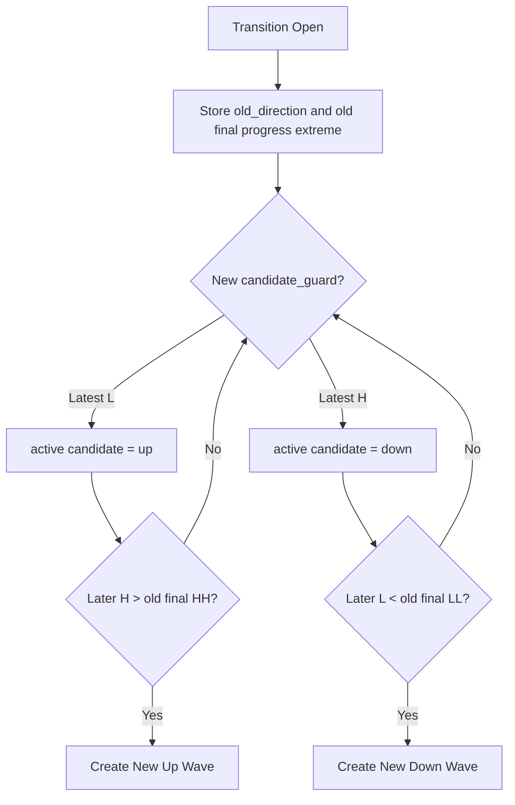
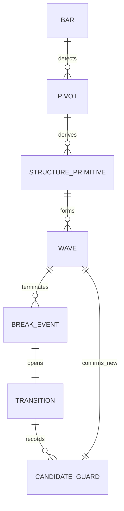

# MALF-Core 定义与定理：语义定稿 v1.3

> 本文件是 MALF 三份设计文件中的第一份。  
> 本版在 v1.2 基础上补完 transition → new wave 的最后三个语义缺口：
>
> 1. transition 中 candidate 方向切换规则；
> 2. candidate context 中 reference H / L 的来源；
> 3. transition 中 old_direction 的必填语义，为后续 Lifespan / System 接口保持一致。
>
> 至此，Core 层的主要语义目标是：
>
> **结构如何形成、如何终止、终止后如何进入 transition、transition 中如何确认 new wave。**

---

# 0. 总述

## 0.1 MALF-Core 的定义

**MALF-Core 是一个以价格序列为输入，以确认极值为最小结构单位，以 HH / HL / LL / LH 为结构原语，以上涨结构、下跌结构、转换区为核心系统状态，以 break 触发旧波段终止，以候选守护极值与推进确认共同触发新波段创建的结构语义系统。**

压缩表达：

```text
MALF-Core =
Bars
→ Pivots
→ Primitives
→ Wave
→ Break
→ Transition
→ Candidate Guard
→ Progress Confirmation
→ New Wave
```

---

## 0.2 Core 只回答什么

| 问题 | Core 是否回答 |
|---|---:|
| 什么是 H / L？ | 是 |
| 什么是 HH / HL / LL / LH？ | 是 |
| “相关 H / L”是什么？ | 是 |
| 什么是上涨结构 / 下跌结构？ | 是 |
| 什么是 wave？ | 是 |
| 什么是 break？ | 是 |
| break 后旧 wave 是否继续？ | 是：不继续 |
| break 后是否进入 transition？ | 是 |
| transition 中 candidate 如何产生？ | 是 |
| candidate 方向切换如何处理？ | 是 |
| new wave 如何确认？ | 是 |
| initial wave 如何建立？ | 是 |
| new-count 是多少？ | 否，交给 Lifespan |
| no-new-span 是多少？ | 否，交给 Lifespan |
| 当前统计位置在哪里？ | 否，交给 Lifespan |
| 是否买卖？ | 否，交给 Alpha / Signal |

---

## 0.3 Core 总图



---

# 1. 退役词汇

## 1.1 退役表

| 旧词 | 退役原因 | Core 正式表达 |
|---|---|---|
| 牛顺 | 口头化、带市场情绪 | 上涨结构中的推进事件 |
| 牛逆 | 口头化、容易误解成交易逆势 | 上涨结构中的非推进区间 |
| 熊顺 | 口头化、带市场情绪 | 下跌结构中的推进事件 |
| 熊逆 | 口头化、容易误解成交易反弹 | 下跌结构中的非推进区间 |
| reborn / 重生 | 隐喻过强，不适合 Core | transition 后创建 new wave |
| 复活 | 暗示旧 wave 可继续 | new wave after break |

---

# 2. 定义

## 定义 D1：价格序列

价格序列是按时间排列的 bar 集合。

```text
Bars = {bar_1, bar_2, ..., bar_n}
```

每根 bar 至少包含：

| 字段 | 含义 |
|---|---|
| symbol | 标的 |
| timeframe | 时间级别 |
| bar_dt | 日期 |
| high | 最高价 |
| low | 最低价 |
| close | 收盘价 |

Core 的结构判断只能从价格序列派生。

---

## 定义 D2：确认极值

确认极值是从价格序列中确认出的局部高点或局部低点。

```text
Pivot ∈ {H, L}
```

| 极值 | 定义 |
|---|---|
| H | 确认高点 |
| L | 确认低点 |

确认规则可由实现层指定。进入 Core 后，极值只表现为 H 或 L。



---

## 定义 D3：结构上下文

结构上下文是解释“相关 H / L”的范围。

```text
StructureContext ∈ {
    active_wave,
    transition_candidate,
    initial_candidate
}
```

| 上下文 | 相关 H / L 的来源 |
|---|---|
| active_wave | 当前 active wave 内的最新相关同类极值 |
| transition_candidate | transition 中候选 wave 的 reference pivot |
| initial_candidate | 初始化阶段候选 wave 的 reference pivot |

> “相关”不是任意历史极值。  
> “相关”必须由当前结构上下文指定。

---

## 定义 D4：相关 H / L

相关 H / L 是用于判定 HH / HL / LL / LH 的比较基准。

| 判定对象 | 比较基准 |
|---|---|
| HH | 当前结构上下文中的 reference H |
| LH | 当前结构上下文中的 reference H |
| HL | 当前结构上下文中的 reference L |
| LL | 当前结构上下文中的 reference L |



---

## 定义 D5：结构原语

结构原语由当前确认极值与结构上下文中的相关 H / L 比较得到。

```text
Primitive ∈ {HH, HL, LL, LH}
```

| 原语 | 完整名 | 定义 |
|---|---|---|
| HH | Higher High | 当前 H 高于当前结构上下文的 reference H |
| HL | Higher Low | 当前 L 高于当前结构上下文的 reference L |
| LL | Lower Low | 当前 L 低于当前结构上下文的 reference L |
| LH | Lower High | 当前 H 低于当前结构上下文的 reference H |

---

## 定义 D6：结构方向

MALF-Core 只承认两种方向性结构：

```text
StructureDirection ∈ {up, down}
```

| 方向 | 推进原语 | 守护原语 |
|---|---|---|
| up | HH | HL |
| down | LL | LH |

---

## 定义 D7：上涨结构

上涨结构是以 HH 为推进原语、以 HL 为守护原语的方向性结构。

```text
UpStructure =
    direction = up
    progress_primitive = HH
    guard_primitive = HL
```

| 对象 | 在上涨结构中的作用 |
|---|---|
| HH | 推进 |
| HL | 守护 |
| break HL | 上涨结构终止 |

---

## 定义 D8：下跌结构

下跌结构是以 LL 为推进原语、以 LH 为守护原语的方向性结构。

```text
DownStructure =
    direction = down
    progress_primitive = LL
    guard_primitive = LH
```

| 对象 | 在下跌结构中的作用 |
|---|---|
| LL | 推进 |
| LH | 守护 |
| break LH | 下跌结构终止 |

---

## 定义 D9：Wave

Wave 是一个有方向、有开始、有推进原语、有守护原语、有终止条件的结构对象。

```text
Wave =
    direction
    start_pivot
    progress_primitive
    guard_primitive
    state
```

Wave 的 Core 状态只有：

```text
wave_core_state ∈ {alive, terminated}
```

> transition 不是旧 wave 的状态，而是 system_state。

---

## 定义 D10：Break

Break 是 guard primitive 被击穿所触发的结构终止事件。

```text
break(up wave)   = break(HL)
break(down wave) = break(LH)
```

| Wave | Guard Primitive | Break 条件 |
|---|---|---|
| Up Wave | HL | 价格击穿当前有效 HL |
| Down Wave | LH | 价格突破当前有效 LH |

---

## 定义 D11：System State

System State 描述当前 MALF-Core 系统处于哪个阶段。

```text
system_state ∈ {
    uninitialized,
    up_alive,
    down_alive,
    transition
}
```

| system_state | 定义 |
|---|---|
| uninitialized | 尚未确认第一个 wave |
| up_alive | 当前有 active up wave |
| down_alive | 当前有 active down wave |
| transition | 旧 wave 已 terminated，新 wave 尚未 confirmed |

---

## 定义 D12：Transition

Transition 是旧 wave terminated 之后、新 wave confirmed 之前的 system_state。

```text
Transition =
    after old_wave.terminated
    before new_wave.confirmed
```

Transition 必须保存：

| 字段 | 含义 |
|---|---|
| old_wave_id | 被终止的旧 wave |
| old_direction | 旧 wave 方向，必填 |
| old_progress_extreme_price | 旧 wave 最终推进极值价格，必填 |
| old_progress_extreme_pivot_id | 旧 wave 最终推进极值 pivot，必填 |
| break_dt | 进入 transition 的日期 |

Transition 不属于旧 wave。  
Transition 不表示旧 wave 复活。  
Transition 只表示结构未决。

---

## 定义 D13：Transition Reference

Transition 中的 candidate context 必须使用旧 wave 的最终推进极值作为 reference。

| 候选方向 | reference 来源 |
|---|---|
| candidate up wave | old_progress_extreme_price 中的最终 HH 价格 |
| candidate down wave | old_progress_extreme_price 中的最终 LL 价格 |

换句话说：

```text
candidate up confirmation:
    later H > old wave final HH

candidate down confirmation:
    later L < old wave final LL
```

说明：

- 不使用 break bar high / low 作为 reference；
- 不使用 transition 中临时最高 / 最低作为 reference；
- 不使用任意历史 H / L 作为 reference；
- 只使用 old wave 的最终 progress extreme。

---

## 定义 D14：Candidate Guard

Candidate Guard 是用于确认 new wave 的候选守护极值。

| 候选方向 | candidate_guard |
|---|---|
| candidate up wave | transition 或 initialization 中确认的 L |
| candidate down wave | transition 或 initialization 中确认的 H |

Candidate Guard 先于 progress confirmation 出现。  
没有 candidate_guard，不得确认 new wave。

---

## 定义 D15：Candidate Direction

Candidate Direction 是由最新 candidate_guard 决定的候选方向。

| 最新 candidate_guard | candidate_direction |
|---|---|
| 最新 L | up |
| 最新 H | down |

在 transition 中，同一时刻只允许存在一个 active candidate。

```text
active_candidate = latest_candidate_guard
```

旧 candidate 一旦被更新的相反方向 candidate_guard 替代，即作废。

---

## 定义 D16：Progress Confirmation

Progress Confirmation 是 active candidate_guard 之后出现的方向性推进确认。

| active candidate | progress confirmation |
|---|---|
| candidate up wave | candidate L 之后，出现 H 且 H > old wave final HH |
| candidate down wave | candidate H 之后，出现 L 且 L < old wave final LL |

---

## 定义 D17：New Wave

New Wave 是 transition 之后，经 active Candidate Guard + Progress Confirmation 共同确认的新方向性结构。

```text
new_wave_confirmed =
    active_candidate_guard exists
    and progress_confirmation occurs after active_candidate_guard
```

| New Wave 来源 | 定义 |
|---|---|
| same-direction new wave | break 后确认与旧 wave 同方向的新 wave |
| opposite-direction new wave | break 后确认与旧 wave 反方向的新 wave |

---

## 定义 D18：Initial Wave

Initial Wave 是 system_state = uninitialized 时确认出的第一个 wave。

| 初始方向 | 确认序列 |
|---|---|
| initial up wave | H0 → L1 → H2，且 H2 > H0；L1 为 candidate_guard |
| initial down wave | L0 → H1 → L2，且 L2 < L0；H1 为 candidate_guard |



---

# 3. 定理

## 定理 T1：结构二分定理

Core 的方向性结构只有两类：

```text
Up Structure
Down Structure
```

尚未归入二者的状态不是第三结构，而是 uninitialized 或 transition。

---

## 定理 T2：推进—守护配对定理

每个方向性结构都必须同时拥有一个推进原语和一个守护原语。

| 结构 | 推进原语 | 守护原语 |
|---|---|---|
| Up Structure | HH | HL |
| Down Structure | LL | LH |

```text
valid wave = progress primitive + guard primitive
```

---

## 定理 T3：Break 终止定理

一旦 guard primitive 被 break，当前 wave 必须立即 terminated。

```text
break(guard) => wave_core_state = terminated
```

| 项目 | 结果 |
|---|---|
| 旧 wave 是否 alive | 否 |
| 旧 wave 是否可延伸 | 否 |
| 旧 wave 是否可复活 | 否 |
| system_state | transition |

---

## 定理 T4：旧波不可复活定理

wave 一旦 terminated，就不能重新变回 alive。

```text
terminated(wave) => never alive again
```

后续只能创建 new wave。

---

## 定理 T5：Candidate 最新有效定理

transition 中同一时刻只允许一个 active candidate。  
active candidate 必须由最新 candidate_guard 决定。

```text
active_candidate = latest(candidate_guard)
```

如果新出现的 candidate_guard 与当前 active candidate 方向相反，则：

```text
old_candidate = invalidated
new_candidate = active
```

因此：

| 场景 | 结果 |
|---|---|
| candidate L 出现 | active candidate = up |
| 后续 candidate H 出现 | old up candidate 作废，active candidate = down |
| 后续又 candidate L 出现 | old down candidate 作废，active candidate = up |

---

## 定理 T6：新波双条件确认定理

new wave 的确认必须同时满足：

```text
active_candidate_guard exists
progress_confirmation after active_candidate_guard
```

因此：

| 条件 | 是否可确认 new wave |
|---|---:|
| 只有 candidate_guard | 否 |
| 只有突破旧 progress extreme，但无 active candidate_guard | 否 |
| active candidate_guard + 后续 progress confirmation | 是 |

---

## 定理 T7：Break 后新波创建定理

break 之后出现的任何已确认新结构，都必须创建 new wave，不得延伸 old wave。

| 旧 wave | break 事件 | 后续确认 | 结果 |
|---|---|---|---|
| Up Wave | HL broken | candidate up confirmed | New Up Wave |
| Up Wave | HL broken | candidate down confirmed | New Down Wave |
| Down Wave | LH broken | candidate down confirmed | New Down Wave |
| Down Wave | LH broken | candidate up confirmed | New Up Wave |

---

## 定理 T8：Transition 非波段定理

Transition 不是 wave。

```text
transition ≠ wave
```

Transition 只负责连接：

```text
old wave terminated -> new wave confirmed
```

---

## 定理 T9：口头状态可消除定理

“牛顺 / 牛逆 / 熊顺 / 熊逆”不是必要概念，可以被 Core 结构语言完全替代。

| 旧词 | 可替代为 |
|---|---|
| 牛顺 | Up Structure + HH update |
| 牛逆 | Up Structure + no HH update + HL intact |
| 熊顺 | Down Structure + LL update |
| 熊逆 | Down Structure + no LL update + LH intact |

---

# 4. 状态机与转换表

## 4.1 Core 总状态机



---

## 4.2 Transition 确认流程



---

## 4.3 状态转换表

| 当前 system_state | 事件 | 下一 system_state | Core 动作 |
|---|---|---|---|
| uninitialized | initial up confirmed | up_alive | 创建 initial up wave |
| uninitialized | initial down confirmed | down_alive | 创建 initial down wave |
| up_alive | HH updated | up_alive | 记录上涨推进事件 |
| up_alive | no HH, HL intact | up_alive | 结构延续 |
| up_alive | HL broken | transition | 终止旧 up wave，保存 old final HH |
| down_alive | LL updated | down_alive | 记录下跌推进事件 |
| down_alive | no LL, LH intact | down_alive | 结构延续 |
| down_alive | LH broken | transition | 终止旧 down wave，保存 old final LL |
| transition | candidate L | transition | active candidate = up |
| transition | candidate H | transition | active candidate = down |
| transition | active up candidate + H > old final HH | up_alive | 创建 New Up Wave |
| transition | active down candidate + L < old final LL | down_alive | 创建 New Down Wave |

---

# 5. Core 数据对象

## 5.1 语义对象图



---

## 5.2 推荐表职责

| 表 | Core 职责 |
|---|---|
| malf_pivot_ledger | 存 H / L |
| malf_structure_ledger | 存 HH / HL / LL / LH |
| malf_wave_ledger | 存 wave 的创建、方向、终止 |
| malf_break_ledger | 存 break 事件 |
| malf_transition_ledger | 存 transition |
| malf_candidate_ledger | 存 candidate_guard、active candidate、confirmation |

---

## 5.3 malf_transition_ledger 关键字段

| 字段 | 含义 |
|---|---|
| transition_id | transition 编号 |
| old_wave_id | 被终止的旧 wave |
| old_direction | 旧 wave 方向，必填 |
| old_progress_extreme_pivot_id | 旧 wave 最终推进极值 |
| old_progress_extreme_price | 旧 wave 最终推进极值价格 |
| break_dt | break 日期 |
| state | open / confirmed |

---

## 5.4 malf_candidate_ledger 关键字段

| 字段 | 含义 |
|---|---|
| candidate_id | candidate 编号 |
| transition_id | 所属 transition |
| candidate_guard_pivot_id | candidate guard |
| candidate_direction | up / down |
| is_active | 是否当前有效 |
| invalidated_by_candidate_id | 被哪个更新 candidate 替代 |
| reference_progress_extreme_price | old final HH / old final LL |
| confirmed_by_pivot_id | 触发 confirmation 的 pivot |
| confirmed_wave_id | 创建的新 wave |

---

# 6. 最终句

## 6.1 标准版

**MALF-Core 从价格序列中识别确认极值，将极值组织为 HH / HL / LL / LH 结构原语，再由结构原语形成上涨结构或下跌结构；当守护原语被 break 时，旧 wave 终止，系统进入 transition；transition 中最新 candidate guard 决定唯一 active candidate，且必须在该 candidate 之后突破旧 wave 的最终推进极值，才可创建 new wave。**

## 6.2 铁律版

> **Break 之后，没有旧波延伸，只有新波创建；新波创建必须经过最新 candidate guard 与旧最终推进极值的 progress confirmation。**
