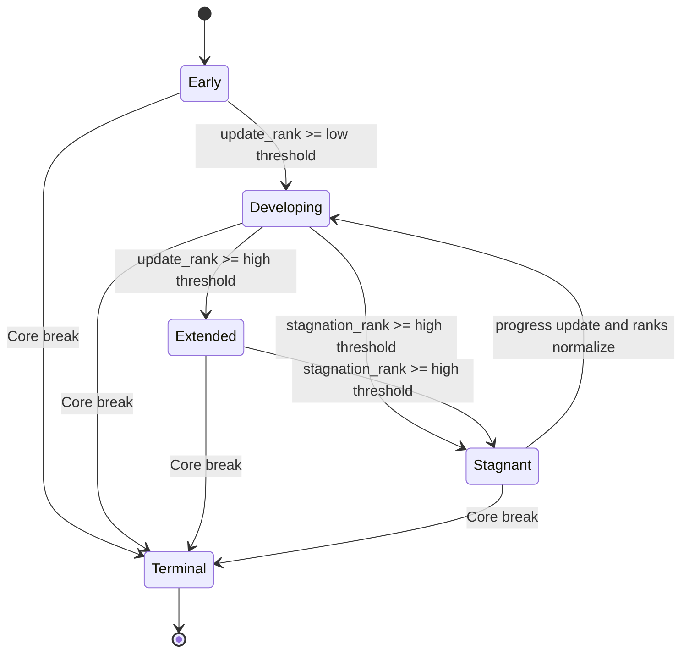
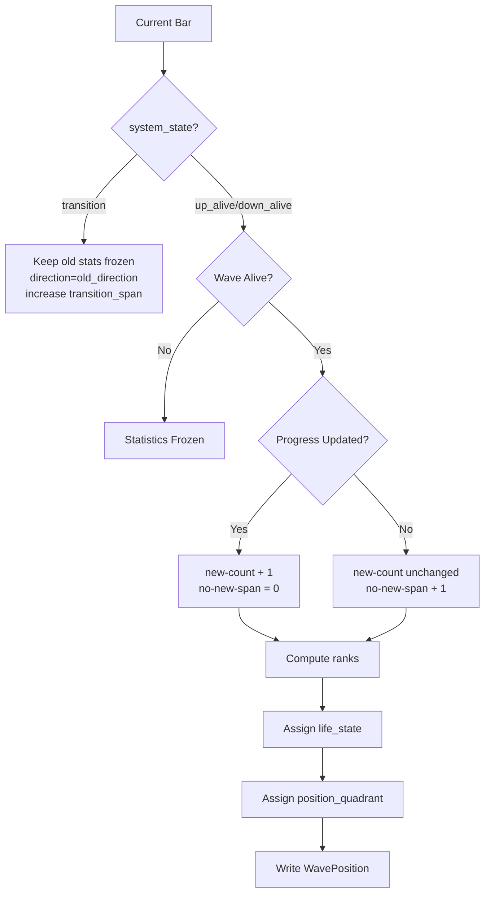

# MALF-Lifespan-Stats 波段统计学定义：语义定稿 v1.2

> 本文件是 MALF 三份设计文件中的第二份。  
> 本版在 v1.1 基础上统一 transition 中 direction 字段：
>
> **当 system_state = transition 时，direction 必填，且 direction = old_direction。**

---

# 0. 总述

## 0.1 Lifespan-Stats 的定义

**MALF-Lifespan-Stats 是建立在 MALF-Core 已确认 wave 之上的统计层：它以 progress primitive 的更新次数定义 new-count，以 progress primitive 未更新的持续时间定义 no-new-span，以历史同类样本定义统计分位，并把 wave 映射为 WavePosition。**

压缩表达：

```text
MALF-Lifespan-Stats = Wave → Count → Span → Sample → Rank → Position
```

---

# 1. 定义

## 定义 L1：统计对象

Lifespan-Stats 的唯一统计对象是 MALF-Core 已确认的 wave。

```text
Object(Lifespan) = Confirmed Wave
```

---

## 定义 L2：Progress Primitive

Progress primitive 是 Core 为 wave 指定的推进原语。

| Wave Direction | Progress Primitive |
|---|---|
| up | HH |
| down | LL |

---

## 定义 L3：New-count

New-count 是一个 wave 生命周期内 progress primitive 被确认更新的累计次数。

```text
new_count(wave, t) = count(progress_update <= t)
```

HL / LH 不增加 new-count。

---

## 定义 L4：No-new-span

No-new-span 是自上一次 progress primitive 更新以来经过的 bar 数。

```text
no_new_span(wave, t) = bars_since_last_progress_update
```

| 当前 bar 事件 | no-new-span |
|---|---|
| new wave confirmation bar | 0 |
| progress primitive 更新 | 0 |
| 无 progress update 且 wave alive | previous + 1 |
| wave terminated | 冻结 |

---

## 定义 L5：No-new-span 起点

New wave 被确认的 bar 必然包含 progress confirmation，因此该 bar 的：

```text
new_count = 1
no_new_span = 0
```

Transition 期间经过的 bar 数不计入 new wave 的 no-new-span。  
Transition 的持续时间使用独立字段：

```text
transition_span
```

---

## 定义 L6：统计冻结

当 Core 判定 wave terminated 时，Lifespan 统计立即冻结。

| 字段 | 含义 |
|---|---|
| final_new_count | 终止时 new-count |
| final_no_new_span | 终止时 no-new-span |
| final_update_rank | 终止时 update-rank |
| final_stagnation_rank | 终止时 stagnation-rank |

---

## 定义 L7：同类样本

同类样本是用于比较当前 wave 的历史 wave 集合。

默认最小 sample scope：

| 维度 | 默认值 |
|---|---|
| timeframe | 当前 timeframe |
| direction | 当前 wave direction |
| universe | 全市场合格标的池 |
| birth_type | all，可配置 |
| sample_cutoff | 不晚于当前 bar_dt |
| sample_version | 必须指定 |

---

## 定义 L8：Update-rank

Update-rank 是当前 wave 的 new-count 在同类样本中的分位位置。

```text
update_rank = percentile_rank(new_count, peer_sample)
```

---

## 定义 L9：Stagnation-rank

Stagnation-rank 是当前 wave 的 no-new-span 在同类样本中的分位位置。

```text
stagnation_rank = percentile_rank(no_new_span, peer_sample)
```

---

## 定义 L10：Life-state 阈值

Life-state 阈值是版本化配置，不得硬编码为无版本常量。

默认阈值：

| 参数 | 默认值 |
|---|---:|
| low_update_threshold | 0.25 |
| high_update_threshold | 0.75 |
| high_stagnation_threshold | 0.75 |

每次计算必须写入：

```text
lifespan_rule_version
```

---

## 定义 L11：Life-state

Life-state 是 Lifespan 根据统计位置赋予 wave 的阶段标签。

```text
life_state ∈ {early, developing, extended, stagnant, terminal}
```

判定顺序：

| 顺序 | 条件 | life_state |
|---:|---|---|
| 1 | wave_core_state = terminated | terminal |
| 2 | stagnation_rank >= high_stagnation_threshold | stagnant |
| 3 | update_rank >= high_update_threshold | extended |
| 4 | update_rank < low_update_threshold | early |
| 5 | 其它 | developing |

---

## 定义 L12：Position Quadrant

Position Quadrant 用于保留 update-rank 与 stagnation-rank 的二维组合，不替代 life-state。

| update-rank | stagnation-rank | position_quadrant |
|---:|---:|---|
| 低 | 低 | early_active |
| 高 | 低 | extended_active |
| 低 | 高 | early_stagnant |
| 高 | 高 | extended_stagnant |
| 中间区域 | 中间区域 | developing |

---

## 定义 L13：WavePosition

WavePosition 是 Lifespan 输出给 Alpha 的主坐标。

```text
WavePosition =
    system_state
    + wave_core_state
    + direction
    + new_count
    + no_new_span
    + update_rank
    + stagnation_rank
    + life_state
    + position_quadrant
```

| 字段 | 含义 |
|---|---|
| symbol | 标的 |
| timeframe | 时间级别 |
| bar_dt | 日期 |
| system_state | up_alive / down_alive / transition |
| wave_id | 当前 wave；transition 中为空 |
| old_wave_id | transition 中被终止的旧 wave |
| wave_core_state | alive / terminated |
| direction | up / down；transition 中必填 old_direction |
| new_count | 推进次数；transition 中为 old final 值 |
| no_new_span | 停滞 bar 数；transition 中为 old final 值 |
| transition_span | transition 已持续 bar 数 |
| update_rank | 推进分位 |
| stagnation_rank | 停滞分位 |
| life_state | early / developing / extended / stagnant / terminal |
| position_quadrant | 二维统计象限 |
| sample_scope | 样本范围 |
| sample_version | 样本版本 |
| lifespan_rule_version | life-state 阈值版本 |

---

# 2. 定理

## 定理 L-T1：推进唯一计数定理

new-count 只能由 progress primitive 更新产生。

```text
new_count(up wave)   counts HH only
new_count(down wave) counts LL only
```

---

## 定理 L-T2：停滞互补定理

在 wave alive 且无 progress update 的 bar 上，no-new-span 必须增加。

```text
if wave.alive and no progress_update:
    no_new_span = previous_no_new_span + 1
```

若发生 progress update：

```text
no_new_span = 0
```

---

## 定理 L-T3：初始归零定理

new wave confirmation bar 的 no-new-span 必须为 0。

```text
new_wave.confirmed => no_new_span = 0
```

transition_span 不并入 no-new-span。

---

## 定理 L-T4：Break 冻结定理

一旦 Core 判定 wave terminated，Lifespan 统计立即冻结。

```text
break => freeze(new_count, no_new_span, ranks)
```

---

## 定理 L-T5：Transition 方向保留定理

当 system_state = transition 时，WavePosition 必须保留 old_direction。

```text
system_state = transition => direction = old_direction
```

direction 不得为空。

---

## 定理 L-T6：Rank 非预测定理

Rank 只表示历史位置，不表示未来收益概率。

```text
rank ≠ probability
rank ≠ expected_return
rank ≠ trading_signal
```

---

## 定理 L-T7：Life-state 非交易定理

life-state 是统计阶段，不是交易建议。

---

## 定理 L-T8：WavePosition 完备定理

对 Alpha 而言，一个 wave 的最小统计位置由以下字段构成：

```text
system_state
wave_core_state
direction
new_count
no_new_span
update_rank
stagnation_rank
life_state
position_quadrant
```

---

# 3. 状态机

## 3.1 Lifespan 状态机



---

## 3.2 统计更新流程



---

# 4. 最终句

## 4.1 标准版

**MALF-Lifespan-Stats 在 MALF-Core 已确认 wave 之上，统计其推进次数与未推进持续时间，并将这些统计量置入版本化的历史同类样本中，得到 update-rank、stagnation-rank、life-state、position_quadrant 与 WavePosition；当系统处于 transition 时，WavePosition 必须保留 old_direction。**

## 4.2 铁律版

> **Rank is position, not prediction.**  
> **Transition keeps old direction.**
