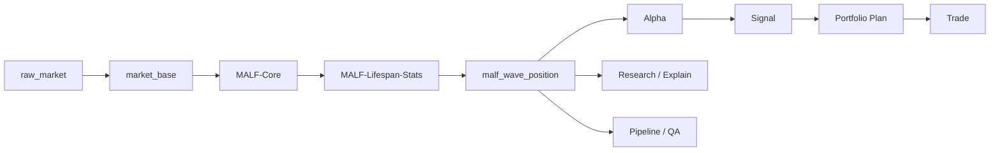
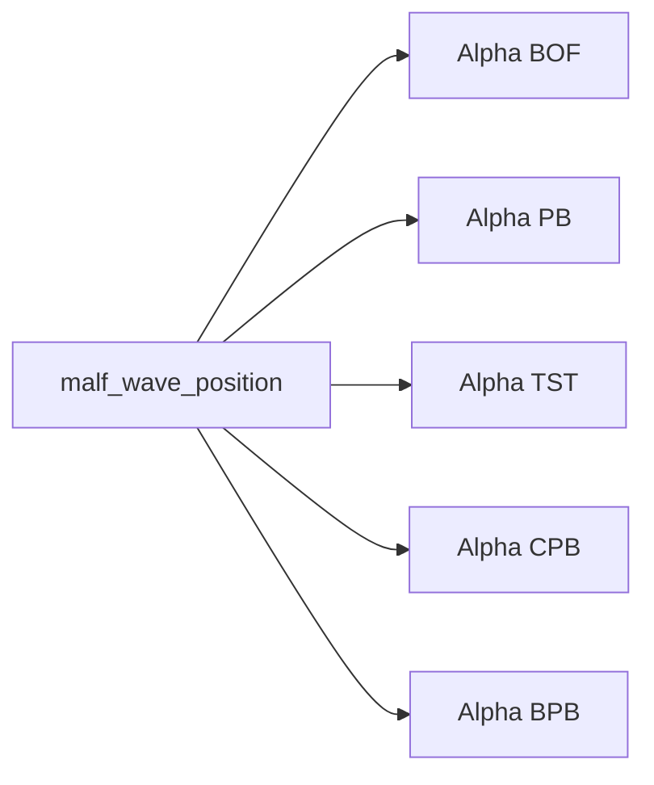
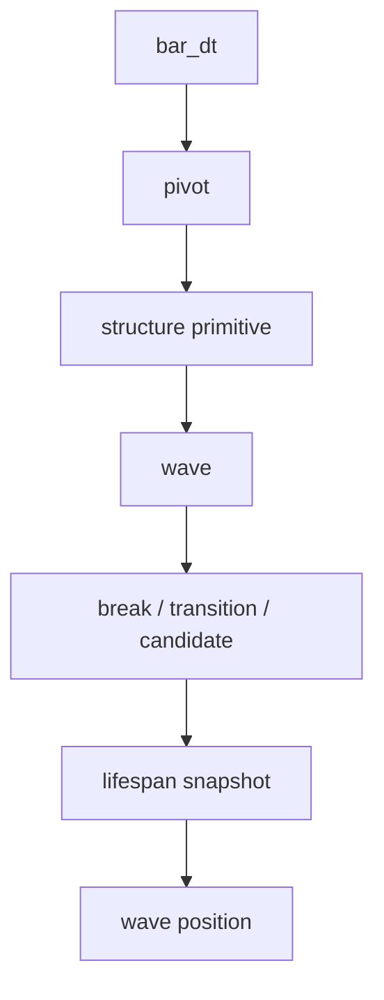
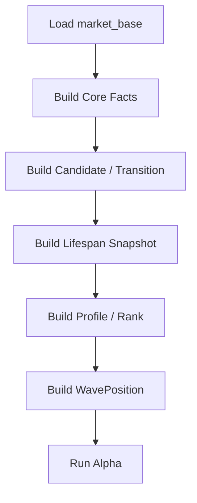

# MALF-System-Service 系统对接设计：语义定稿 v1.2

> 本文件是 MALF 三份设计文件中的第三份。  
> 本版统一 transition 中 direction 字段：
>
> **当 system_state = transition 时，direction 必填，且 direction = old_direction。**

---

# 0. 总述

## 0.1 System-Service 的定义

**MALF-System-Service 是把 MALF-Core 与 MALF-Lifespan-Stats 的结果组织成稳定数据产品，并向 Alpha、Signal、Portfolio、Trade、Research、Pipeline 提供结构服务的系统接口层。**

---

# 1. 状态字段拆分

## 1.1 禁止混用状态

不得用一个 `core_state` 同时表示 wave 状态与系统状态。

错误：

```text
core_state = alive / transition / terminal
```

正确拆分：

| 字段 | 取值 | 含义 |
|---|---|---|
| wave_core_state | alive / terminated | wave 自身状态 |
| system_state | uninitialized / up_alive / down_alive / transition | 系统阶段 |

---

## 1.2 transition 中的状态表达

当系统处于 transition：

| 字段 | 值 |
|---|---|
| system_state | transition |
| active_wave_id | NULL |
| old_wave_id | 被终止的旧 wave |
| wave_core_state | terminated |
| direction | old_direction，必填，不得为空 |
| transition_span | transition 已持续 bar 数 |

---

# 2. MALF 在系统中的位置



---

# 3. 数据产品分层

| 层 | 表 | 使用者 |
|---|---|---|
| Core Facts | pivot / structure / wave / break / transition / candidate | Research、QA、Debug、Lifespan |
| Lifespan Stats | lifespan_snapshot / lifespan_profile | Alpha、Research |
| Interface | wave_position | Alpha、Signal、解释器 |

推荐库内分层：

```text
Core:
  malf_pivot_ledger
  malf_structure_ledger
  malf_wave_ledger
  malf_break_ledger
  malf_transition_ledger
  malf_candidate_ledger

Lifespan:
  malf_lifespan_snapshot
  malf_lifespan_profile
  malf_wave_position

Governance:
  malf_update_log
  malf_schema_version
  malf_sample_version
  malf_rule_version
```

---

# 4. Sample Scope 系统定义

默认 sample_scope：

```text
sample_scope = market_all_eligible_by_timeframe_direction
```

组成：

| 字段 | 默认 |
|---|---|
| universe | all_eligible_symbols |
| timeframe | current timeframe |
| direction | current direction |
| sample_cutoff | <= current bar_dt |
| birth_type | all |
| sample_version | required |

---

# 5. 对 Alpha 的服务

Alpha 默认只读 WavePosition。



## 5.1 Alpha 输入字段

| 字段 | 用途 |
|---|---|
| symbol | 标的 |
| timeframe | 时间级别 |
| bar_dt | 日期 |
| system_state | 当前系统阶段 |
| wave_core_state | wave 自身状态 |
| wave_id | active wave；transition 中为空 |
| old_wave_id | transition 上下文 |
| direction | up / down；transition 中为 old_direction，必填 |
| new_count | 推进次数 |
| no_new_span | 停滞时间 |
| transition_span | transition 时间 |
| update_rank | 推进分位 |
| stagnation_rank | 停滞分位 |
| life_state | 统计阶段 |
| position_quadrant | 二维统计象限 |
| guard_boundary_price | 结构失效边界，可选 |
| sample_version | 样本版本 |
| lifespan_rule_version | 统计规则版本 |

---

# 6. Research / Debug 服务

Research 可以读取完整链路：



| 问题 | 查询对象 |
|---|---|
| 为什么这里是 HH？ | structure_ledger |
| 为什么 wave 终止？ | break_ledger |
| 为什么进入 transition？ | transition_ledger |
| candidate 为什么切换？ | candidate_ledger |
| new wave 为什么确认？ | candidate_ledger |
| 为什么 new-count 是 5？ | lifespan_snapshot |
| 为什么 update-rank 是 0.82？ | lifespan_profile |

---

# 7. Pipeline 服务



---

# 8. 不变量检查

| 检查项 | 要求 |
|---|---|
| terminated wave 不得重新 alive | 必须成立 |
| break 后不得延伸旧 wave | 必须成立 |
| transition 必须关联 old_wave_id | 必须成立 |
| transition.direction 必须等于 old_direction | 必须成立 |
| confirmed transition 必须关联 new_wave_id | 必须成立 |
| transition 中同一时刻只能有一个 active candidate | 必须成立 |
| 新 candidate 必须替代旧 candidate | 必须成立 |
| new wave 必须有 active candidate_guard + progress_confirmation | 必须成立 |
| candidate up confirmation 必须 H > old final HH | 必须成立 |
| candidate down confirmation 必须 L < old final LL | 必须成立 |
| new wave confirmation bar 的 no_new_span = 0 | 必须成立 |
| transition_span 不并入 no_new_span | 必须成立 |
| wave_core_state 不得取 transition | 必须成立 |

---

# 9. 最终句

## 9.1 标准版

**MALF-System-Service 将 Core 的结构事实与 Lifespan 的统计位置组织为稳定、可版本化、可回放、可解释的数据产品，并通过 WavePosition 向 Alpha 提供服务；MALF 不直接服务交易执行，不产生买卖、仓位、收益预测。**

## 9.2 铁律版

> **MALF serves structure and position; Alpha interprets value; Portfolio allocates capital; Trade executes orders.**
