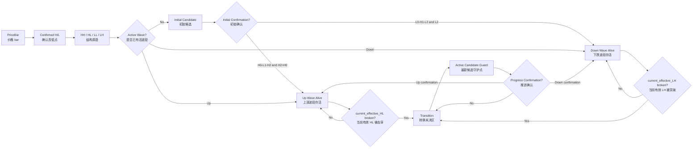
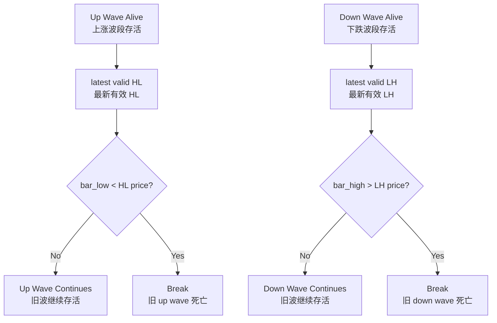
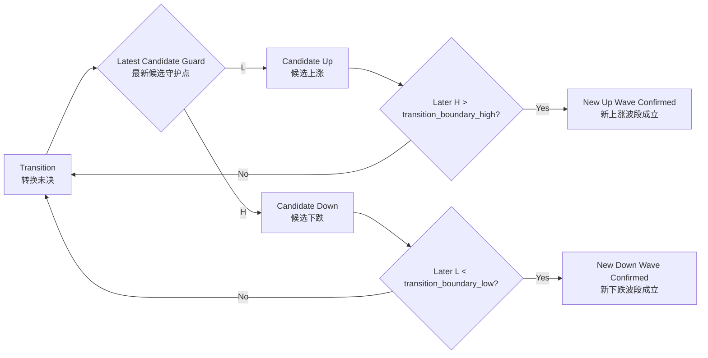

# MALF-Core 图表版辅助理解 v1.3

> 本文件是 Core 的图表阅读版。  
> 它帮助理解 `MALF_01_Core_Definitions_Theorems_v1_3.md`，但不替代权威定义。

---

## 1. 一图看 Core 主线



---

## 2. 活波段的两个核心部件

| 方向 | 推进点 | 守护点 | 人话理解 |
|---|---|---|---|
| up | HH | HL | 不断创新高，同时回落不能打穿当前有效 HL |
| down | LL | LH | 不断创新低，同时反弹不能突破当前有效 LH |

关键点：

```text
HH / LL = 生命往前走
HL / LH = 生命还守得住
```

---

## 3. 哪个 HL / LH 会触发 Break



不要把 `break(HL)` 理解成任意历史 HL。它只指当前 active up wave 内最新确认且仍有效的 HL。

---

## 4. Break 后的双边界

| 旧波方向 | transition_boundary_high | transition_boundary_low |
|---|---|---|
| old up wave break | old final HH | broken current_effective_HL |
| old down wave break | broken current_effective_LH | old final LL |

人话版：

```text
旧波死了，不再参与新生命。
Transition 接管旧波死亡时留下的上下边界。
新波只突破 transition boundary，不复活旧波。
```

---

## 5. New Wave 确认



正式条件：

```text
new_wave_confirmed =
    active_candidate_guard exists
    and progress_confirmation occurs after active_candidate_guard
```

---

## 6. Core 铁律

```text
Break kills the old wave.        # Break 之后旧波死亡
Transition owns the boundary.    # Transition 接管上下边界
Candidate is not wave.           # Candidate 只是候选，不是波段
New wave requires guard + confirmation.
                                  # 新波必须有候选守护 + 后续推进确认
```

