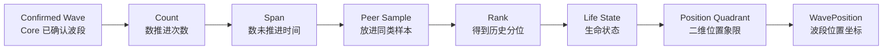
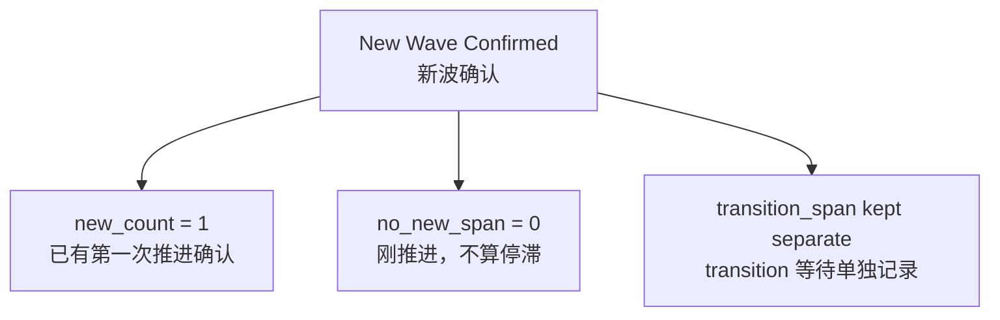

# MALF-Lifespan 图表版辅助理解 v1.3

> 本文件是 Lifespan 的图表阅读版。  
> 它帮助理解 `MALF_02_Lifespan_Stats_Definitions_Theorems_v1_3.md`，但不替代权威定义。

---

## 1. 一图看 Lifespan 主线



---

## 2. Up / Down 的计数规则

| wave direction | new_count 数什么 | no_new_span 什么时候增加 |
|---|---|---|
| up | 只数 HH | 没有新 HH 时增加 |
| down | 只数 LL | 没有新 LL 时增加 |

```text
HL / LH 是守护，不增加 new_count。
```

---

## 3. New Wave 出生时的初始统计



关键点：

```text
transition_span 不并入 no_new_span。
```

---

## 4. Rank 与生命状态

| 统计量 | 中文理解 | 不能理解成 |
|---|---|---|
| update_rank | 推进强度在历史同类中的位置 | 未来上涨概率 |
| stagnation_rank | 停滞程度在历史同类中的位置 | 未来下跌概率 |
| life_state | 当前生命阶段 | 买卖建议 |

生命状态简表：

| 优先级 | 条件 | life_state |
|---:|---|---|
| 1 | wave terminated | terminal |
| 2 | stagnation_rank 高 | stagnant |
| 3 | update_rank 高 | extended |
| 4 | update_rank 低 | early |
| 5 | 其它 | developing |

---

## 5. 二维位置象限

| update_rank | stagnation_rank | position_quadrant | 人话理解 |
|---:|---:|---|---|
| 低 | 低 | early_active | 早期且还活跃 |
| 高 | 低 | extended_active | 已延展且还活跃 |
| 低 | 高 | early_stagnant | 没怎么推进但已停滞 |
| 高 | 高 | extended_stagnant | 推进很多后进入停滞 |
| 中 | 中 | developing | 中间发展区 |

---

## 6. 出生过程描述

| 字段 | 中文理解 | 回答的问题 |
|---|---|---|
| birth_type | 出生类型 | 初生、同向新生、反向新生 |
| transition_span | 转换等待 | break 后等了多久才确认新波 |
| candidate_wait_span | 候选等待 | active candidate 出现后等了多久确认 |
| candidate_replacement_count | 候选替换次数 | transition 内方向摇摆了几次 |
| confirmation_distance_abs | 突破绝对距离 | 突破边界多少价格 |
| confirmation_distance_pct | 突破比例距离 | 相对边界突破多少比例 |

这些字段描述“出生过程”，不描述“出生以后一定会怎样”。

---

## 7. Lifespan 铁律

```text
Rank is position, not prediction.
Birth describes formation, not outcome.
Transition keeps old direction.
```

