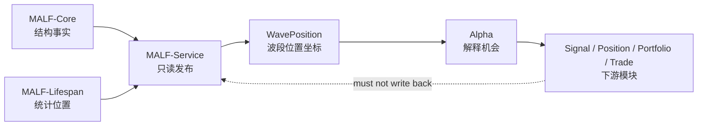
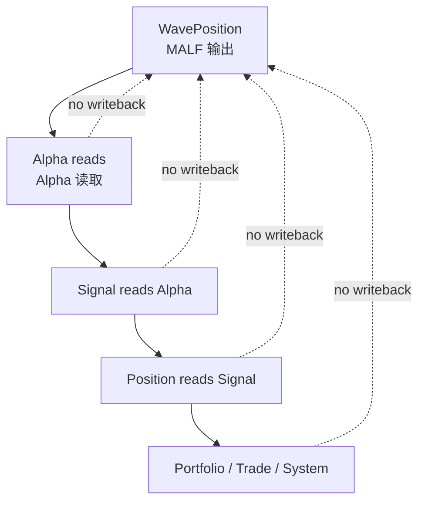
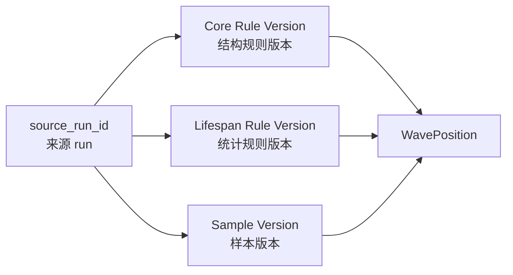

# MALF-Service 图表版辅助理解 v1.3

> v1.4 baseline note: 本文件从 v1.3 继承语义基线；文件内部的 v1.3 表述表示被继承的语义内容。v1.4 的规范增量以 MALF_01B_Core_Operational_Boundary_Rules_v1_4.md 为准。

> 本文件是 Service 的图表阅读版。  
> 它帮助理解 `MALF_03_System_Service_Interface_v1_3.md`，但不替代权威定义。

---

## 1. 一图看 Service 的位置



Service 不发明新语义，只把 Core 和 Lifespan 的结果合成稳定接口。

---

## 2. WavePosition 字段分组

| 分组 | 典型字段 | 中文理解 |
|---|---|---|
| identity | symbol, timeframe, bar_dt, service_version | 这条记录是谁、哪天、哪个接口版本 |
| core_state | system_state, wave_core_state, direction | Core 判定的结构状态 |
| transition_trace | broken_guard, boundary, candidate, confirmation | 新波从哪里来 |
| lifespan_stats | new_count, no_new_span, ranks, life_state | 波段现在处在什么统计位置 |
| birth_descriptors | birth_type, wait span, distance | 出生过程描述 |
| versions | rule_version, sample_version, source_run_id | 追溯来源和规则版本 |

---

## 3. 只读边界



边界铁律：

```text
Alpha may read MALF.
Alpha must not write MALF.
Downstream must not redefine MALF fields.
```

---

## 4. MALF 不输出什么

| 禁止输出 | 原因 |
|---|---|
| buy | 买入是下游解释，不是结构事实 |
| sell | 卖出是下游解释，不是结构事实 |
| weight | 权重是组合层职责 |
| order | 订单是 Trade 职责 |
| position_size | 仓位是 Position / Portfolio 职责 |
| portfolio_allocation | 组合分配不是 MALF 职责 |

MALF 只说：

```text
这个波段是什么结构。
它现在处在什么统计位置。
它从哪里确认而来。
```

---

## 5. 审计追溯图



每条 WavePosition 都必须能追溯到来源 run、规则版本和样本版本。

---

## 6. Service 铁律

```text
MALF serves structure and position.
Alpha interprets value.
No buy/sell/weight/order from MALF.
No downstream writeback to MALF.
```

