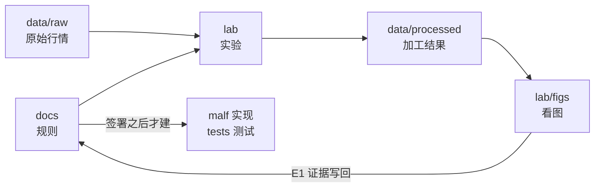

# MALF Definitive · 个人研究型量化实验工作台

一个人的研究台。只做三件事：把 MALF 规则想清楚 → 在真实 A 股日线上跑出证据 → 签署后再写实现。

当前稿：[docs/MALF终极权威定义（A股版）.md](docs/MALF终极权威定义（A股版）.md)（**v3.1，2026-11-26 签署，MALF 权威定义**；2026-11-27 勘误并补 P28 倒算继承细则；封存 README/版本索引里的"当前权威 v3.0"是历史记录，替代关系见当前稿 §2）

## 一张图



## 目录

| 目录 | 放什么 | 规矩 |
|---|---|---|
| `docs/` | 当前稿；`malf-definitive-figs/` 是进了文档的编号图；`pictures/` 是截图和书页；`archive/` 是 v1.0–v3.0 历史版本 | 只改当前稿。`archive/` 封存，只读 |
| `data/raw/` | 原始行情：`bars.csv`（314 只）、`bars_all.csv`（全 A 股）、`_a_share_10y_*.parquet`（全 A 股 10 年三种复权，hithink 导出底账） | 只进不改 |
| `data/processed/` | 脚本产物，一次实跑一个文件夹 | 不手改，删了能重跑 |
| `lab/` | 实验脚本；`figs/` 是看图用的未编号图；`legacy/` 是旧稿 | 一个脚本只做一件事，只用 Python 标准库 |
| `malf/` | 权威实现（2026-11-26 定义层签完后建）：`core.py` 引擎、`percentile.py` 分位；`python -m malf` 全样本首跑并自核对。2026-11-27 起倒算继承的读数按时点算（P28） | 是 |
| `tests/` | 测试：引擎 golden、分位契约、P28 倒算继承与截断重放（25 例） | 改引擎必须全绿 |

## 规矩

1. 规则只认当前稿。条款标【继承】【裁决】【新增｜待确认】；证据标 E1 实测 / E2 原文 / E3 项目自述 / E4 推断。
2. 实验只读 `data/raw`，只写 `data/processed` 和 `lab/figs`。要进文档的图才编号，放进 `docs/malf-definitive-figs/`。
3. 结论写回当前稿的证据底账，带上脚本的路径。
4. 长期规矩：数据、截图、`.workbuddy/` 只留本机，不入库（见 `.gitignore`）。

## 跑实验

```bash
python lab/p20_real_c.py     # 小波段（已裁决：守护点随最新确认的 HL 上移），打印文档 4.6.7 的表 -> data/processed/p20_real_c/events.json
python lab/p20_real_chart.py 002899 2020-03-16 2020-08-24 a   # 画一段真实日线：盘整区、新高第几只、守护点台阶 -> lab/figs/p20c_a.svg
python lab/p20_real.py       # 对照：小波段守护点出生后不动 -> data/processed/p20_real/events.json
python lab/nested.py         # 大小波段嵌套，三种写法 A / B / C -> data/processed/nested/nested.json
python lab/big_from_small.py # 大波段从小波段推（八步），前顶两种读法对比 -> data/processed/big8/big8.json、lab/figs/big8_up.svg、big8_dn.svg
python lab/big_real.py       # 大波段（丙）首跑 -> data/processed/big/big_events.json
python lab/quant_charts.py   # 按总只数分档挑例子画图 -> lab/figs/wave_q*.svg
python lab/nested_chart.py A # 画一条上涨、一条下跌大波段 -> lab/figs/nested_up.svg、nested_dn.svg
python lab/pct_chart.py 000001 a  # 单标的5年全景：K线+大波段时间带+新高第几只+守护台阶，下方逐bar扩展窗分位 -> lab/figs/pct_000001_a.svg
python -m malf data/raw/bars.csv data/processed/first_run_1127          # 314 只：引擎 + 分位 -> 文档 4.6.3 的表
python -m malf data/raw/bars_all.csv data/processed/full_run_1127      # 全 A 股（窗口内有 K 线的 5328 只）：引擎 + 分位 -> 图 13
python lab/full_dist_cdf.py                                          # 画图 13（读上面两个文件夹）
sort -t, -k1,1 -k2,2 data/raw/bars_all.csv | python lab/limit_flat_stat.py   # 一字板与相邻两根最高价相等的数量 -> 文档 5.4
python -m unittest discover -s tests -v  # 验收测试（引擎 golden + 分位契约 + P28 倒算继承与截断重放，25 例）
```

## 数据来历

`data/raw/bars.csv`：取自 `B:/arc-pinbar/data/db/arc-pinbar.db` 的 `bar` 表。314 只 A 股，2020-01-02 到 2024-12-31 日线，后复权价（锚定 2020-01-02，**未舍入**，全行超 2 位小数），去掉停牌根。导出语句没有留档。

`data/raw/_a_share_10y_{raw,qfq,hfq}.parquet`：hithink-finance CLI `db export` 自本地 DuckDB（`data sync` 全量同步，2026-11-26）。2016-11-28 到 2026-11-26 全部 A 股 5581 只日线，三种复权口径各一份。

`data/raw/bars_all.csv`：由 `_a_share_10y_hfq.parquet` 导出，取 2020-01-01 到 2024-12-31，后复权未舍入，代码去 `.SZ` 后缀。库内 5581 只里，这个窗口内有 K 线的是 5328 只（5,561,996 根）。全市场引擎跑这个：`python -m malf data/raw/bars_all.csv data/processed/full_run_1127`。
【取舍｜已签】① 现况上市、**不含已退市**（P4 含退市暂无法满足，hithink 库无退市数据；退市可得时补入，自动生效）；② 与旧 `bars.csv` 是同一复权链（逐日比值恒定），仅精度与锚点不同——引擎事件结构 220 只参考标的中 217 只完全一致，3 只（000711、002555、300071）因供应商复权处理差异分叉，属数据差异非引擎 bug。

`lab/nested.py`、`lab/big_from_small.py` 是 2026-11-26 的对照脚本，波段清单与 `malf/` 一致，但倒算继承的读数是旧写法（偏大），只作对照，不要引用它们的只数。
