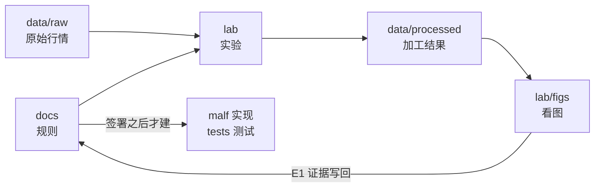

# MALF Definitive · 个人研究型量化实验工作台

一个人的研究台。只做三件事：把 MALF 规则想清楚 → 在真实 A 股日线上跑出证据 → 签署后再写实现。

当前稿：[docs/MALF终极权威定义（A股版）.md](docs/MALF终极权威定义（A股版）.md)（v3.1 候选，未签署）

## 一张图



## 目录

| 目录 | 放什么 | 规矩 |
|---|---|---|
| `docs/` | 当前稿；`malf-definitive-figs/` 是进了文档的编号图；`pictures/` 是截图和书页；`archive/` 是 v1.0–v3.0 历史版本 | 只改当前稿。`archive/` 封存，只读 |
| `data/raw/` | 原始行情，现在只有 `bars.csv` | 只进不改 |
| `data/processed/` | 脚本产物，一次实跑一个文件夹 | 不手改，删了能重跑 |
| `lab/` | 实验脚本；`figs/` 是看图用的未编号图；`legacy/` 是旧稿 | 一个脚本只做一件事，只用 Python 标准库 |
| `malf/`、`tests/` | 实现、测试 | 签署前不建 |

## 规矩

1. 规则只认当前稿。条款标【继承】【裁决】【新增｜待确认】；证据标 E1 实测 / E2 原文 / E3 项目自述 / E4 推断。
2. 实验只读 `data/raw`，只写 `data/processed` 和 `lab/figs`。要进文档的图才编号，放进 `docs/malf-definitive-figs/`。
3. 结论写回当前稿的证据底账，带上脚本的路径。
4. 长期规矩：数据、截图、`.workbuddy/` 只留本机，不入库（见 `.gitignore`）。

## 跑实验

```bash
python lab/p20_real.py       # 小波段：bars.csv -> data/processed/p20_real/events.json
python lab/nested.py         # 大小波段嵌套，三种写法 A / B / C -> data/processed/nested/nested.json
python lab/big_real.py       # 大波段（丙）首跑 -> data/processed/big/big_events.json
python lab/quant_charts.py   # 按总只数分档挑例子画图 -> lab/figs/wave_q*.svg
python lab/nested_chart.py A # 画一条上涨、一条下跌大波段 -> lab/figs/nested_up.svg、nested_dn.svg
```

## 数据来历

`data/raw/bars.csv`：取自 `B:/arc-pinbar/data/db/arc-pinbar.db` 的 `bar` 表。314 只 A 股，2020-01-02 到 2024-12-31 日线，后复权价，去掉停牌根。导出语句没有留档。
