# MALF 终极权威定义（A股版）

| 项 | 内容 |
|---|---|
| 版本 | v3.1 |
| 日期 | 2026-11-25，2026-11-26 修订 |
| 状态 | **候选稿，待用户签署**。签署前不改变任何现有文件的权威地位，不得作为施工依据 |
| 规则底子 | v1.4（v1.3 语义 + O1–O8 操作规则），用户 2026-11-25 裁决 |
| 推进计数 | 新值记录法：刷新一次新高 / 新低，记一只。用户 2026-11-25 裁决，见 4.3.1 |
| 样本池 | 全市场，用户 2026-11-25 裁决 |
| 起草 | AI 起草，用户裁决 |
| 大小波段、计时器、盘整区 | 大波段的新高第几只同样数日线、守护点用小波段推（丙，八步与四条细则）、只用一张日线、盘整区怎么认、小波段的守护点随最新确认的 HL 上移（极值规则定为分形 k=2）：已裁决，见 4.2.2、4.6。计时器【新增｜待确认】P16 |

> 本文件是结构定义，不是策略，不构成投资建议。

---

## 0. 阅读须知

本文件每一条款都带一个标签，标明它从哪里来、能不能直接用。

| 标签 | 含义 | 能否直接用 |
|---|---|---|
| 【继承】 | 来自已有权威原文，本稿没有改语义，括号里是出处 | 能 |
| 【裁决】 | 用户 2026-11-25 至 26 的裁决，尚待签署落盘 | 签署后能 |
| 【新增｜待确认】 | 本稿新加的内容，含假设、风险、取舍、范围四类 | **不能**，等用户裁决 |

证据等级沿用项目约定：E1 实测、E2 原文、E3 项目自述、E4 推断。

带【待确认】的条款不得进入需求、代码、参数或验收项。

---

## 1. MALF 是什么

### 1.1 一句话

**MALF 是一把读价格的尺子。它告诉你：现在有没有一条活的波段，方向朝哪，靠哪个点守着，它在自己的历史里走到了什么位置。**

它只做三件事：

1. 把 K 线读成确认极值，再把极值读成波段。
2. 数这条波段：新高到第几只，多久没新高。
3. 把这两个数放回历史同类波段里，看它排在第几。

**图 1　从 K 线到波段位置**

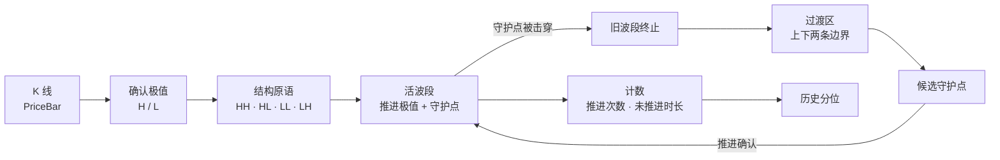

### 1.2 铁律

```text
给位置，不给动作。
分位是历史排位，不是概率。
守护点被击穿，旧波段即死，不会复活。
过渡区不是波段。
新波段 = 候选守护点 + 之后的推进确认。
```

### 1.3 它回答什么，不回答什么

| 问题 | 是否回答 |
|---|---:|
| 现在有没有活的波段，方向是什么 | 是 |
| 波段靠哪个点守着，推进到哪里 | 是 |
| 这条波段新高到第几只、多久没新高 | 是 |
| 这条波段活了多久（计时器） | 【新增｜待确认】P16 |
| 大波段走到哪了，小波段结束它结束了没有 | 【裁决】P17（丙）；计时器已裁决 P16 |
| 这两个数在历史同类里排第几 | 是 |
| 旧波段怎么死的，新波段怎么生的 | 是 |
| 接下来会不会涨、会不会跌 | **否** |
| 现在该不该买卖、买多少 | **否** |
| 哪只股票更好 | **否** |
| 哪里是支撑位、阻力位、多次触碰的关键区 | **否**。只给当前守护点一条线，和过渡区上下两条边界 |

【继承】v1.0《第四战场》与 v1.4 定理 T10、L-T6、S-T3。

### 1.4 最初的设想与现在的认知

最初的设想是 v1.0 的"给位置，不给动作"：人眼看盘时会判断"这波走到哪了"，MALF 把这句感觉变成几个可复核的数。

现在的认知比当时多四条，都是后来的版本用教训换来的：

- **守护点必须是一个确认过的极值，不能是某根 K 线的最低价。** 否则波段要么永远不死，要么几乎总是死的（E1，两套 3.0 引擎在 314 只真实 A 股五年日线上分别跑出这两种结果）。
- **旧波段死掉之后，新波段要经过"候选 + 确认"两步才算出生。** 中间的过渡区是一个独立状态，不属于任何波段（E2，v1.3 D12）。
- **分位只报数，不切桶。** "分位高于 0.8 就算衰竭"这类阈值分桶已被明令废止（E2，v2.0 Bridge 第 95 行）。
- **推进次数按新值记，不按极值点记。** v1.0 原文是"只记新值替代旧值""若本 bar 未产生新值"。v1.4 把它改成数确认过的极值，连涨 10 天只算 1 次（E2，v1.0《第四战场》第 3 页；v1.4 L3）。

### 1.5 五个常见误读

| 误读 | 正确读法 |
|---|---|
| 分位高就是要跌，分位低就是要涨 | 分位只说"这条波已经走了多少"，不说接下来怎么走 |
| 守护点被击穿就是卖出信号 | 击穿是一个结构事实，动作是另一回事 |
| 进入过渡区就是方向反转了 | 过渡区方向未定，新波段可以与旧波段同向 |
| 全市场分位是选股排名 | 分位是"这条波在历史同类波里的位置"，不是"这只股票比别的股票强" |
| 连涨 10 天只算 1 次新高 | 每根刷新新高的 K 线各记一只：连涨 10 天，是新高第 10 只 |

---

## 2. 权威链与本稿地位

| 时间 | 事件 | 证据 |
|---|---|---|
| v1.0 | 概念稿：`WavePosition = (方向, 推进分位, 停滞分位, 生命状态)` | E2 |
| v1.2–v1.3 | 分成 Core / Lifespan / Service 三层；v1.3 把过渡区、候选、双条件确认讲清楚，样本池默认改为全市场 | E2 |
| v1.4 | 补 O1–O8 操作规则：事件顺序、严格比较、候选替换、快照、重放 | E2 |
| v2.0（2026-06-16） | 立下"只报数，不报桶"铁律 | E2 |
| v2.1（2026-07-26） | 用户签署认定为当时的权威。声明"完整保留 v1.4"，但实际有三处与 v1.4 不同：初始化规则、候选替换规则、停滞分位的算法 | E2，`AUTHORITY.md` 第 84 行；不同之处见 §8 |
| 2026-11-08 | 余年-Definitive 声明归档 malf | E2，转引自 `QUANT-FIRST-READ.md` §3.2，本稿未回原文核对 |
| 2026-11-23 | v3.0 Definitive 建档，README 标为"当前权威" | E2 |
| 2026-11-25 | 审查结论：3.0 需要修订。用户裁决：规则按 v1.4，样本池用全市场，推进计数按新值记录（回到 v1.0 原意） | E1 |

**图 2　版本脉络**

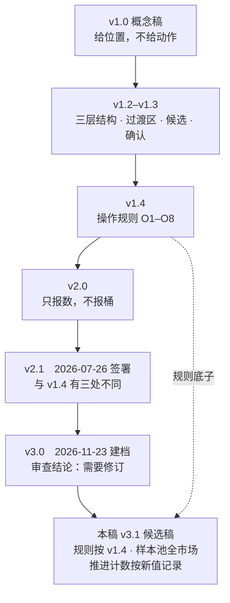

本稿的地位：

- 签署后，本稿取代 v3.0 成为 MALF 的权威定义；v3.0 降为分档导航。
- v1.4 的四份原文仍是逐条依据，本稿是它们的合并读本，不是替代品。推进计数一处例外，按用户裁决回到 v1.0 的写法（见 4.3.1）。
- README 和版本索引仍写着"当前权威 v3.0"。这两份是封存文件，本稿没有改；签署时需要你授权登记替代关系。

---

## 3. 要素一览

| 要素 | 英文 | 人话 |
|---|---|---|
| 价格 K 线 | PriceBar | 原始输入 |
| 确认极值 | Pivot | 已经确认的局部高点 H 或局部低点 L |
| 结构原语 | Primitive | HH / HL / LL / LH，当前极值和参照极值比出来的。只管波段的生死，不用于计数 |
| 波段 | Wave | 有方向、有推进、有守护、会死的一段结构 |
| 大波段 | — | 同一套规则在更大尺度上再跑一遍，守护点用小波段推，只用日线。【裁决】P17 |
| 当前有效守护点 | Current Effective Guard | 活波段真正用来判死活的那个 HL 或 LH |
| 击穿 | Break | 守护点被打穿，旧波段死亡 |
| 系统状态 | System State | 未初始化 / 上涨活 / 下跌活 / 过渡区 |
| 过渡区 | Transition | 旧波已死、新波未生的那段 |
| 过渡边界 | Transition Boundary | 旧波死亡时留下的上下两条线 |
| 候选守护点 | Candidate Guard | 新波出生前先出现的 L 或 H |
| 推进确认 | Progress Confirmation | 候选之后真正越过边界。同向新生已改为上破盘整高值（4.2.5） |
| 推进次数 | new_count | 这条波刷新了几次新高：新高第几只（下降波是新低第几只） |
| 未推进时长 | no_new_span | 这条波多久没推进了 |
| 波段年龄 | wave_age | 这条波从出生到现在过了几根 bar（计时器）。冻结后只记录、不做分位。【已裁决】P16 |
| 历史分位 | rank | 这两个数在历史同类里排第几 |
| 波段位置 | WavePosition | 以上全部打包成一条只读记录 |

**图 3　十七个要素各在哪一层**

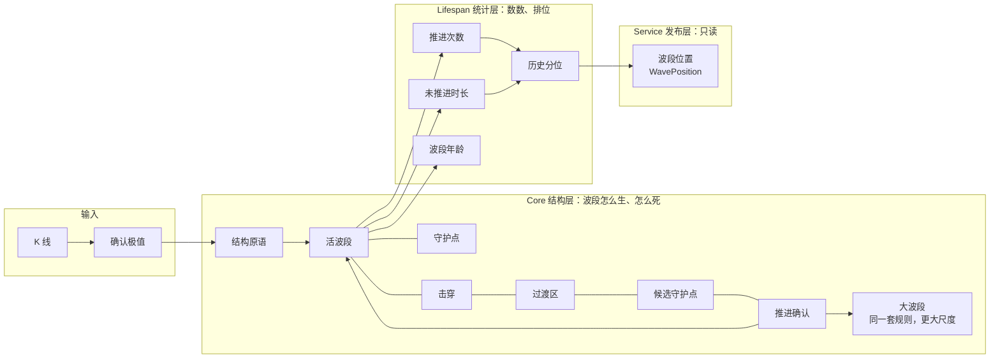

---

## 4. 权威定义

除标注外，本节全部【继承】自 v1.4。

**图 4　三层各管一件事**

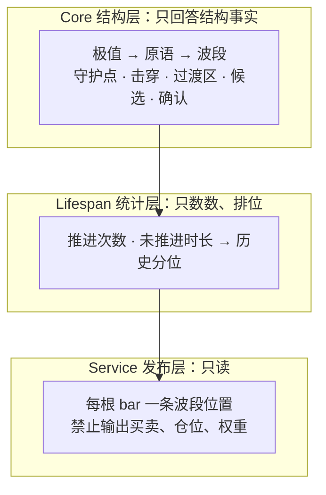

### 4.1 输入

**PriceBar（D1）**

```text
PriceBar = symbol + timeframe + bar_dt + open + high + low + close
```

所有结构必须最终追溯到 PriceBar。A 股的数据口径见第 5 节。

### 4.2 Core：结构层

#### 4.2.1 极值与原语

- **确认极值（D2）**：从价格序列确认出的局部高点 H 或局部低点 L。确认规则必须版本化并记录（O1）。v1.4 没有规定具体规则。
- 【裁决】P1：极值确认规则用 v2.1 签署过的**分形 k=2**（用户 2026-11-26 认可小波段的守护点上移时一并定下）。一根 bar 的最高价严格高于左右各 2 根，是高点；最低价严格低于左右各 2 根，是低点。右边第 2 根收盘时确认，也就是晚 2 根。并列不算。版本名 `fractal_k2_v1.0`。
- **结构原语（D4）**：当前极值与"结构上下文指定的参照极值"比较。

| 原语 | 含义 |
|---|---|
| HH | 当前 H 高于参照 H |
| HL | 当前 L 高于参照 L |
| LL | 当前 L 低于参照 L |
| LH | 当前 H 低于参照 H |

这里的 HH / LL 是确认极值之间的比较，只用于波段的出生、守护、候选、确认，**不用于计数**。推进次数按 K 线记新高第几只，见 4.3.1。

- **参照从哪来（D3）**：由结构上下文决定，分三种：活波段内、过渡区内、初始化阶段。不能拿任意历史极值当参照（T1）。
- **方向（D5）**：上涨结构以 HH 推进、HL 守护；下跌结构以 LL 推进、LH 守护（T2）。

#### 4.2.2 波段与守护点

- **波段（D8）**：有方向、有起点、有推进极值、有当前有效守护点、会终止的一段结构。状态只有 `alive` 和 `terminated` 两种。
- **当前有效守护点（D9）**：

| 活波段 | 守护点 |
|---|---|
| 上涨波段 | 本波段内最新确认的 HL |
| 下跌波段 | 本波段内最新确认的 LH |

- 新高只更新推进极值，**不换守护点**。只有后来确认的 HL / LH 才替换守护点（T3）。
- 【裁决】守护点的两条细则（用户 2026-11-26）：

  | 什么时候 | 上涨波段的守护点 | 下跌波段的守护点 |
  |---|---|---|
  | 出生那根 | 盘整的低点（4.6.7），当场可用，不等极值确认 | 盘整的高点 |
  | 出生之后 | 每确认一个新的 HL（分形 k=2），就换过去 | 每确认一个新的 LH，就换过去 |

  同一根 bar 里先记新高，再确认极值、换守护点，最后判击穿（4.2.7）。实跑：68.2% 的小波段守护点上移过（4.6.7）。
- 【规则推论｜待确认】推进极值随之取"本波段到目前为止的最高价"，也就是最后一根新高 K 线的最高价，不再要求它是确认过的极值。见 P15。
- 初始守护点：初始上涨波用 `H0 → L1 → H2`（H2 高于 H0）里的 L1；初始下跌波用 `L0 → H1 → L2`（L2 低于 L0）里的 H1。

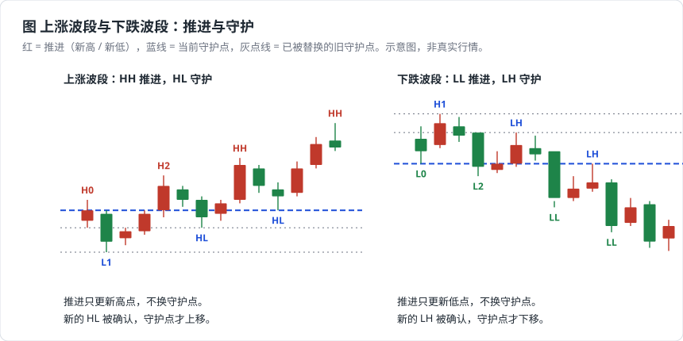

*图 5　新高只更新极值；新的 HL / LH 被确认，守护点才移动。*

#### 4.2.2A 双序列：HH(n) 与 HL(m)（含义）

【裁决】用户 2026-11-26：hh、hl 各自记录新值第几只，按序号排列；先确立含义，再实现。上涨波段记 HH(n) 与 HL(m)；下跌波段镜像，记 LL(n) 与 LH(m)。

- **HH(n)**：第 n 根刷新本波段最高价的日线，就是 4.3.1 的"新高第 n 只"。**实时**：当根收盘即知。
- **HL(m)**：本波段第 m 个"比前一个 HL 高"的低点，由分形 k=2 确认，**晚 2 根**才知。HL(1) = 出生守护点（盘整低点，4.6.7）。比当前守护点低的分形低点不进序列。
- **LL(n) / LH(m)**：下跌镜像。LL(n) 实时记新低第几只；LH(m) 记渐次降低的反压高点，LH(1) = 盘整高点。

**时间配对（本条的核心）**：bar = 时间 + 价格，两个序列在时间上错位，不能并排一一对应。

- HH(n) 生成那一刻，HL(m) 还不存在。此刻的守护是**上一个已确认的 HL**，记 HL(m-1)。
- HH(n) 之后回落里将要形成的那个低点，是 HL(m) 的候选，只有两种结局：
  1. 守在 HL(m-1) 之上，右侧两根后确认 → 成为 HL(m)，守护点上移；
  2. 跌穿 HL(m-1) → 波段死。这个低点不是 HL，是击穿点。
- 一句话：**进攻看 HH(n)，守护看 HL(m-1)，HL(m) 是下一个待定低点。** 击穿的定义不变（4.2.3），这里只是说清它击穿的是谁：HH(n) 生成时在位的守护 HL(m-1)。
- 持续与停滞：HH 不刷新 = 未推进时长增加（4.3.1）；HL 没等到确认 = 守护不动。两个序列都不动，就是磨。

大波段同构（4.6）：HH(n) 数刷新大波段最高价的日线；HL(m) 数大波段的抬升低点，八步里每换一次守护点 m+1。下跌镜像。


*图 17　上：HH(n) 生成时守护是 HL(m-1)，HL(m) 还不存在；回落低点守住并经右侧两根确认，才成为 HL(m)，守护上移。下：回落低点跌穿 HL(m-1)，波段死，这个低点不是 HL(m)。*

#### 4.2.3 击穿与系统状态

**击穿（D10）**

```text
上涨波段击穿 = 这根 bar 的最低价 < 守护点价
下跌波段击穿 = 这根 bar 的最高价 > 守护点价
```

- 等于不算击穿（O3）。
- 被击穿的必须是当前有效守护点，不能是任意历史 HL / LH，也不能是击穿那根 bar 自己的高低点。
- 击穿后：旧波段进入 `terminated`，永不复活（T4）。

**系统状态（D11）**

| 状态 | 含义 |
|---|---|
| `uninitialized` | 还没确认出第一条波段 |
| `up_alive` | 有一条活的上涨波段 |
| `down_alive` | 有一条活的下跌波段 |
| `transition` | 旧波段已死，新波段未确认 |

系统状态和波段状态是两回事，不能混用。

**图 6　四个状态之间怎么走**

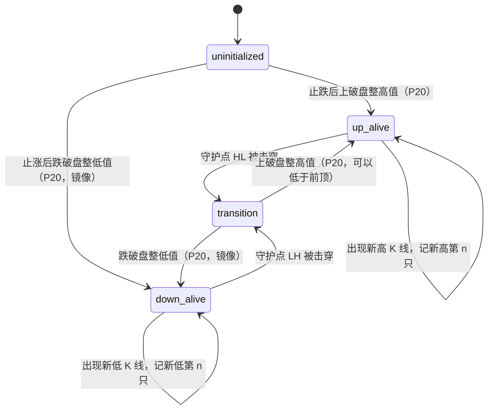

#### 4.2.4 过渡区

过渡区必须保存：被击穿的守护点、旧波段最终推进极值、上下两条边界、击穿日期（D12）。

**双边界（D13）**

| 死掉的是 | 上边界 | 下边界 |
|---|---|---|
| 上涨波段 | 旧波段的最高价 | 被击穿的 HL 价 |
| 下跌波段 | 被击穿的 LH 价 | 旧波段的最低价 |

不得使用击穿那根 bar 的高低点，也不得使用任意历史极值。旧波段死后只剩审计价值，边界由过渡区接管（T9）。

- 【规则推论｜待确认】v1.4 原文写的是"旧波段最终 HH / LL"。按新值记法，它就是本波段的最高价 / 最低价。见 P15。

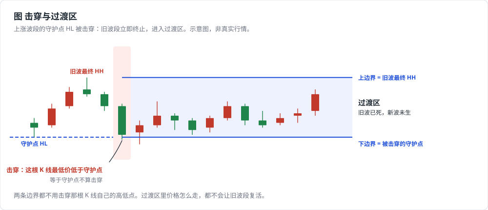

*图 7　守护点被击穿：旧波段立即终止，两条边界接管。*

#### 4.2.5 候选与确认

- **候选守护点（D14）**：过渡区里盘整区的低点（候选上涨波）或高点（候选下跌波）。【已裁决（2026-11-26，岔路 2：留边界简化候选）】候选就是盘整低点 / 高点本身，不是另找的极值；它当场可用，就是将来的 HL(1) / LH(1)。过渡区里向上、向下两张表同时跑（见 4.6.7 的链），各有一个候选，谁先破谁出生。
- **不再有候选替换。** v1.4 的 D15、T5、O4（"只认最新候选、后来的一律替换"）是过渡区里逐根找极值时代的规则；盘整机制下候选只在"没上破先破低点"时作废、从新低点重找（4.6.7），不存在候选 L1 / L2 互相替换，也不存在候选 L 被候选 H 顶掉。这组规则整组冻结为历史规则，不再适用；`candidate_replacement_count` 不再统计。

- **推进确认（D16）**：

```text
候选 L 之后出现 H，且 H > 过渡上边界  → 新上涨波   （上半句已改写，见下）
候选 H 之后出现 L，且 L < 过渡下边界  → 新下跌波
```

确认必须晚于候选。同一个极值不能既当候选又当确认。等于边界不算确认（O3）。

【裁决】用户 2026-11-25、2026-11-26：**新上涨波段的第一只新高，是止跌之后上破盘整高值的那根 K 线，可以低于旧波段的最高价。** 这一条改写 D16 的上半句：同向新生不再以"高过过渡上边界（旧波段最高价）"为条件，改以"高过盘整高值"为条件。盘整怎么认，历代版本没有写过，2026-11-26 已裁决，规则在 4.6.7。

- 【裁决】新生上涨波段的守护点 = 盘整的低点（用户 2026-11-26）。它就是盘整定义里的那个低点，当场可用，不等极值确认，出生这一步不依赖 P1。图 8 画的就是这一种。出生之后，守护点随最新确认的 HL 上移（4.2.2，用户 2026-11-26）。
- 【规则推论】极值规则已定为严格分形 k=2（P1），这个低点最晚在上破那根收盘时同时被确认，而 O2 第 2 步（确认极值）先于第 7 步（推进确认），两套说法不冲突。未实跑（E4）。
- 【裁决】下跌波段镜像，D16 下半句同样改写（用户 2026-11-26）：新下跌波段的第一只新低，是止涨之后跌破盘整低值的那根，可以高于旧波段的最低价。办法见 4.6.7。

- **新波段（D17、T7）**：可以与旧波段同向，也可以反向。击穿之后出现的任何新结构都是新波段，不能算旧波段的延续。
- **过渡区不是波段（T8）**：它只负责连接旧波和新波。

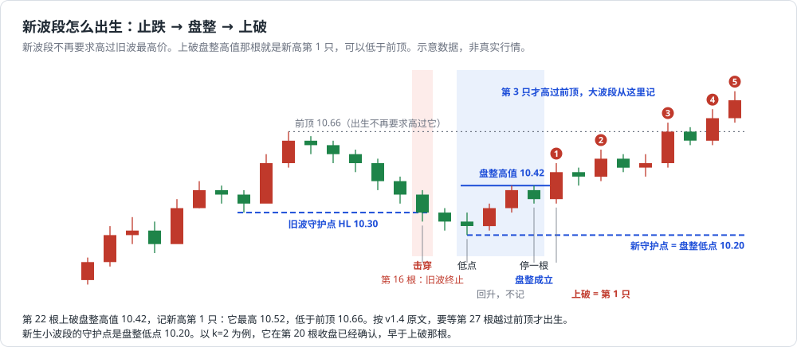

*图 8　止跌之后先有盘整，上破盘整高值那根就是新高第 1 只，新波段出生；它可以低于前顶。*

这张图于 2026-11-26 按裁决重画。2026-11-25 之前的版本画的是 v1.4 原文：过渡区里只认最新的候选，越过边界之后新波段才出生。

- 【规则推论｜已消解】这条是旧候选机制（D15、O4 逐根找极值）下的推论：极值规则定为严格分形 k=2（P1）时，确认出的高低点必然交替。2026-11-26 岔路 2 裁决候选改为盘整低点 / 高点后，"候选交替"已无对象，本条连同"候选 L1 / L2 替换"表一起冻结为历史。v2.1"反向候选不替换同向候选"的差异也随之失去意义，见 §8。

#### 4.2.6 初始波段（D18、O6）

- 初始化阶段只能产生初始候选，**不能产生击穿，也不能打开过渡区**。
- `H0 → L1 → H2` 且 H2 高于 H0，确认初始上涨波；`L0 → H1 → L2` 且 L2 低于 L0，确认初始下跌波。
- 条件不满足时留在 `uninitialized`。之后出现更高的 H 可以替换 H0，出现更低的 L 可以替换 L0。
- 初始化失败不得产生任何已终止的波段，也不得计为击穿。

#### 4.2.7 事件顺序（O2）

同一根 bar 内，固定按这个顺序处理：

**图 9　九步固定顺序**

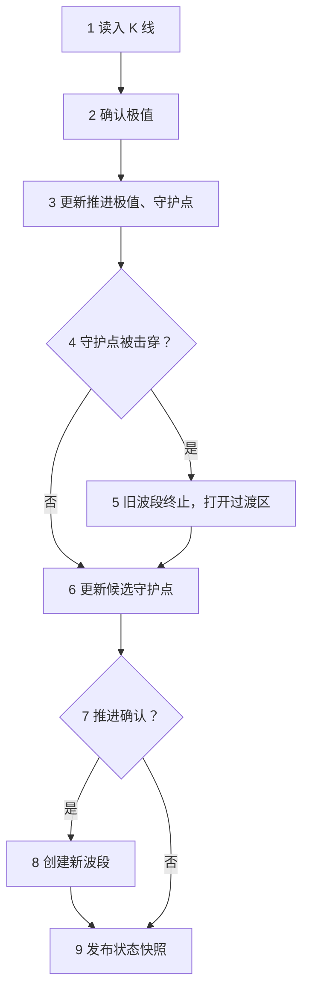

- 同一根 bar 既击穿守护点又越过过渡边界：先判击穿；过渡区打开后，候选和确认按顺序重新判断。
- 不能把还没出现的候选反推到确认之前。
- 新高 K 线在当根收盘时就记数；守护点要等极值确认后才移动。两者时点不同：记数是实时的，守护晚 k 根（k 见 P1）。
- 版本号 `core-event-order-v1` 必须进运行记录。

#### 4.2.8 严格比较（O3）

- 击穿和确认都用严格大于、严格小于。等于不触发任何事件。
- 不允许悄悄改用大于等于或小于等于。
- 不允许不记录策略就使用浮点容差（`epsilon_policy = none`）。
- 价格必须先按正式精度归一化，再进入比较。A 股的精度口径见 §5 的 P2。

#### 4.2.9 过渡区内的原语（O5）

过渡区内的极值仍可形成原语并记账，但上下文必须标为 `transition_candidate`。这些原语不得更新旧波段的极值和守护点，只服务于候选和确认的追溯。

#### 4.2.10 版本、快照、重放（O1、O7、O8）

- 极值确认规则版本必须随请求、运行记录、极值账本一起记录。同一次运行内不得混用。
- 每根 bar 发布一份状态快照，最小字段见下表。
- 相同输入加相同规则，必须重放出相同结果。重放有差异，必须能归因到下面至少一项。

| 差异来源 | 必须记录 |
|---|---|
| 输入数据变了 | `source_run_id` |
| 极值规则变了 | `pivot_detection_rule_version` |
| Core 语义变了 | `core_rule_version` |
| 事件顺序变了 | `core_event_ordering_version` |
| 价格比较变了 | `price_compare_policy` |
| 表结构变了 | `schema_version` |

**状态快照最小字段（O7）**

| 字段 | 说明 |
|---|---|
| `symbol`, `timeframe`, `bar_dt` | 标的、级别、bar |
| `system_state` | 四种系统状态 |
| `active_wave_id` / `old_wave_id` | 活波段；过渡区时为旧波段 |
| `direction` | 活波段方向；过渡区时为旧方向 |
| `wave_core_state` | `alive` / `terminated`，不得为过渡区 |
| `current_effective_guard_pivot_id` / `_price` | 当前守护点 |
| `progress_extreme_pivot_id` / `_price` | 当前推进极值 |
| `open_transition_id` | 当前打开的过渡区 |
| `active_candidate_guard_pivot_id` / `active_candidate_direction` | 当前候选 |
| `core_rule_version`, `pivot_detection_rule_version`, `core_event_ordering_version`, `price_compare_policy` | 规则版本 |
| `source_run_id`, `run_id` | 来源运行、本次运行 |

### 4.3 Lifespan：统计层

#### 4.3.1 计数

【裁决】推进次数按**新值记录法**记：刷新一次新高，记一只，接着上一只往下数。

- **统计对象（L1）**：只统计 Core 已确认的波段。过渡区不是波段，不产生计数。
- **新高 K 线**：最高价严格高于本波段到此为止的最高价的一根 K 线。下降波镜像，叫新低 K 线。
- **推进次数 new_count（L3 改写）**：本波段到现在，新高 K 线的累计只数。读作"新高第 n 只"；下降波读作"新低第 n 只"。
- **未推进时长 no_new_span（L4）**：距上一根新高 K 线过了几根 bar。

| 这根 K 线发生了什么 | 推进次数 | 未推进时长 |
|---|---|---|
| 新波段出生：出生那根 | 第 1 只 | 0 |
| 刷新了新高 | 上一只 +1 | 0 |
| 没有新高，波段还活着 | 不变，也不清零 | 上一根的值 + 1 |
| 守护点被击穿那根 | 冻结 | 冻结 |
| 之后的过渡区 | 冻结不动 | 冻结不动 |

- 归 1 和归 0 都只有一个时刻：**新波段出生那根**。不论新波段与旧波段同向还是反向，都从头记。旧波段数到第 7 只死了，下一条同向的波段从第 1 只重数，不接着数第 8 只。大波段要接着数，见 4.6。
- 未推进时长多一个归 0 的时刻：**每一根新高 K 线**。它量的是"距上一根新高过了几根"，不是"这条波活了多久"。
- 中间不创新高的 K 线不计数，也**不清零**。
- 并列不记：最高价等于前面的最高价，不算新高（O3）。
- 【裁决】L2 改写（用户 2026-11-26）：HL / LH 不进 HH / LL 的推进计数，但**自己有序号**（4.2.2A）。上涨波段在 new_count 之外另记 **hl_count**：HL(1) = 出生守护点（盘整低点）；之后每确认一个比当前守护点高的分形低点，hl_count +1，守护点跟过去。这与 4.2.2 的守护点上移是同一件事的两本账：hh 记进攻，hl 记守护。下跌镜像记 lh_count。低于守护点的分形低点不进序列。击穿那根，两个计数一起冻结。
- 实跑（E1，16210 条已死小波段，程序 `lab/hl_count.py`）：HL(m) 中位 2、均值 2.29、最大 13；m=1（守护从没抬过）占 32.2%；n>m 占 66.5%、n=m 25.2%、n<m 8.3%；上涨小波段的顶到最新 HL 的距离中位 9.0%；相邻 HL 间隔中位 9 根。大波段 HL(m) = 1 + 守护点换位次数，m≥2 占 38.7%。
- 过渡区经过的 K 线不计入新波段（L5、L-T3）。
- 守护点被击穿那根：未推进时长、波段年龄不再加一。击穿时冻结最终统计：final_new_count、final_no_new_span（L6、L-T4）。
- 【规则推论｜待确认】击穿那根如果同时创了新高（最高价过前顶，最低价又破了守护点），按 O2 的顺序先记后死：第 3 步更新推进时记上一只，第 4 步判击穿（P15 d）。
- 【规则推论｜待确认】只看最高价、最低价，不分阴线阳线（P15 b）。
- 【裁决】出生那根是哪一根：上涨波段是止跌后上破盘整高值的那根；下跌波段镜像（2026-11-26 已裁决）。它记为第 1 只（用户 2026-11-25，看图 15 的批注）。它不要求高过旧波段的最高价，也不等极值确认。见 4.2.5 与 4.6.7。
- 【已裁决（2026-11-26，P16）】第三个量，波段年龄 wave_age：这条波从出生那根到现在过了几根 bar。每根 bar 加 1，不清零，击穿那根冻结。冻结后的读数就是这条波段的总长，只作记录，不做分位（P13 否掉的是冻结后做分位，不是实时计数，本条是它的补充）。见 4.6。

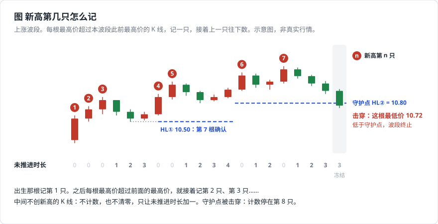

*图 10　红圈数字是新高第几只。中间不创新高的 K 线只让未推进时长加一；守护点被击穿，计数冻结。*

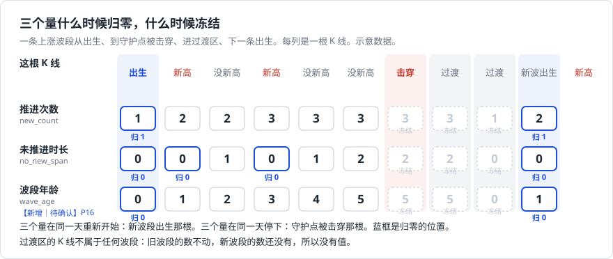

*图 11　蓝框是归零的位置。新波段出生那根，几个量一起重来；每根新高 K 线，只有未推进时长归 0；守护点被击穿那根，一起冻结。波段年龄一行已裁决（P16）。*

**为什么这样记**

- 依据（E2）：v1.0《第四战场》第 3 页写的是"new-count 只记新值替代旧值""若本 bar 未产生新值 → new-count 不变，no_new_span + 1"。这是按 K 线记的。v1.4 L3 把它写成"推进原语被确认更新的累计次数"，变成数确认过的极值点，连涨 10 天只算 1 次。本稿按用户裁决回到 v1.0 的写法。
- 日本交易法里是同一种记法（E2）：
  - 林辉太郎《期货市场的技术》："9 月份期货是第 4 根新低价。"其中 5 月 11 日那根阴线没有更新最低价，不计数，也没有清零。第 21 图把数字标在每根创新高、新低的 K 线上，方向一转从头记 1。
  - 立花义正《你也能成为股票操作高手》："反弹的第一支新值阳线……第二支的新值阳线"；并说懂"新值阳线出现概率"，就知道反弹走到了哪里。
- 两本书的原文写的是"阳线新高价、阴线新低价""新值阳线"。本稿推荐不分阴阳，理由是原始语义只有高低。这一条列为 P15（b）。
- MALF 的推进分位做的正是立花说的那件事：看"新高第 n 只"在历史同类波段里排第几（E4，本稿的类比）。

#### 4.3.2 样本池

【裁决】样本池用全市场。

样本范围（L7）：

| 维度 | 取值 |
|---|---|
| timeframe | 与当前波段同一级别 |
| direction | 与当前波段同方向 |
| universe | 全市场合格标的池 |
| sample_cutoff | 不晚于当前 bar |
| sample_version | 必须指定 |

池里放什么【继承】v2.1 Lifespan §3：

- 已终止的同方向波段，终止时间不晚于当前 bar。
- 不含当前活着的波段。
- 退市股票已终止的波段照常入池。

"合格标的"的标准 v1.4 没有定义，见 §7 的 P4。

#### 4.3.3 历史分位

**图 12　两个计数怎么变成两个分位**

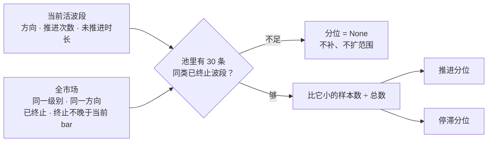

```text
update_rank     = percentile_rank(当前波段的 new_count,     池内各波的 final_new_count)
stagnation_rank = percentile_rank(当前波段的 no_new_span,   池内各波的 final_no_new_span)
```

【继承】L8、L9。公式和约束【继承】v2.1 Lifespan §4，因为 v1.4 没有写。

```text
percentile_rank(x, sample) = count(x_i < x) / N
```

- 严格小于。等于当前值的样本不计入。
- 取值范围 [0, 1)。当前值最大时等于 (N−1)/N，永远到不了 1。
- 池内不足 30 个样本时返回 None。不 fallback、不补零、不扩大样本范围。
- 过渡区和未初始化状态下没有活波段，两个分位都是 None。

**分位怎么读**

| 分位 | 读作 |
|---|---|
| update_rank = 0.8 | 这条波段到现在新高的只数，已经超过历史上 80% 的同类波段一辈子新高的只数 |
| stagnation_rank = 0.9 | 这条波段现在停的时间，已经超过历史上 90% 的同类波段临终前停的时间 |

分位是位置，不是概率，不是收益，不是信号（L-T6）。

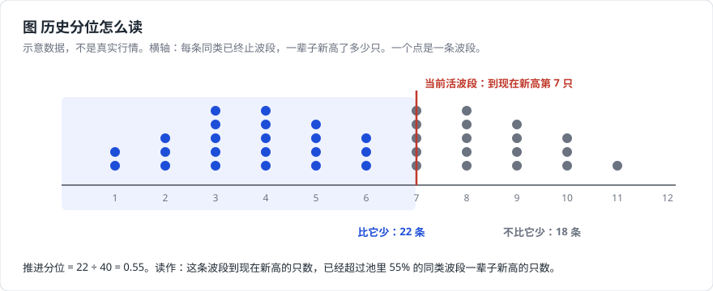

*图 13　分位就是"排在第几"：比它小的样本数，除以样本总数。*

#### 4.3.4 出生描述（L13–L17）

只描述新波段怎么形成的，不预测未来（L-T7）。

| 字段 | 含义 |
|---|---|
| `birth_type` | initial / same_direction_after_break / opposite_direction_after_break |
| `transition_span` | 击穿到新波段出生经过的 bar 数 |
| `consolidation_span` | 盘整区几根（低点到停顿那根）。【已裁决（2026-11-26）】替代 v1.4 的 `candidate_wait_span` |
| `void_count` | 盘整作废重来的次数。【已裁决（2026-11-26）】替代 `candidate_replacement_count`：盘整机制下没有候选替换，只有作废重来 |

【已裁决（2026-11-26，岔路 2）】v1.4 的 `candidate_wait_span`、`candidate_replacement_count`、`confirmation_distance_abs` / `_pct` 三个字段不再输出：出生条件改成"上破盘整高值"后，候选等待、候选替换、确认距离都没有对应物。过渡区双边界（D12、D13）保留，只作审计。

#### 4.3.5 WavePosition：最终输出（L18、S3–S9）

每根 bar、每只标的、每个级别一条记录。

| 组 | 字段 |
|---|---|
| 身份 | symbol, timeframe, bar_dt, wave_id |
| Core 状态 | system_state, wave_core_state, direction, old_wave_id, old_direction, break_dt |
| 过渡追溯 | broken_guard_pivot_id, broken_guard_price, old_final_progress_extreme_pivot_id, old_final_progress_extreme_price, transition_boundary_high, transition_boundary_low, active_candidate_guard_pivot_id, active_candidate_direction, confirmation_pivot_id, confirmed_wave_id |
| 统计 | new_count, no_new_span, transition_span, update_rank, stagnation_rank |
| 出生描述 | 见 4.3.4 |
| 版本 | core_rule_version, lifespan_rule_version, sample_version, service_version, source_run_id |

- 自然键唯一：`symbol + timeframe + bar_dt + service_version`（S14）。
- 系统状态为过渡区时，direction 必须是旧波段的方向（L-T5）。
- 每条记录必须绑定来源运行（S13）。

### 4.4 时间与波幅在 MALF 里的地位

一句话：**MALF 记的是"新高第几只"和"多久没新高"，不量波幅。**

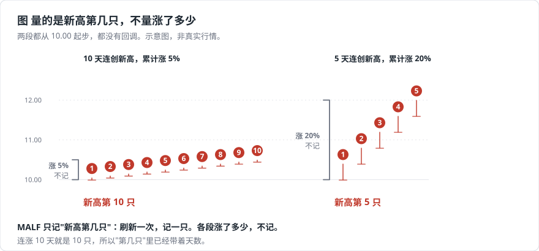

*图 14　同样是连涨：10 天记到新高第 10 只，5 天记到新高第 5 只。各涨了多少，不记。*

| 量 | 是什么 | v1.0 | v1.4 | v2.0–v2.1 | 本稿 |
|---|---|---|---|---|---|
| 新高第几只 new_count | 这条波刷新了几次新高。连涨 10 天就是 10 只，里面带着天数 | 有，按 K 线记 | 有，改成数确认极值 | 有 | 【裁决】按 K 线记 |
| 未推进时长 no_new_span | 距上一根新高 K 线过了几根 bar | 有，三轴之一 | 有，有分位 | 有，分位算法换了 | 【继承】 |
| 过渡时长 transition_span | 旧波死到新波生过了几根 bar | 无 | 有，只做出生描述 | 有，并入区间层 | 【继承】 |
| 波段总长 span_bars | 一条波活了几根 bar | 无 | 无 | 有，有分位 | 【裁决】不纳入，P13。P16 提议加一个实时的计时器，见 4.6 |
| 波段幅度 price_range | 一条波走了多少价 | 无 | 无 | 有，有分位 | 【裁决】不纳入，P13 |
| 推进比例 progress_pct | 推进的幅度占守护距离的比例 | 无 | 无 | 有，有分位 | 【裁决】不纳入，P13 |
| 确认越过边界的距离 | 出生时越过边界多少 | 无 | 有，只做出生描述 | 有 | 【继承】 |

出处：v1.0 两份原始 PDF 的抽取文本；v1.4 的 L3、L4、L14–L17；v2.1 Lifespan §3；v2.0 Range R1。全部 E2。

三点说明：

- **时间从两个地方进来，都不是"这条波活了多久"。** 一是"新高第几只"本身带着天数；二是未推进时长，量的是停了多久。波段总长不纳入。P16 的计时器如果采纳，会多出第三个：波段年龄。
- **时间数的是 K 线根数，不是日历天。** 停牌没有 K 线，就不计数（§5.3）。
- **波幅不纳入。** 用户裁决：原始语义只有高低。上面两本书的记法也只数新值 K 线，不量幅度。v2.0–v2.1 加过波段幅度并做分位，本稿不继承。

有一个取舍要知道：10 天涨 5% 记 10 只，5 天涨 20% 记 5 只。MALF 分得出"刷新了几次"，分不出"涨了多少"。这是设计如此，不是遗漏。

### 4.5 Service：只读发布

- 只把 Core 和 Lifespan 已经产生的事实整理成 WavePosition 发布，不发明语义（S-T1）。
- 下游只能读，不能写回（S12、S-T2）。
- 每条输出可追溯到规则版本、样本版本、来源运行（S-T4）。
- 过渡区或新波段由过渡区确认时，必须能追溯到被击穿的守护点、两条边界、有效候选、确认极值（S15）。没实现的字段必须标为待补，不得伪造。

**禁止输出（S11、S-T3）**

```text
buy  sell  weight  order  position_size  portfolio_allocation  target_exposure
```

【裁决】本定义不与任何具体策略写明关联，MALF 独立成立。

### 4.6 大小波段与计时器

P16 已裁决（2026-11-26：加，只实时报数、冻结后不做分位，从出生那根起算）；P19 是【新增｜待确认】。历代 MALF 版本都没有写过这一节。已裁决八条：大波段的新高第几只同样数日线，过前顶那根的 +1 加在大波段自己的读数上，直线走势照记（4.6.2）；大波段的守护点用小波段推，即丙，八步与四条细则，大波段出生可倒算继承，过顶那根自身低点等于回调最低点时不算击穿（4.6.3，P17）；两个级别的计数只发生在一张日线图上，周线、小时线不进 MALF（4.6.5，P18）；盘整区怎么认（4.6.7，P20）；盘整区是出生装置（4.6.7 开头，P21）；小波段的守护点随最新确认的 HL 上移，极值规则定为分形 k=2（4.2.2，P1）。

一句话：**同一套 MALF 规则，跑在两个尺度上。小波段的 HL 被击穿，只结束小波段；大波段有自己的守护点、自己的新高第几只、自己的计时器。**

#### 4.6.1 为什么要两个尺度

按第 4 节的规则，小上涨波段的 HL 一破，这条波段就结束，计数归 1。但一条像样的上涨大波段，通常由三条以上的上涨小波段组成：小波段的 HL 破了，两个顶之间的那个最低点没有破，大波段就还在。

三本书的说法（全部 E2，OCR 文本，行号见 §10）：

| 书 | 原话 | 说明的事 |
|---|---|---|
| 立花义正《你也能够成为股票高手》第二十九章 | "要赚取大波段就必须牺牲小波段""在上涨途中只注意大波段，不看小波段" | 大小波段要分开看 |
| 同书 | "懂得了大波段的操作不过是小波段的延伸" | 大波段用的是同一套做法，不是另一套 |
| 林辉太郎《波段交易法》第三部 | "大波动套着小波动" | 大波段由小波段组成 |
| 同书【原书注】"天数" | "以一波行情的起始点为基点，从那一天开始经过的天数。随着波动方向的改变又重新计算天数" | 计时从起点数，方向变了才重数 |
| 同书 | "小波段3个月，大波段6个月"；自统计 2560 次波段，平均约 60 天（原文一处写 59.6，一处写 59.2） | 两个尺度寿命不一样长 |
| 同书 | "只要……跟随了大波段就一切都没问题" | 大波段是主心骨 |

#### 4.6.2 两个尺度各记各的

【裁决】用户 2026-11-25 看图 15 两次批注：

- **大波段的新高第几只，数的也是日线，不是小波段。**
- **小波段的新高第 1 只，是止跌之后上破盘整高值的那根日线。** 不管怎么跌，跌完总有盘整；上破盘整高值，才开始记（4.2.5）。

大波段和小波段用的是同一条新值记录法（4.3.1），只是各记各的账。落到一条上涨大波段上：

| 事 | 小波段（日线 MALF） | 大波段 |
|---|---|---|
| 新高第几只 | 每根刷新本波段最高价的日线，记一只。第 1 只是上破盘整高值那根 | **同样数日线**：每根刷新大波段最高价的日线，记一只。过前顶那根也只是一只，加在大波段自己的读数上（【裁决】2026-11-26） |
| 未推进时长 | 每根刷新的日线归 0 | 同一套：每根刷新大波段高点的日线归 0 |
| 守护点 | 出生时是盘整的低点，之后换到最新确认的 HL | 相邻两个小波段顶之间整段回调的最低点；新生小波段过前顶那根换过去（丙，已裁决）。八步见 4.6.3 |
| 结束 | 日线最低价低于小波段守护点 | 日线最低价低于大波段守护点 |
| 归 1 | 每条小波段记下第 1 只新高时 | 只在整个大波段结束、新大波段出生时 |

- **两个本子记的是同一批日线里的不同部分。** 一根日线只要既刷新了小波段的高点、又刷新了大波段的高点，两边都记。小波段死了，小波段归 1；大波段没死，接着数。图 15：小波段 2 的第 2 只是大波段的第 12 只，小波段 2 的第 12 只是大波段的第 22 只，小波段 3 的第 4 只是大波段的第 23 只，最后一根是第 27 只。
- **小波段的头几只，大波段不一定记。** 小波段从盘整高值往上数，前顶还在它上面。图 15 里小波段 2 的第 1 只（最高 10.80）和小波段 3 的第 1、2、3 只（最高 11.30、11.36、11.40）都低于前顶，只进小波段的本子。
- 【裁决】**过前顶那根的 +1，加在大波段自己的读数上**（用户 2026-11-26）。它的意思是：大波段重新回到上升。第一轮，前顶是第一条小波段，两个本子到前顶为止读数相同，所以就是"前顶第几只 + 1"。第二轮起，前顶那条小波段的头几只在前顶下面，只进小波段的本子；大波段在那根的读数比它大，过前顶那根记的是"大波段自己在前顶的读数 + 1"。大小两个本子各记各的，详见 4.6.3。
- 【裁决】**直线走势照记**（用户 2026-11-26）。每根日线都刷新极值、中间不停一下，盘整立不起来，小波段没有出生。大波段只看一件事：这根日线有没有刷新它自己的最高价。有，就照记。
- **小波段生不生，与大波段记不记无关。** 大波段只看一件事：这根日线有没有刷新它自己的最高价。回调里的日线刷不了，就不记，也不清零。
- **大波段守护点只在新顶出现之后上移**，上移到新的"两个小波段顶之间的最低点"。回调还在进行时，守护点是上一次那个。
- **计时器从哪根起算。【已裁决（2026-11-26，P16）】从出生那根起算**，与新高第 1 只同一天。林辉太郎的"天数"从起点（最低那根）数，本稿不采用——盘整区是出生装置（P21），出生那根才是波段的第 1 根。P16 (b)

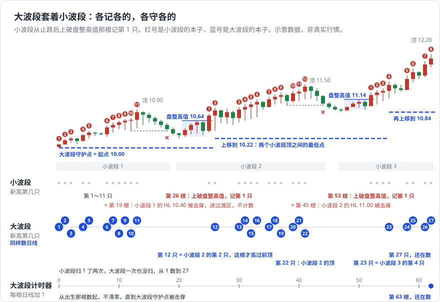

*图 15　同一段日线，两个尺度各记各的。淡蓝底是止跌后的盘整，顶上一条线是盘整高值，上破那根记小波段的第 1 只。红号是小波段的本子：HL 破了两次，归 1 两次。蓝号是大波段的本子：同样数日线，从第 1 只数到第 27 只，一次没归 1，计时器不清零。大波段的守护点是蓝色虚线，只在新顶出现后上移。*

#### 4.6.3 大波段的守护点怎么来：三种做法

计数两个尺度一样，都数日线。三种做法只差在一件事：大波段的守护点怎么定，也就是大波段什么时候算死。

| 做法 | 大波段的守护点怎么来 | 什么时候知道 | 代价 |
|---|---|---|---|
| 甲 周线 | 周线 K 线上再跑一遍 MALF，取周线波段的守护点 | 周线收完才知道（5.7），死讯最多晚 4 天 | 周从哪天切是人为的；日线已经击穿、周线还没收完的那几天，大波段还算活着 |
| 乙 换尺度 | 日线 K 线，把极值尺度放大（P1 的 k 取更大的值），各跑一遍 | 击穿当根知道；守护点晚 k 根确认 | 多一个要标定的参数；k 取多大没有依据 |
| **丙 用小波段推（已裁决）** | 相邻两个小波段顶之间整段回调的最低点；新生小波段过前顶那根换过去。图 15、实跑图 C、D 画的是这一种 | 击穿当根知道 | 不加参数，只用日线；"顶"要等小波段死了才算完 |

【裁决】P17：用户 2026-11-25 选丙。大波段的守护点用小波段推，这样 MALF 只用日线就够，不依赖周线。甲、乙留作对照，不进公式。

**丙怎么算：八步**

用户 2026-11-26 给的办法。以上涨为例，下跌镜像（最高价与最低价对调，高值与低值对调）。

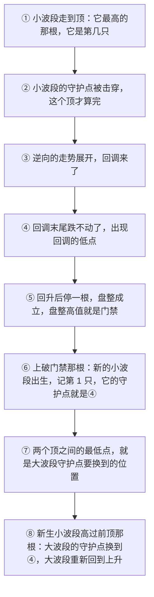

**四条细则**

八步说的是最顺的情形。真实行情有四处走样，用户 2026-11-26 逐条裁决：

| 哪里 | 裁决 | 实跑里碰到的情形（E1） |
|---|---|---|
| 过前顶那根的 +1 加在谁身上 | 加在**大波段自己的读数**上。第一轮两个本子读数相同，就是"前顶第几只 + 1"；第二轮起，前顶那条小波段的头几只只进小波段的本子 | 3306 次换位里，前顶是第一条小波段的 1184 次，是后面几条的 2122 次 |
| 直线走势记不记 | **照记**。每根都刷新极值、中间不停，盘整立不起来，小波段没有出生；大波段照样记 | 大波段记的 29676 只里，2315 只（7.8%）不在任何同向小波段里 |
| 前顶是哪一个 | **上一条同向小波段的顶**。没过前顶就死的小波段留下一个更低的顶，下一条小波段过了这个低顶，也换守护点 | 小波段的顶 9072 个，39.3% 没过当时大波段的最高价 |
| 换到哪一个低点 | **整段回调的最低点**：从前顶那根起，到过前顶那根止。回调走了几段，也取整段 | 3306 次换位里，1378 次（41.7%）回调不止一段 |

【已裁决（2026-11-26）】两条，八步没有写到，按下面的写法定死：

- **大波段怎么出生。** 大波段和第一条同向小波段同时出生，出生守护点就是那条小波段的出生守护点，两个本子都从第 1 只记起。大波段死的那根，如果已经有一条反向的小波段活着，新大波段从那条小波段的出生那根算起，读数接着它的只数。实跑：4698 条大波段里 1776 条（37.8%）是这样起的。
- **过前顶那根，自己的最低价恰好就是整段回调的最低点。** 按 4.2.7 的顺序，先换守护点，后判击穿，这一根不算击穿——**等于不击穿**：守护点被击穿要求严格低于（上涨）/ 严格高于（下跌），等于不触发，与 O3 一致。3306 次里 1 次。

**实跑结果（E1，2026-11-26）**：同一份数据，314 只 A 股，2020-01-02 到 2024-12-31，日线。程序 `lab/big_from_small.py`，按八步从头独立写，与 `lab/nested.py` 的写法 C 逐条核对，0 只标的不一致。

| 看什么 | 结果 |
|---|---|
| 大波段 | 4698 条，上涨 2231、下跌 2467 |
| 一条大波段总共几只 | 中位数 7，P90 23，最大 76 |
| 活多少根 | 中位数 40，P90 172 |
| 里面有几条同向小波段 | 1 条 50.0%，2 条 18.6%，3 条 12.0%，4 条以上 19.4% |
| 守护点换过的 | 38.7% 的大波段，共换 3306 次 |


*实跑图 C　002576，2020-06-18 到 2020-11-25，107 根真实日线，上涨大波段，里面 3 条同向小波段。带圈数字是八步，红号是小波段的本子，顶上蓝号是大波段的本子，细点线是小波段守护点，蓝虚线是大波段守护点。第一轮两边读数相同，所以是 3+1=4。*


*实跑图 D　002868，2024-04-03 到 2024-09-30，121 根真实日线，下跌大波段的镜像，里面 3 条同向小波段。第一轮是 7+1=8；之后大波段的本子一路数到 18，小波段归 1 过 3 次。*

#### 4.6.4 代价

【风险｜待确认】

- **流畅走势里两个尺度重合。** 小波段的 HL 不破，就只有一条小波段。大波段的守护点和它相同，数也相同，大波段不多给信息。实跑：一半的大波段里只有 1 条同向小波段（4.6.3）。
- **丙的顶要等小波段死。** 小波段的顶要等它的 HL 被击穿才算完，大波段的守护点才换成"这个顶和下一个顶之间的最低点"。回调进行中，大波段的守护点还是上一次那个，离现价远。
- **小波段的第 1 只常常低于前顶。** 盘整离前顶越远，小波段要数出越多只才轮到大波段记。极端情形是盘整上破之后走不到前顶又跌回去：小波段记了几只，大波段一只没记。
- **盘整的认定办法在手造数据和 314 只真实日线上核过。** P20 已裁决，实跑见 4.6.7。"最高价不高于前一根"遇到十字星、内包 K 线就停顿，盘整成立得早：五分之一的小波段只有 1 只就死。
- **小波段多了。** 守护点会跟着抬之后，小波段死得早：314 只 5 年 16447 条，每只标的 5 年中位数 56 条。两个尺度的读数都比"守护点不动"时密得多（4.6.7）。
- **前顶可能很低，回调可能分几段。** 没过前顶就死的小波段留下更低的顶，下一条小波段过了它，大波段的守护点就换到两个顶之间的最低点，这个位置可能离上一个大波段的顶很远。回调分几段时取整段，守护点比"最后一段的低点"更低，离现价更远。
- **大波段出生时和小波段分不开。** 两条同时出生，开头数的是同一批日线。小波段第一次死的时候大波段能不能活下来，要看回调有没有击穿两个顶之间的最低点。"三条以上才算大波段"是分桶，不做（v2.0 铁律），只报数。
- **大波段自己的分位还没写。** 它的新高第几只、未推进时长、年龄在历史同类大波段里怎么排，样本池怎么取，还没有写。P17 的四条细则已定（2026-11-26），现在可以写了。
- **与 P13 的关系要说清。** 冻结后的计时器读数，就是 P13 裁决不纳入的"波段总长"。提案是只实时报数，冻结后不做分位。这算对 P13 的补充还是违反，需要你一句话定。

#### 4.6.5 只用一张日线

【裁决】用户 2026-11-26：两个级别的计数，发生在一张日线图里。周线、日线、小时线要配合着看，白白增加复杂，不要。

| 周期 | 在 MALF 里的位置 | 说明 |
|---|---|---|
| 日线 | 唯一的周期 | 小波段在这里数，大波段也从这里长出来（丙） |
| 周线 | 不进 MALF | 想看对照自己看，不参与计数，不出位置 |
| 小时线 | 不进 MALF | 买卖属于下游，不属于这把尺子 |

2026-11-25 记下的"最大看周线，主要看日线，买卖看小时线"作废，以本条为准。P18、P11 随之作废。


#### 4.6.6 仓位不在这里

【取舍｜待确认】P19：仓位分"大波段仓位 + 小波段仓位"，属于下游，不属于 MALF。4.5 节禁止输出仓位、权重。MALF 能给的是两层各自的位置，仓位怎么分由读它的人定。

书上的对应做法（E2）：《简简单单做股票》第六个心得，"双重仓位：短期仓和中期仓（也叫'试探仓和主力仓'）"；"3 段式：进来就错了，全走；进短期仓对了，加中期仓；短期结束短期仓出，中期结束中期仓出"；"通过大形态来看回调力度，然后用小形态来分析企稳特征"。

#### 4.6.7 盘整区怎么认（P20，已裁决）

小波段从哪一根起数，取决于盘整高值取哪一根（4.2.5 的裁决）。

【已裁决（2026-11-26）】盘整区在双序列里的定位（P21）：盘整区是**出生装置**，只活在没有活波段的时候（`transition` / `uninitialized`），不属于任何波段本体。

- 它只产出两样东西：**HL(1)**（盘整低点 = 出生守护点）和**门禁**（盘整高值 = 出生触发线）。
- 上破门禁那根 = HH(1)，波段出生，盘整区即失效；之后的节奏全由 HH(n) / HL(m) 双序列接管（4.2.2A），盘整区里的高低点不编号、不进任何序列。
- 出生失败只有一种：没上破先破低点，盘整作废，从新低点重新找 HL(1)（即下面的"作废重来"）。
- 大波段没有独立的盘整区：它借小波段的盘整区出生（4.6.3 八步的 ⑤⑥），不另认。
- 下跌镜像：盘整区产出 LH(1)（盘整高点）与门禁（盘整低值）。

这样分工后：无波段时看盘整区，有波段时看双序列，两套机制不重叠。

【裁决】用户 2026-11-26：看过图 16，三个后果都认。办法如下，不加参数。

下跌途中记着一个低点：到目前为止最低的那根。低点之后，每根日线收盘时只做两个比较，落进三种里的一种：

| 这根日线 | 算什么 | 做什么 |
|---|---|---|
| 最低价低于低点 | 还在跌 | 低点换成这根；已经成立的盘整作废 |
| 没破低点，最高价高于前一根的最高价 | 回升 | 什么都不做，不记 |
| 没破低点，最高价不高于前一根 | 停一根 | 盘整成立。盘整高值 = 低点到这根为止最高的那个最高价 |

盘整成立之后只看两件事：出现最高价高于盘整高值的日线，那根就是小波段的新高第 1 只；没上破先破低点，盘整作废，从新低重数。

这条办法不加参数：没有 k，没有"至少几根"，没有幅度门槛。每根日线收盘当场判定，不等极值确认，所以盘整的认定不依赖 P1。

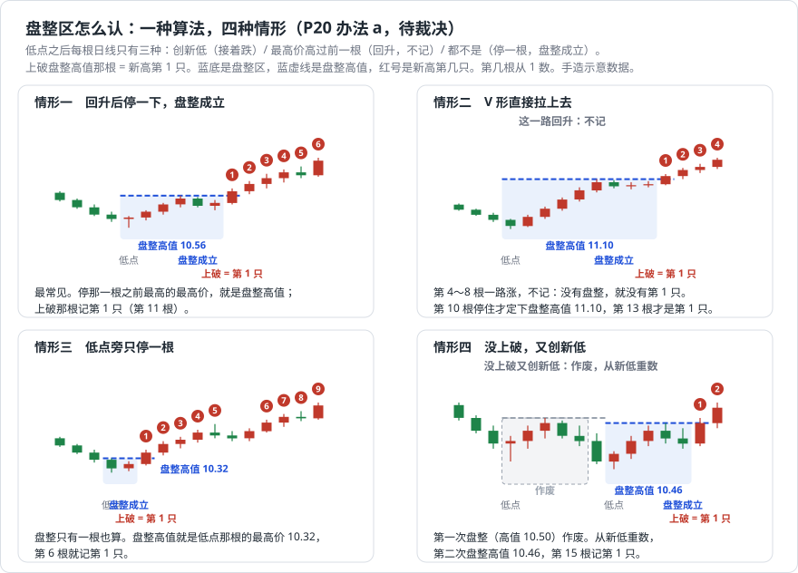

*图 16　同一条算法的四种情形。蓝底是盘整区，蓝虚线是盘整高值，红号是小波段的新高第几只。情形一最常见。情形二的 V 形回升路上不记。情形三盘整只有一根也算。情形四没上破又创新低，第一次盘整作废，从新低重数。手造示意数据。*

图里的三个后果，用户 2026-11-26 都认：

1. **V 形的回升段不记。** 情形二第 4～8 根一路涨，因为中间没有停顿，一只都不记；第 13 根才是第 1 只。这是"先有盘整，再上破才记"的直接后果。不另定起数点。
2. **盘整最少只有一根。** 情形三低点旁边停一根，盘整就成立，盘整高值是低点那根的最高价。不加"至少停几根"。
3. **作废重来。** 情形四第一次盘整作废，之前没有记过数，所以没有账要撤。作废只换低点。

没有采纳的做法：低点确认（晚 k 根）之后才开始找停顿。多等 k 根，第 1 只来得晚，还要先等 P1 定下来。

【风险｜待确认】"最高价不高于前一根"遇到十字星、内包 K 线就会停顿，停顿来得早，盘整就成立得早，第 1 只可能偏早。图 8、图 16 的手造数据对得上。

**实跑结果（E1，2026-11-26）**：314 只 A 股，2020-01-02 到 2024-12-31，日线，只用最高价和最低价。盘整的认定不用分形；小波段出生之后，守护点按已裁决的分形 k=2 上移（4.2.2）。程序 `lab/p20_real_c.py`，已入库。本表是"守护点会上移"的口径；"守护点出生后不动"的口径是 2332 条、只数中位 4，程序 `lab/p20_real.py`。

| 看什么 | 结果 |
|---|---|
| 出生 | 16447 条，上涨 7878、下跌 8569 |
| 同向 / 反向 | 同向 7973、反向 8161（另 313 条是每只标的的第一条） |
| 同向新生里，出生那根没过前顶 | 80.7% |
| 盘整区几根（低点到停顿那根） | 最短的 2 根 45.2%，3 根 24.0%，4 根 14.6%，5 根以上 16.3% |
| 作废重来 | 94.0% 没作废过，964 条作废一次，22 条两次 |
| 过渡几根（死亡那根到出生那根） | 2 根 12.2%，3 根 16.6%，4 根 16.1%，5 根 12.7%，6 根以上 42.4% |
| 一条波段总共几只 | 中位数 3，均值 4.73；只有 1 只就死的占 21.7%，10 只以上的占 11.9% |
| 守护点上移 | 68.2% 的小波段上移过，共 21500 次；上移 1 次的 35.1%，2 次 16.7%，3 次以上 16.4% |
| 每只标的 5 年几条 | 中位数 56，最多 71 |
| 过渡里同一根既上破又下破 | 0 次 |

读法：盘整一半以上是"低点旁边停一两根"，所以小波段出生得早；守护点跟着抬，又死得早。每只标的 5 年 56 条，中位数 3 只就换一条。这是"不加参数"的直接代价，不是程序错。两张实跑对照图如下，不编号。2026-11-26 按"守护点会上移"的口径重画，旧图在版本历史里。


*实跑图 A　002899，2020-03-16 到 2020-08-24，110 根真实日线。蓝底是程序认出的盘整区，蓝虚线是盘整高值或盘整低值，红号绿号是新高、新低第几只，灰虚线是守护点，叉是击穿那根。110 根里 7 条小波段，4 次同向都出生在前顶下面；守护点上移 7 次，灰虚线走成台阶。*


*实跑图 B　002826，2022-03-28 到 2022-09-05，110 根真实日线。下跌镜像同样成立：停一根之后跌破盘整低值，记新低第 1 只。7 条小波段，守护点上移 9 次。*

实跑时用到的两条，是本稿按对称推出来的（E4），没有经过裁决：

- 链是顺序的：活着 → 守护点被击穿 → 过渡 → 下一条出生。同一时刻只有一条小波段。【取舍｜待确认】
- 过渡里两张表同时跑：一张找低点等上破，一张找高点等下破，都从击穿那根起记，谁先破谁出生。上破生上涨波段，下破生下跌波段。【取舍｜待确认】

数据口径没核：复权方式不明。

【裁决】三个细节，用户 2026-11-26 认可，写进规则：

- 低点从哪一根起记：从上一条小波段的守护点被击穿那根起，到这里为止最低的那根。
- 新生上涨波段的守护点 = 盘整的低点（4.2.5）。
- 下跌波段镜像：最高价与最低价对调、高值与低值对调，其余一字不改。止涨之后跌破盘整低值那根，是新低第 1 只；新生下跌波段的守护点 = 盘整的高点。D16 下半句（反向新生）同样改写（4.2.5）。


---

## 5. A 股口径

本节全部是【新增｜待确认】，历代版本都没有写过 A 股。标注"规则推论"的，是第 4 节规则的直接结果，不是新规则。

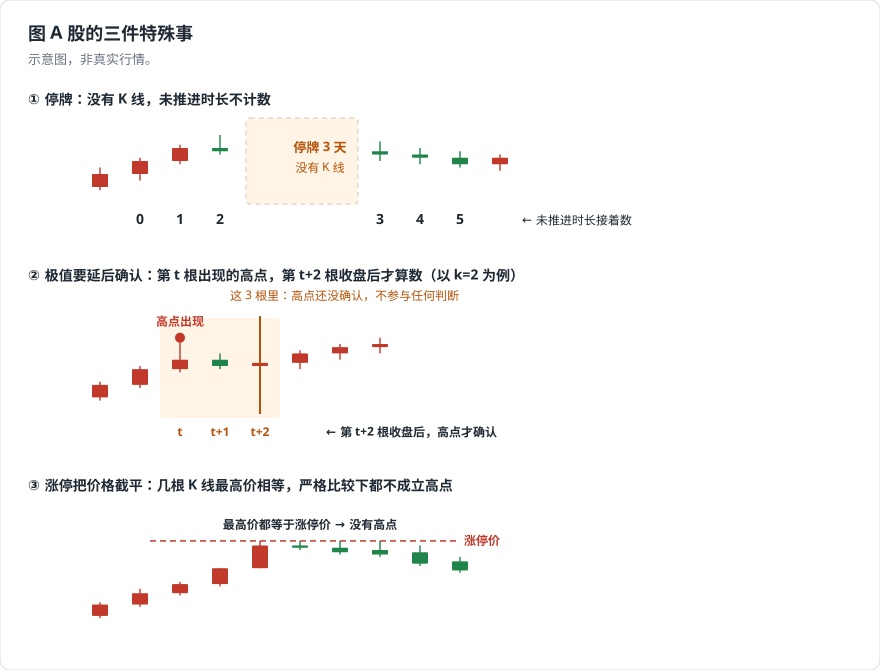

*图 17　停牌、极值延迟确认、涨停截平价格。下面各小节逐条说明。*

### 5.1 复权：用后复权价做结构计算

【取舍｜待确认】P3

- 问题：除权除息会造成价格断层。不复权，会把一次分红除息误读成"守护点被击穿"。
- 推荐：原始价乘自建的后复权因子。理由是与既有治理原则一致：原始价与因子分存、不信任第三方复权开关、复权锚点不能放在最新一根。
- 选项：保留（后复权，推荐）/ 删除（不复权）/ 改用前复权（历史价会随未来的公司行为改写，既有原则已否定）。

### 5.2 价格比较域

【取舍｜待确认】P2

- A 股最小报价单位是 0.01 元。复权后价格不再是 0.01 的整数倍。
- O3 要求"按正式精度归一化后严格比较"，但 v1.4 没定义 A 股的归一化方式。
- 推荐：复权价按统一标度取整为整数后再比较。标度的具体数值是【假设｜待确认】，本稿不给。
- 选项：保留（取整成整数，推荐）/ 删除（直接比较浮点数，等值判断依赖实现）/ 延期到实现阶段再定。

### 5.3 停牌：不计 bar

- 规则推论：no_new_span 数的是 bar 数（L4）。停牌日没有 bar，所以不计数，复牌后从停牌前的值继续累加。波段年龄同理（P16）。
- 复牌首日不特判，按当根 bar 的真实高低价处理。

### 5.4 涨跌停与一字板：按真实成交价计算，不修正

【取舍｜待确认】P9

- 涨跌停把当日价格截断在涨跌停价上。MALF 读到的就是被截断后的价格，这是真实成交区间。
- 涨跌幅随板块、风险警示状态、新股上市天数变化，历史上也变过。本定义不写具体幅度，一律以当时生效的规则为准。
- 一字板可以是单侧极值。极值规则是严格比较（分形 k=2，P1），它不可能同时是高点又是低点（规则推论）。
- 若极值规则采用严格比较，相邻两根 bar 最高价相等时，两者都不成立高点（规则推论）。
- 规则推论：新高计数同理。连续一字涨停的几根 bar 最高价相等，只有第一根记新高。
- 选项：保留（不修正，推荐）/ 删除（把触及涨跌停的 bar 排除）/ 延期，等实测后再定。

### 5.5 新股与退市

- 规则推论：新股上市初期结构不足，自然停在 `uninitialized`，不需要特判。
- 规则推论：退市时如果还有活波段，这条波段永远不会终止，所以不入样本池。已终止的波段照常入池。
- 【取舍｜待确认】P4："合格标的池"怎么定。选项：保留（全部 A 股股票，含退市股，推荐，与"退市股必须进入研究样本"的既有裁决一致）/ 删除（剔除上市不满若干日的股票，日数需另定）/ 延期。

### 5.6 时点：什么时候才能读到

【新增｜待确认】P10

- bar t 收盘后，才能得到 bar t 的 WavePosition。之前的 bar 一律不可用。
- 极值在 bar t 出现，要到 bar t+k 收盘后才确认（k 是确认规则里的延迟根数）。确认之前，这个极值不参与任何结构判断。
- 本定义只保证 MALF 自己不使用未来信息。任何读取 MALF 的下游什么时候能成交，不属于本定义。

### 5.7 周线与月线：只用收完的周期 bar（已不进 MALF）

【裁决】2026-11-26 起周线、小时线不进 MALF（4.6.5），本节留档，不再约束任何计算。P11 作废。下面三行是 2026-11-25 的原稿。

- 周线 bar 只在该周最后一个交易日收盘后才成立；月线同理。没收完的周期 bar 不得使用。
- 周期内停牌的，按实际有的日 bar 合成。
- （原稿：小时线的口径没有写。2026-11-26 起小时线不进 MALF，这一条不再需要。）

### 5.8 不涉及的事项

MALF 不输出交易动作，所以以下制度与本定义无关，本稿不写：T+1、涨跌幅对成交的约束、最小交易单位、交易时段、集合竞价。

---

## 6. 用这把尺子看 A 股

### 6.1 读法顺序

**图 18　先看状态，再看数**

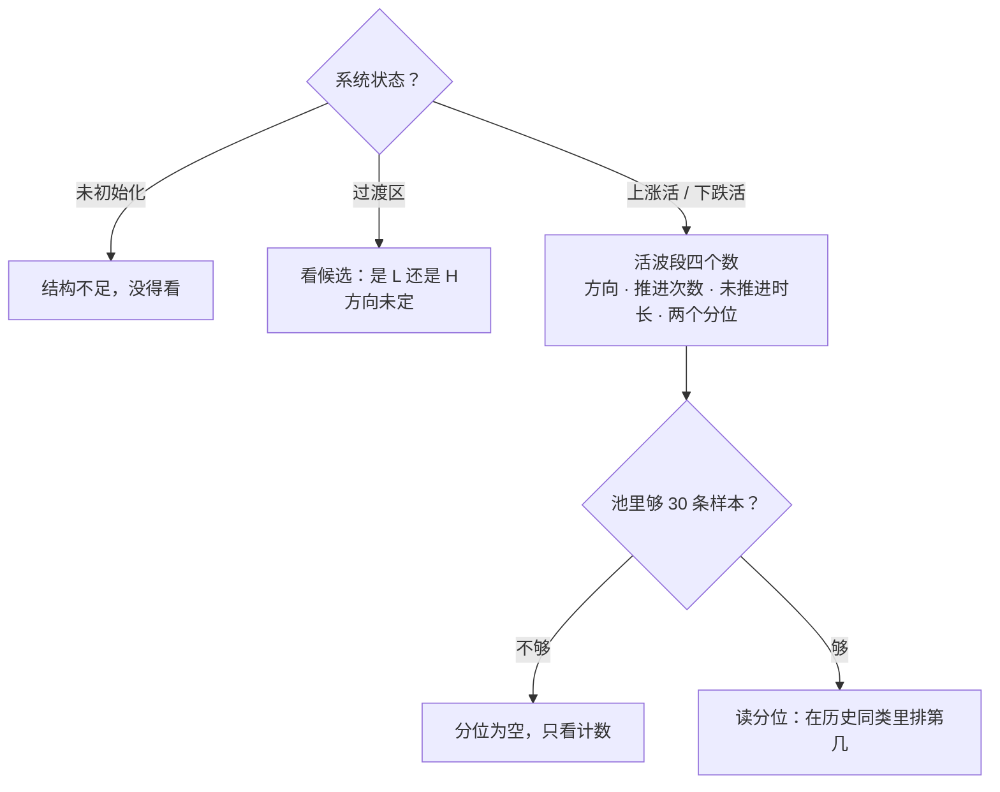

1. **先看系统状态。** `uninitialized` 是结构不足，没得看。`transition` 是方向未定。只有 `up_alive` 和 `down_alive` 才有波段可读。
2. **活波段看四个数。** 方向、新高第几只、多久没新高、两个分位。
3. **过渡区看候选。** 候选是 L，市场在试着向上，还没确认；候选是 H，在试着向下，还没确认。候选随时可能被替换。
4. **【新增｜待确认】两个尺度各看一遍。** 先看大波段，再看小波段。大波段还活着、小波段刚结束，读作"小波段结束，大波段没结束"。

### 6.2 几种典型位置的结构含义

| 位置 | 结构含义 |
|---|---|
| 上涨波段，推进分位低，停滞分位低 | 刚起步，历史上还算早 |
| 上涨波段，推进分位高于 0.9，停滞分位低 | 新高的只数已超过绝大多数历史同类波一辈子新高的只数 |
| 上涨波段，停滞分位高，守护点未破 | 停的时间已经很长，但波段还活着 |
| 过渡区，候选为 L，价格未过上边界 | 向上未确认 |
| 过渡区，候选被反复替换 | 方向摇摆，替换次数有记录 |

表中只描述结构，不对应任何动作。

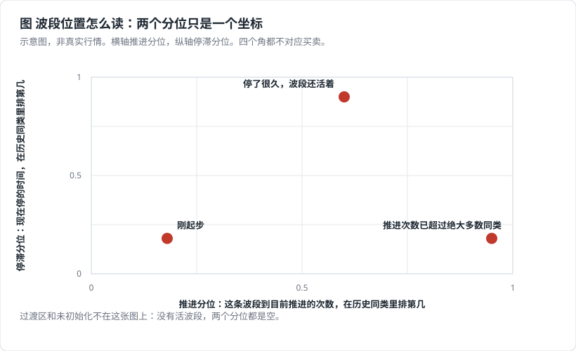

*图 19　两个分位只是一个坐标。图上任何一个点都不对应买卖。*

### 6.3 这把尺子现在能看多远

诚实交代三件事：

- **第 4 节的规则只有一小部分在真实 A 股数据上跑过。** 跑过的是波段的出生、守护点、击穿、计数，小波段和大波段两个尺度（4.6.3、4.6.7，E1）。候选与过渡区那一套没有跑过。另外实跑过的两套 3.0 引擎都退化了（E1）。分位分布长什么样，现在还不知道：两个分位一次都没有算出来过。
- **极值规则已定为分形 k=2，但没有比较过别的 k。** k 直接决定波段的疏密，也决定守护点晚几根确认。见 §7 的 P1。
- **全市场池把不同股票放在一起比，可比性没有验证。** 见 §7 的 P7。
- **大小波段的规则已裁决，计时器没有。** 大波段自己的分位还没写（4.6.4）；计时器见 P16。

### 6.4 不能拿它做的事

- 不能从分位推涨跌概率。
- 不能把击穿、确认当成买卖点。
- 不能把分位当成选股排名。
- 不能把任何位置读成"该买"或"该卖"。

---

## 7. 待裁决清单

标【已裁决】的条目等用户签署落盘后生效；其余各项都未生效，本稿的写法只是占位，不代表已定。

| 编号 | 事项 | 现状 | 选项 | 本稿写法 |
|---|---|---|---|---|
| P1 | 极值确认规则 | v1.4 只要求版本化，没给规则。v2.1 用的是分形 k=2（一根 bar 的最高价严格高于左右各 2 根；最低价严格低于左右各 2 根；延迟 2 根确认），版本名 `fractal_k2_v1.0` | **已裁决（2026-11-26）：分形 k=2。** 用户认可小波段的守护点随最新确认的 HL 上移，确认规则随之定下 | 已写，见 4.2.1、4.2.2 |
| P2 | 价格比较域 | 见 5.2 | 见 5.2 | 见 5.2 |
| P3 | 复权口径 | 见 5.1 | 见 5.1 | 见 5.1 |
| P4 | 合格标的池 | v1.4 只写"全市场合格标的池" | 见 5.5 | 见 5.5 |
| P5 | 击穿那根 bar 的极值能否当候选 | v1.4 没写。v2.1 明令禁止（C-05） | **已裁决（2026-11-26）：自动消解，不再适用。** 候选改为盘整低点 / 高点（岔路 2），低点从守护点被击穿那根起记（4.6.7），击穿那根的极值天然不是候选，v2.1 C-05 与本稿此处一致 | 无需再写 |
| P6 | 五档生命状态、位置象限 | v1.4 的 Lifespan 里有（L11、L12）；v2.1 签署时以"阈值分桶"为由明令废止 | 维持废止（推荐）/ 恢复（需定阈值）/ 延期 | 未纳入 |
| P7 | 全市场池的跨股可比性 | 不同板块涨跌幅不同，波动不同；一个"推进次数"在不同股票上含义可能不同 | 不分层，按原文（推荐，先实测再议）/ 按板块或波动分层（新增规则）/ 延期 | 未分层 |
| P8 | v2.1 的区间层、结构位置层 | v2.1 签署时纳入，但不在 v1.4 里 | 不纳入（推荐，符合"按 v1.4"的裁决）/ 纳入 / 延期 | 未纳入 |
| P9 | 涨跌停与一字板 | 见 5.4 | 见 5.4 | 见 5.4 |
| P10 | 时点可知规则 | 历代版本没写 | 保留（推荐，与"只使用当时可知信息"的既有原则一致）/ 删除 | 见 5.6 |
| P11 | 周线月线口径 | 历代版本没写。2026-11-26 起周线不进 MALF | **已作废（2026-11-26）** | 5.7 留档 |
| P12 | 3.0 的信号过滤、仓位示例 | 违反"不给动作"的铁律，但它在封存文件里 | 移出权威（推荐）/ 保留 / 延期 | 本稿不纳入 |
| P13 | 波段总长、波段幅度、推进比例 | v1.4 没有。v2.1 有，并且各自做了分位，取代了原来的两个分位。见 §4.4 | **已裁决（2026-11-25）：不纳入。** 时间和波幅不进 MALF，原始语义只有高低 | 不纳入。计时器提案是其中"波段总长"的实时版，两者关系见 P16 |
| P14 | 最小波幅过滤：回调太小不算一段 | v1.4 原文没有。按新值记法，回调本来就不产生计数，这个问题不再存在 | **推定已裁决（2026-11-25）：不列。** 依据是"时间和波幅不加进来"；如另有想法请指出 | 不纳入 |
| P15 | 新值计数的细节 | 见 4.3.1 | (a) **已裁决（2026-11-25）：出生那根 = 止跌后上破盘整高值的那根，记第 1 只**，认定办法见 P20；(b) 只看最高价、最低价，不分阴阳（推荐）/ 只记阳线创新高、阴线创新低（两本日本书的写法）；(c) 推进极值与过渡边界取本波段实际最高价、最低价（推荐）/ 仍取最后一个确认极值（v1.4 原文）；(d) 击穿那根同时创了新高：先记后死（推荐，按 O2 的顺序）/ 不记 | (a) 已写；其余按推荐项写，待确认 |
| P16 | 计时器：波段年龄 wave_age | 历代版本没有实时的总长计数。v2.1 有冻结后的波段总长及分位，P13 已裁决不纳入。见 4.6 | **已裁决（2026-11-26）：(a) 加，只实时报数，冻结后不做分位——这是对 P13 的补充：P13 否掉的是"冻结后做分位"，不是实时计数；(b) 从出生那根起算**，与新高第 1 只同一天 | 已写进 4.3.1 |
| P17 | 大波段的守护点怎么来 | 历代版本只有一个尺度。见 4.6.3 | **已裁决（2026-11-25）：丙，用小波段推，只用日线。** **细则已裁决（2026-11-26）：** 小波段的守护点被击穿时，它的顶才算完；新生小波段过前顶那根，守护点换过去；前顶是上一条同向小波段的顶；换到整段回调的最低点；过前顶那根的 +1 加在大波段自己的读数上；直线走势照记 | 八步与四条细则已写，见 4.6.2、4.6.3。大波段怎么出生【取舍｜待确认】 |
| P18 | 周期分工 | 周、日、小时三个周期要配合，白增复杂 | **已裁决（2026-11-26）：只用日线。** 两个级别的计数发生在一张日线图上；周线、小时线不进 MALF | 已写，见 4.6.5 |
| P19 | 仓位分层 | 4.5 禁止输出仓位 | 不属于 MALF，另写（推荐）/ 写进本定义 | 不纳入 |
| P20 | 盘整怎么认定：盘整高值取哪一根 | 用户 2026-11-25：小波段的新高第 1 只 = 止跌后上破盘整高值那根。历代版本没有"盘整"这个概念。见 4.6.7 | **已裁决（2026-11-26）：** 低点之后每根日线三种判定：破低点 / 最高价高过前一根 / 停一根。停一根即盘整成立，盘整高值 = 低点到这根的最高价。不加参数。三个后果都认：V 形回升段不记；盘整最少一根；没上破先破低点，作废重来 | 已写进规则，见 4.6.7。三个细节已裁决（2026-11-26）：低点从上一条小波段的守护点被击穿那根起记；新生小波段的守护点 = 盘整的低点；下跌波段镜像，D16 下半句同改 |
| P21 | 盘整区在双序列里的定位 | 用户 2026-11-26 问"盘整区怎么办"。P20 只定了怎么认，没定它在 HH/HL 框架里的角色 | **已裁决（2026-11-26）：** 出生装置，只产出 HL(1) 与门禁；出生后失效，高低点不编号；大波段借小波段的盘整区，不另认；下跌镜像 | 已写进 4.6.7 开头 |

---

## 8. 修订清单（从 v3.0 到本稿）

| 编号 | 3.0 的写法 | 本稿的写法 | 依据 |
|---|---|---|---|
| C1 | 守护点有三处互相矛盾的定义；示例代码从不建立守护点 | 最新确认的 HL / LH | 【继承】D9 |
| C2 | 三个状态：alive / broken / reborn | 四个系统状态；`reborn` 废除 | 【继承】D11 |
| C3 | 新波段一句话："新方向首个极值" | 候选守护点 + 之后的推进确认，越过过渡边界。同向新生已改，见 C15 | 【继承】D14–D17、T6 |
| C4 | 极值没有定义 | 必须版本化并记录；具体规则见 P1 | 【继承】O1 |
| C5 | 没有事件顺序 | 九步固定顺序 | 【继承】O2 |
| C6 | 相等是否触发没有说明 | 严格比较，等于不触发 | 【继承】O3 |
| C7 | 推进口径是"这根 bar 创了新高"，但没有出生记法，也没说并列怎么算 | 同样按 K 线记"新高第几只"；补上出生记第 1 只、并列不记、不清零 | 【裁决】v1.0 原意；O3 |
| C8 | 核心输出是四个原始计数，分位降为可选 | 计数 + 两个历史分位 | 【继承】L8、L9；v1.0 原意 |
| C9 | 样本池退回单股 | 全市场 | 【裁决】 |
| C10 | 停滞计数在实际在用的版本里是空函数 | 按 L4 逐 bar 累加 | 【继承】L4 |
| C11 | 没有重放、快照、版本追溯 | O1、O7、O8 全部补上 | 【继承】 |
| C12 | 没有 A 股口径 | 第 5 节 | 【新增｜待确认】 |
| C13 | Plus 的信号过滤、仓位示例 | 不纳入 | 见 P12 |
| C14 | v1.4 把推进次数写成"推进原语被确认更新的累计次数" | 按新值记录法，每根刷新新高的 K 线记一只 | 【裁决】 |
| C15 | v1.4：同向新波段必须高过旧波段的最高价才出生 | 止跌后上破盘整高值那根即出生，记第 1 只，可以低于前顶；盘整怎么认有可计算的办法，不加参数。D16 下半句同改（镜像）；新生小波段的守护点 = 盘整的低点 | 【裁决】4.2.5、4.6.7，P20 |
| C16 | 历代版本只有一个尺度；v1.4 的守护点要等极值确认，但没给确认规则 | 小波段的守护点随最新确认的 HL 上移，确认规则定为分形 k=2；大波段由小波段八步推出来，两个尺度各记各的账 | 【裁决】4.2.2、4.6.2、4.6.3，P1、P17 |
| C17 | v1.4 L2：HL / LH 是守护，不计数 | 改为双序列：HH(n) / LL(n) 记推进（实时），HL(m) / LH(m) 记守护序列（分形 k=2 确认，晚 2 根）。时间配对：HH(n) 的守护是 HL(m-1)，HL(m) 是下一个待定低点；候选低点跌穿 HL(m-1) 即波段死，不是 HL。大波段同构 | 【裁决】4.2.2A、4.3.1 |

相对 v2.1 的三处不同，按"规则以 v1.4 为准"的裁决回到 v1.4：

| 不同之处 | v2.1 的写法 | v1.4 的写法（本稿采用） |
|---|---|---|
| 初始化 | 首个极值确认即起波，守护点先设为 0 或无穷大 | 必须走完 `H0 → L1 → H2` 或 `L0 → H1 → L2` 才成立波段（D18、O6） |
| 候选替换 | 反向候选不替换同向候选 | 最新候选一律替换先前候选（O4） |
| 停滞分位 | 改成"波段总长 ÷ 原语个数"的排位，并与波段总长、波段幅度、推进比例三个分位并列 | 仍是"未推进时长"在同类里的排位（L9）；另三个量按裁决不纳入，见 P13 |

---

## 9. 本稿没有纳入的内容

| 内容 | 没纳入的理由 |
|---|---|
| 五档生命状态、位置象限、任何阈值分桶 | 已签署的权威已废止；本项目治理原则也把小样本阶段的分位分桶列为不做 |
| 区间层、结构位置层（v2.0–v2.1） | 不在 v1.4 里；见 P8 |
| 波段总长、波段幅度、推进比例及其分位（v2.1） | 不在 v1.4 里；用户裁决不纳入，见 §4.4、P13 |
| 把分位改造成"k 根 bar 内击穿的概率"（生存分析） | 新增统计口径，没有需求依据，也没有样本支持；不在本稿范围 |
| 按行业、市值、波动率给样本池分层 | v1.4 原文没有；见 P7 |
| 最小波幅过滤 | 推定不列：时间和波幅不进 MALF；按新值记法，小回调本来就不产生计数。见 P14 |
| 水平关键位识别：支撑阻力、多次触碰区域、聚类、强度评分 | 历代 MALF 原文都没有。MALF 只给出当前守护点一条线和过渡区上下两条边界，其余关键位不做。大小两个尺度只多给出大波段的顶和守护点，仍不做 |
| 走查验证、交易成本、回测 | MALF 不产生交易，这些属于下游，不属于本定义 |
| 大波段仓位 + 小波段仓位、进出场规则 | MALF 禁止输出仓位和动作；两层的位置由 MALF 给，仓位由下游定。见 P19 |
| 与任何具体策略、具体工程的关联 | 【裁决】 |
| 修改 README、版本索引、导航等封存文件 | 需要用户单独授权 |

---

## 10. 证据底账

| 内容 | 来源 | 等级 |
|---|---|---|
| Core 语义 D1–D18、T1–T10 | `MALF_v1.4_BoundaryRules/MALF_01_Core_Definitions_Theorems_v1_4.md` | E2 |
| 操作规则 O1–O8 | `MALF_v1.4_BoundaryRules/MALF_01B_Core_Operational_Boundary_Rules_v1_4.md` | E2 |
| 统计层 L1–L18、L-T1–L-T8 | `MALF_v1.4_BoundaryRules/MALF_02_Lifespan_Stats_Definitions_Theorems_v1_4.md` | E2 |
| 服务层 S1–S15、S-T1–S-T4 | `MALF_v1.4_BoundaryRules/MALF_03_System_Service_Interface_v1_4.md` | E2 |
| v2.1 权威认定、废止分桶、版本治理 | `MALF_v2.1_StructuralPosition_Implemented/AUTHORITY.md` | E2 |
| 分位公式、样本不足返回 None、样本池构成、分形 k=2、C-05 | `MALF_v2.1_.../MALF_01_Core_...md`、`MALF_03_Lifespan_...md` | E2 |
| "只报数，不报桶"铁律 | `MALF_v2.0_FiveLayer_Range_Probability/MALF_00_Bridge_v2_0-claude-20260616.md` 第 95 行 | E2 |
| v1.0 原意 | v1.0 两份原始 PDF 的抽取文本 | E2 |
| 推进次数按新值记 | v1.0《第四战场》第 3 页："new-count 只记新值替代旧值""若本 bar 未产生新值 → new-count 不变，no_new_span + 1"；v1.4 L3 写的是"推进原语被确认更新的累计次数" | E2 |
| 新值记录法（日本交易法） | 林辉太郎《期货市场的技术》第 3 章第 19 图说明"9 月份期货是第 4 根新低价"、第 21 图；立花义正《你也能成为股票操作高手》第 8 章"第一支新值阳线……第二支的新值阳线"。出处：`B:/trading-reference/` 下两个 2012 日本书目目录里的 OCR 文本 | E2 |
| 全归档没有关键位、支撑、阻力的定义 | 2026-11-25 对 malf-Definitive 全部 md 检索，只有术语表的一句例话出现 1 次 | E1 |
| 两套 3.0 引擎在真实 A 股上退化 | 2026-11-25 实跑，314 只、341,593 根日线、2020–2024 | E1 |
| v2.1 对 v1.4 的三处不同 | `MALF_v2.1_.../MALF_01_Core_...md` 第 219–232 行、第 158–159 行；`MALF_03_Lifespan_...md` §3 | E2 |
| 时间与波幅各版本的出处 | v1.0 两份原始 PDF 的抽取文本；`MALF_v1.4_.../MALF_02_Lifespan_...md` L4、L14–L17；`MALF_v2.1_.../MALF_03_Lifespan_...md` §3；`MALF_v2.0_.../MALF_02_Range_...md` R1 | E2 |
| 严格分形下候选必然交替 | 由 D14、D15、O4 与分形定义推出，未实跑 | E4 |
| "天数"从起点数、方向变了才重数；小波段 3 个月、大波段 6 个月 | 林辉太郎《波段交易法》OCR 第 1067–1103 行（【原书注】解释一个术语：天数） | E2 |
| 2560 次波段平均约 60 天 | 同书 OCR 第 114 行（59.6）、第 1793 行（59.2），两处不一致 | E2，存疑 |
| "大波动套着小波动""跟随了大波段就一切都没问题" | 同书 OCR 第 2558、1296 行 | E2 |
| "大波段的操作不过是小波段的延伸"；"在上涨途中只注意大波段，不看小波段" | 立花义正《你也能够成为股票高手》（大陆版）OCR 第 1292、4700–4703 行 | E2 |
| 双重仓位、3 段式、大形态看回调小形态看企稳 | 《简简单单做股票》OCR 第 1809、1827、868 行 | E2 |
| 直接从过渡区生出的同向小波段，出生即高过前顶 | 由 v1.4 的 D13、D16 推出。2026-11-25 裁决"上破盘整高值才记第 1 只"之后，这条不再是规则，只描述 v1.4 原文 | E4，已被裁决取代 |
| 大波段的新高第几只同样数日线：小波段 1 数到 11，第 27 根是大波段第 12 只，顶 11.50 是第 22 只 | 用户 2026-11-25 看图 15 的批注原话 | E1 |
| 小波段的新高第 1 只 = 止跌后上破盘整高值那根，可以低于前顶：第 26 根（最高 10.80）、第 53 根（最高 11.30） | 用户 2026-11-25 第二次批注；两支蓝箭头的箭头尖从截图像素量出，对齐到 K 线列 | E1 |
| 盘整的认定办法 P20 | 为了同时指到第 26 根和第 53 根而反推出来的算法。"V 形回升段不记""盘整最少一根""作废重来"三个后果由算法推出，用户看图后都认。2026-11-26 在 314 只真实 A 股日线上跑过一次，结果见 4.6.7 | E4 推出，E1 实跑过一次 |
| 盘整区认定办法及其三个后果 | 用户 2026-11-26 对话原话："都认。盘整区已经看过，ok" | E1 |
| 小波段的守护点上移前后：2332 条对 16447 条 | `lab/p20_real.py`（出生后不动）对 `lab/p20_real_c.py`（随最新确认的 HL 上移），314 只、2020–2024 | E1 |
| 大波段八步：4698 条、3306 次换位，四条细则各自碰到的情形 | `lab/big_from_small.py`，与 `lab/nested.py` 写法 C 逐条核对，0 只标的不一致 | E1 |
| 大波段八步；过前顶那根的 +1 加在大波段自己的读数上；直线走势照记；前顶是上一条小波段；换到整段回调的最低点 | 用户 2026-11-26 对话原话 | E1 |
| k=2 下低点最晚在上破那根收盘确认 | 守护点 = 盘整低点已裁决，不再依赖这句；这句由 O2 事件顺序与严格分形定义推出，未实跑 | E4 |
| 图 16 | 手造示意数据，四段各 16 根；三种判定、盘整高值、第 1 只、作废、新高第几只已逐根断言 | E1（仅指图形自洽，不代表真实行情） |
| 中国书的类似结构：突破后回调、在箱体里盘整、再上破 | 《简简单单做股票》第 81 页图（铺垫 K 线、调整确认 K 线、短线仓再介入点、中线仓再介入点） | E2 |
| 图 11、图 15 | 手造示意数据。图 15 的极值、守护点、击穿 bar 已按严格分形 k=2 逐根断言；小波段 1、2、3 各 11、12、8 只，大波段 1～27 只逐根断言；盘整高值 10.64（第 22～25 根）、11.14（第 49～52 根）已断言 | E1（仅指图形自洽，不代表真实行情） |
| 只用日线：两个级别的计数发生在一张日线图里；周、日、小时要配合，白增复杂 | 用户 2026-11-26 对话原话，取代 2026-11-25 的"最大看周线，主要看日线，买卖看小时线" | E1 |
| 图 5、7、8 的 K 线是手造的示意数据；其中极值位置已用分形 k=2 逐根核对（图 8 于 2026-11-26 重画，盘整、上破、新高第几只已逐根断言） | 2026-11-25、2026-11-26 核对 | E1（仅指图形自洽，不代表真实行情） |
| 治理原则（三禁、证据等级、数据红线、退市股入样本） | `B:/trading-reference/QUANT-FIRST-READ.md` | E2 |
| 余年归档 malf | 同上 §3.2 的转引，未回原文核对 | E2（转引） |
| 涨跌停制度 | `B:/trading-reference/A股市场/A股涨跌停板制度-tushare版.md`；其中"主板新股首日"和"ST 股涨跌幅"两处表述与常见口径不一致，本稿因此不引用具体幅度 | E2，存疑 |

---

## 签署栏

| 角色 | 名称 | 日期 | 签署 |
|---|---|---|---|
| 起草 | AI | 2026-11-25 | 已完成 |
| 裁决 | 用户 | | 待签署 |
